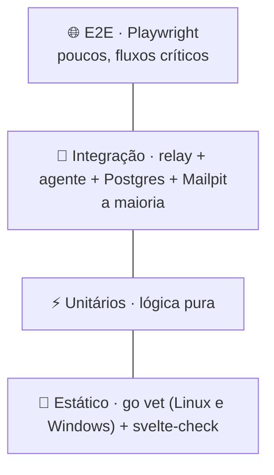

# Contribuindo

Do clone ao primeiro teste passando em menos de 10 minutos. Este guia também reúne
[como o projeto é testado](#testes) (com o checklist manual no Windows) e
[as regras de design do console](#design).

## Pré-requisitos

| Ferramenta | Versão | Para quê |
| --- | --- | --- |
| Go | 1.27+ | relay e agente (o `go.mod` baixa a toolchain certa sozinho) |
| Node | 26+ | console Svelte |
| Docker + Compose v2 | 29+ | banco, testes de integração e E2E |
| Zig | 0.17+ (opcional) | agente Windows com H.264; sem ele o agente sai só com JPEG |

## Setup

```bash
cd frontend && npm ci && cd ..
make test          # unitários: ~5 s, sem Docker
make dev-db        # depois, em terminais separados: make dev-relay, make dev-agent, make dev-frontend
```

`make help` lista todos os alvos.

## Organização do código

O código está dividido em **contextos delimitados**: cada pacote tem uma responsabilidade e as
dependências apontam para dentro (`cmd` → contextos → `protocol`). Mapa completo e regras em
[docs/ARQUITETURA.md](docs/ARQUITETURA.md) e [docs/FLUXOS.md](docs/FLUXOS.md). Na prática:

- **Regra de negócio** fica no pacote do contexto (`hub`, `identity`, `audit`, `session`, `media`),
  nunca nos handlers HTTP ou no `main`.
- **SQL** só em `internal/relay/storage/postgres`. Os contextos definem interfaces (`identity.Repository`,
  `audit.Store`) e o Postgres as implementa.
- **Código de Windows** usa sufixo `_windows.go` com um par `_other.go`. O resto do código não
  conhece a plataforma, e tudo compila e testa no Linux.
- **`cmd/*/main.go` só monta as peças**: lê flags e ambiente, cria as dependências e chama `Run`.

## Mudanças que tocam mais de um lugar

- **Protocolo WebSocket:** altere `internal/protocol` **e** `frontend/src/lib/protocol.ts`, depois
  atualize [docs/ARQUITETURA.md](docs/ARQUITETURA.md#protocolo). O teste `TestFrameLayout` fixa o layout binário.
- **Schema do banco:** crie `internal/relay/storage/postgres/migrations/NNNN_descricao.sql` com o
  próximo número. Migrations já aplicadas nunca são editadas; o relay aplica as novas ao iniciar.
- **API HTTP:** handler em `internal/relay/httpapi`, cliente em `frontend/src/lib/api.ts`, tabela
  em [docs/ARQUITETURA.md](docs/ARQUITETURA.md#api).

## Estilo

- `gofmt` e `go vet` limpos; comentários e mensagens em português.
- Todo pacote tem comentário `// Package x ...`. Identificadores exportados têm doc comment que
  explica o **porquê** e as restrições, não o que o código já mostra.
- Registre no [CHANGELOG.md](CHANGELOG.md) o que muda para quem usa o sistema.

---

<a id="testes"></a>
## 🧪 Testes

> 🗣️ **Em palavras simples:** a maior parte dos testes liga as peças **de verdade**: um banco PostgreSQL real, o relay real, o agente real e um navegador real. Assim, o que passa no teste é o que acontece em produção. Só o que depende do Windows (capturar a tela, digitar no PC) fica num checklist manual.



Formato "troféu": poucos unitários, a maioria em integração, E2E nos fluxos críticos. Sempre que
possível as dependências são reais (banco, relay, WebSocket, agente). Motivo: [ADR 0005](docs/DECISOES.md#adr-0005).

| Camada | Comando | Onde | Precisa | Tempo |
| --- | --- | --- | --- | --- |
| ⚡ Unitário | `make test` (com `-race`) | `*_test.go` ao lado do código | Go | segundos |
| 🐘 Integração | `make test-integration` | `test/integration/` (tag `integration`), testcontainers | Docker | ~1 min |
| 🌐 E2E | `make test-e2e` | `frontend/e2e/` + `compose.e2e.yaml` (Chromium/Playwright) | Docker | ~2 min na primeira vez |
| 🔎 Estático | `make check` | `go vet` (Linux e Windows) + `svelte-check` | Go, Node | segundos |
| Tudo | `make test-all` | tudo acima | | |

Prefira testes de integração com dependências reais a mocks. Fakes só onde o recurso real não
existe no CI: SendInput, caixa de consentimento e tela.

### ⚡ Unitários: lógica pura

| Pacote | O que fixa |
| --- | --- |
| `protocol` | Cabeçalho binário: codificar e decodificar de volta e o layout byte a byte; payload AVC444 (layout e truncado); `Accepts` lê o hello novo e o antigo e fecha com JPEG |
| `avc444` | ida e volta das duas visões sem compressão erra no máximo 2 níveis; só a principal perde cor; branco fica sem cor; a referência do console (`frontend/e2e/fixtures/avc444.json`) continua igual ao que o Go gera |
| `scale` | `Fit` (tamanho de saída: nunca amplia, par, mínimo legível) e `Area` (média da área: blocos 2x2, pesos fracionários, cores lisas intactas) |
| `relay/hub` | Substituição de conexão, técnico novo assume, `stop` só do técnico atual, repasse, derrubar máquina removida |
| `protocol` (atualização) | assinatura recusada com outra chave, outro `.exe`, outra versão, outra edição ou sem chave |
| `relay/agentbin` | Gravar o código no espaço reservado do `.exe`; recusar binário sem espaço, com dois espaços ou código inválido |
| `agent/machine` | Cadastra uma vez e reusa a credencial; `.exe` de outro técnico recadastra; código recusado cai na credencial antiga ou no legado; 401 apaga a credencial, 403 não |
| `relay/identity` | Validação de nome, senha e papel; não remover a si mesmo |
| `relay/httpapi` | Limite por IP e agrupamento de IPv6; limite de login conta só falhas, por IP e por usuário |
| `relay/mail` | Validação da configuração SMTP |
| `protocol` (teclas) | toda tecla que o agente injeta volta ao mesmo nome no visualizador (`KeyToVK` ↔ `CodeForVK`) |
| `viewer/decode` | JPEG e PNG viram BGRA com as cores certas; **a recomposição 4:4:4 em C (`yuv.h`) bate byte a byte com a referência em Go**; o AVC444 guarda a última visão de cada fluxo e usa só a principal enquanto a auxiliar não chega; a `Canvas` (tela composta do GDI) só deixa o vídeo pintar a região e mantém os retalhos |
| `viewer/ui` | lista do visualizador (online primeiro, busca por nome/dono/usuário, dono só para admin), contagem, segmentos e cores da telemetria, motivo do 4:4:4 inativo, erros de login legíveis (DNS, certificado, sem resposta, senha) e o diagnóstico |
| `viewer/client` | ordem dos codecs do hello (4:4:4 só com H.264); o hello mantém o campo `h264` para agentes antigos; **a rota local só é usada se o endereço responde com a mesma identidade do relay**, e a conferência não leva a sessão |
| `agent/media/gpu` | AV1: o cabeçalho de sequência entra depois do delimitador temporal e nunca em dobro; extração do `av1C`; OBUs com extensão e tamanho longo |
| `agent/media` | **Bitrate pela fila** (corta com fila ou esperas, segura no começo da fila, só sobe se a banda foi usada: `TestRateControl`); controle de fluxo (limite em trânsito, quadro lento, ACK perdido, ACK falso; **a janela cresce com o RTT** e ainda para quando um quadro espera mais que o RTT mínimo + 50 ms); **a captura troca de thread quando o desktop não pode ser seguido e volta a transmitir** (`TestStreamRecoversWhenDesktopCanBeFollowedAgain`); **negociação de codecs**: segue a ordem do técnico, pula o 4:4:4 nos presets que reduzem, cai para o próximo quando um encoder não abre ou quebra no meio, e troca com um hello novo (`codec_test.go`); **blocos e regiões** (`tiles_test.go`, `region_test.go`): com um bloco piscando, o resto ganha retalho sem perda e o vídeo passa a valer só no bloco que muda; tela parada inteira vira um PNG só; **a área do técnico só reabre o encoder se o tamanho de saída mudar**; stats com o tempo de codificação, e o encoder lento passa a priorizar velocidade |
| `agent/input` | Tabela `KeyboardEvent.code` → virtual-key |

### 🐘 Integração: as partes juntas, de verdade

`TestMain` sobe um **PostgreSQL 19** com testcontainers (ou usa `TEST_DATABASE_URL`). Cada teste
cria um relay completo com `httptest` sobre o banco limpo (`newEnv`).

| Arquivo | Cenários |
| --- | --- |
| `relay_test.go` | login/logout, login sem JSON → 415, chave do agente, agente entra e sai da lista, ponte agente ↔ técnico com quadro de 300 KB idêntico, segundo técnico assume, agente sai → técnico cai, sem login → 401, outra origem → 403 (CSWSH), offline → 404, gestão de usuários e papéis, sessão de usuário removido invalida, auditoria com início e fim, **sem auditoria → acesso recusado**, **download nunca vem de cache** e troca o arquivo sem reiniciar (`TestAgentDownloadIsNeverCached`), **as duas edições saem cada uma pela sua rota** (`TestBothAgentEditionsDownload`), também em `.zip` com o `.exe` marcado |
| `accounts_test.go` | com Mailpit real: cadastro e aprovação, primeiro admin por e-mail, campos injetados, link vencido, reusado e concorrente, recuperação derruba sessão e tela, vínculo de e-mail, limites, migração de banco existente |
| `agent_test.go` | agente real transmite JPEG válido 640x360 e envia stats, consentimento negado → nenhum quadro, **sem ACK no máximo 2 quadros** (sem RTT medido a janela não cresce) e retomada após ACK, **input só depois do consentimento**, **bloquear a tela só depois do consentimento** (`TestLockOnlyAfterConsent`) |
| `machines_test.go` | **o binário real do agente, baixado pelo técnico, se cadastra sozinho e só aparece para a dona e os admins**, e reusa a identidade ao rodar de novo (`TestDownloadedAgentBelongsToItsTechnician`); credencial errada → 401, legado não usa ID `m_`, remover derruba e dá 403; link de instalação público (`.zip` no navegador, `.exe` cru em `/exe` igual ao do zip, script `/ps` com o hash dele) com limite de máquinas, revogação e a versão sem prazo e sem limite; limite de login; cabeçalhos de segurança; acessos órfãos encerrados na partida |
| `viewer_test.go` | o **cliente do visualizador nativo** contra relay e agente reais: login, sessão guardada, lista, o hello com 4:4:4, AV1 e H.264 cai em JPEG num agente sem eles, mais de 2 quadros (os acks voltam), mouse, teclado e área de transferência chegando ao agente, técnico sem acesso, logout; **rota local** (o mesmo relay noutra porta, com `RELAY_LOCAL_URL`) e **vídeo do tamanho da área**: o agente manda 320x180 quando pedido e volta a 640x360 no "Tamanho real" (`TestNativeViewerLocalRouteAndViewport`) |
| `update_test.go` | com a ferramenta de assinatura real: o agente recebe exatamente o `.exe` publicado; mesma versão não faz nada; técnico conectado adia; legado não atualiza; `.exe` trocado, manifesto reescrito ou chave de outro projeto são recusados; a versão aparece no console |
| `storage_test.go` | migrations idempotentes, auditoria sobrevive à remoção do usuário, sessão vencida rejeitada, admin inicial só com banco vazio |

Fakes usados: `recordingInjector` (no lugar do SendInput) e funções de consentimento. Todo o resto
é código de produção.

Dica: uma leitura com timeout corrompe a conexão do gorilla/websocket. Para "esperar e ver se nada
chega", use uma goroutine leitora com canal (veja `TestFlowControlWithoutAcks`).

### 🌐 E2E: navegador real

`make test-e2e` sobe `compose.yaml` + `compose.e2e.yaml` com o projeto `remoteit-e2e` (relay em
`localhost:18080`, banco descartável, agente Linux com hostname `e2e-pc`), roda o Playwright 1.65 em
container e derruba tudo com `down -v`.

| Teste | Prova |
| --- | --- |
| senha errada | mensagem de erro, não entra |
| admin vê a tela remota | quadros atravessam agente → relay → navegador (pixels não pretos no canvas) |
| criar e recuperar conta | link do Mailpit, aprovação, login por e-mail, senha antiga deixa de valer |
| associar e-mail | conta antiga confirma o link mesmo tendo saído |
| técnico isolado | admin cadastra um técnico; o técnico **não vê** a máquina do admin nem tem botão de compartilhar; o acesso do admin aparece na auditoria encerrado |
| link de instalação | os três botões de download apontam para os `.zip`; gerar pela tela um link **sem prazo e sem limite**; ele abre sem login; um link inventado dá 404; o **comando do PowerShell** aparece e o script `/ps` responde (404 para link inventado); **revogar abre o modal**: Esc cancela, o botão revoga e o link para de baixar |
| desenho do console (`render.spec.ts`) | sem relay nem agente: `render.ts` numa página vazia. **A recomposição 4:4:4 em WebGL bate com a referência em Go** (no máximo 1 nível; `e2e/fixtures/avc444.json`), com e sem a visão auxiliar; o vídeo só pinta a região, e o retalho sem perda fica |

Falhou? O Playwright grava trace em `frontend/test-results/`; abra com `npx playwright show-trace`.

### 🪟 Fora do CI: checklist manual por release (Windows real)

Os testes rodam no Linux, então nada abaixo é exercitado automaticamente: `SendInput`, DXGI, Media Foundation, serviço do Windows e desktops. O que compila no Windows é garantido por `GOOS=windows go vet` e `go build`; o comportamento, só por esta lista.

Para a janela do visualizador há um teste de fumaça no Wine (container com Xvfb e `xdotool`: login, lista, sessão e vídeo). Ele não cobre o Media Foundation, o hook de teclado nem o DPAPI.

**Shaders do 4:4:4 no Wine:** `TestAVC444ShadersMatchReference` (em `internal/agent/media/gpu`, só Windows) compila o HLSL de `rcenc.h` e compara as duas visões com `avc444.Pack`. Roda no Windows e no Wine:

```bash
CGO_ENABLED=1 GOOS=windows CC="zig cc -target x86_64-windows-gnu" CGO_CFLAGS="-O2 -Wno-missing-braces" \
  go test -c -o gpu.test.exe ./internal/agent/media/gpu/
docker run --rm -v "$PWD":/w remoteit-wine bash -c \
  'Xvfb :9 & export DISPLAY=:9 WINEDEBUG=-all; sleep 2; wine /w/gpu.test.exe -test.v'
```

Ele cobre a matemática dos shaders, não o desenho direto nos planos NV12 nem os encoders (só com GPU de verdade). No mesmo `gpu.test.exe`, `TestScaleShaderMatchesReference` compara o shader de redução com `internal/scale.Area` em três fatores quebrados (no máximo 1 nível).

**Desenho do visualizador no Wine:** `internal/viewer/render` tem o mesmo esquema. O Wine não lê NV12 por shader, então o autoteste sobe os planos em texturas separadas e roda os mesmos shaders: a conversão do H.264 contra `yuv.h` (até 2 níveis), o 4:4:4 com e sem a auxiliar (até 1), o 1:1 como cópia exata, a composição (o retalho fica fora da região) e a redução na janela contra `scale.Area`:

```bash
CGO_ENABLED=1 GOOS=windows CC="zig cc -target x86_64-windows-gnu" CGO_CFLAGS="-O2 -Wno-missing-braces" \
  go test -c -o render.test.exe ./internal/viewer/render/
docker run --rm -v "$PWD":/w remoteit-wine bash -c \
  'Xvfb :9 & export DISPLAY=:9 WINEDEBUG=-all; sleep 2; wine /w/render.test.exe -test.v'
```

O teste de fumaça do visualizador no Wine (login, lista, sessão, vídeo e barra) passa pelo desenho em GDI, pelo mesmo motivo; com `RELAY_LOCAL_URL` no relay de teste e o login por outro endereço (`127.0.0.1` × `localhost`), a barra mostra **Rota local**.

**▶️ Portátil (`suporte-ti.exe`)**

- [ ] `build.sh` com Zig: a barra mostra `H.264 GPU` (ou `AV1 GPU` num PC com encoder AV1 e um navegador que decodifica AV1 na GPU)
- [ ] `agent.log` sem "codec indisponível" para H.264 numa máquina com placa de vídeo; se houver para AVC444/AV1, anote a GPU e o erro
- [ ] Dois cliques, usuário sem admin: a máquina aparece no console, sem nenhuma janela
- [ ] Dois cliques de novo, com ele aberto: nada acontece (não derruba a sessão)
- [ ] Caixa de consentimento aparece (build sem `NO_CONSENT`) e "Não" bloqueia
- [ ] Mouse, teclado com acentos (ç, ã) e Ctrl+Shift+Esc
- [ ] UAC mostra "tela protegida" e retoma
- [ ] Monitor com escala de 125%+: o clique cai no lugar certo

**🖥️ Visualizador do técnico (`remoteit-tecnico.exe`)**

- [ ] Login, e a sessão continua ao fechar e abrir o programa (DPAPI); senha errada mostra "Usuário ou senha inválidos."
- [ ] Lista com ponto de estado e versão; **Buscar** filtra; Enter conecta; rodapé mostra "H.264 sim · 4:4:4 sim" (e AV1 se a extensão estiver instalada)
- [ ] Barra de telemetria com FPS e RTT coloridos; **Ajuda ▸ Diagnóstico de vídeo** mostra codec e encoder do PC remoto
- [ ] Título mostra "decodificação na GPU" numa máquina com placa de vídeo
- [ ] Win, Win+R, Alt+Tab e Ctrl+Esc chegam ao PC remoto com a janela em primeiro plano; com **Teclado** desligado, ficam no PC local
- [ ] Teclas mortas: ´ + a vira "á" no PC remoto (teclado ABNT2)
- [ ] Ctrl+Alt+F entra e sai da tela cheia; Tamanho real fica 1:1
- [ ] Enviar área de transferência + Ctrl+V cola o texto no PC remoto
- [ ] Atualização automática: publicar uma versão nova troca o visualizador sem sessão aberta
- [ ] **4:4:4:** preset Nítido, título com "H.264 4:4:4 GPU"; texto vermelho/azul pequeno (planilha, editor de código) nítido **enquanto rola**; desligar **Cor 4:4:4** volta a "H.264 GPU" sem reconectar
- [ ] **4:4:4 com preset reduzido** (Equilibrado): cai para H.264 comum sozinho; voltar a Nítido religa o 4:4:4
- [ ] **AV1** (só com PC remoto RTX 40+/Arc/RX 7000+ e a Extensão de Vídeo AV1 aqui): título "AV1 GPU", imagem normal; sem a extensão, nunca pede AV1
- [ ] **Desenho na GPU:** Ajuda ▸ Diagnóstico diz "Desenho: GPU (Direct3D 11)"; imagem igual à do GDI (`REMOTEIT_VIEWER_GDI=1`) em cor e posição; redimensionar a janela não pisca nem deixa a imagem velha; o clique cai no lugar certo (a janela filha deixa o mouse passar)
- [ ] **Resolução pela janela:** numa tela remota 4K, com a janela pequena a barra mostra a resolução da janela (não 4K), o texto fica legível e a banda cai; "Tamanho real" volta a 4K
- [ ] **Áreas sem perda:** com o cursor de texto piscando num editor, o resto da tela fica nítido (não "pulsa"); rolar e parar: o texto fica exato em ~0,3 s; mexer só o mouse não gera quadros (FPS perto de 0 com a tela parada)
- [ ] **Rota local:** com `RELAY_LOCAL_URL` no relay e o visualizador no mesmo PC, a barra mostra "Rota local" e o RTT cai (~90 ms a menos com o túnel)
- [ ] **Codif.** na barra: valores de alguns ms com GPU; se passar de ~10 ms a 60 fps, o `agent.log` registra "encoder lento: priorizando velocidade"

**🌐 Console no navegador (Chrome/Edge)**

- [ ] Botão **4:4:4** aparece (WebGL2 + H.264 em software); com ele, texto colorido nítido enquanto rola; num PC fraco, o 4:4:4 sai sozinho (volta para H.264) em vez de travar
- [ ] Aberto por `http://localhost:3000` no PC do relay: a telemetria mostra "Rota local"

**🧩 Serviço (`suporte-ti-servico.exe`)**

- [ ] Dois cliques → UAC → serviço instalado; `PathName` aponta para `C:\Program Files\RemoteIT`
- [ ] Dois processos `SISTEMA`: serviço na sessão 0 e worker na sessão do console
- [ ] `service.log` e `agent.log` criados em `C:\ProgramData\RemoteIT`
- [ ] 🔒 bloqueia a tela, a tela de bloqueio aparece, o clique mostra a caixa de senha e o login funciona
- [ ] Logar com **outra conta** do Windows pela tela de bloqueio
- [ ] Reiniciar o PC: acesso na tela de login, antes de qualquer usuário entrar
- [ ] Dois cliques num `suporte-ti-servico.exe` mais novo: atualiza (hash do Program Files muda)
- [ ] Com o serviço instalado, dois cliques no portátil: nada acontece
- [ ] `uninstall`: serviço e pasta do Program Files somem

---

<a id="design"></a>
## 🎨 Design do console

Tema "Terminal Tático": console de operações estilo terminal/shell, fundo quase preto com tom azulado
e acento ciano, tudo em fonte monoespaçada. Layout de entrada (mensagem grande à esquerda, caixa de
login compacta no canto direito) herdado da iteração anterior do tema; a linguagem visual (titlebar
com os três pontos, prompt `$`, cores) é nova.

### 🎨 Tokens (`frontend/src/app.css`)

| Papel | Valor |
| --- | --- |
| Palco / superfície / painel | `#020408` / `#060a12` / `#0a0e16` |
| Acento | `#00f0ff` |
| Texto forte / normal / apoio / rótulo | `#f1f5f9` / `#c7d2d8` / `#5b6b78` / `#44525c` |
| Réguas | ciano a 7%, 14% e 35% |
| Raio | 0 px (bordas retas, estilo terminal) |
| Fonte | JetBrains Mono em tudo — não há uma segunda família |

O rótulo mais escuro (`#44525c`) ainda passa 4,5:1 de contraste sobre os três fundos.

### 🧱 Estrutura (`frontend/src/components/layout/`)

| Componente | Papel |
| --- | --- |
| `Frame` | Moldura de 1280 px com titlebar de shell (`root@relay:~/console$` + pontos coloridos) e cabeçalho em três colunas |
| `Entrance` | Entrada: mensagem (3/4) e formulário no trilho (1/4) |
| `Sequence` | Seção: trilho com `$ comando` e leituras (1/4) e trabalho (3/4) |
| `ConfirmDialog` | Modal de confirmação (`<dialog>` nativo), aberto por `ask()` de `lib/confirm.svelte.ts` |

### 📏 Regras

- **Leitura é dado real.** Nada de latência, contador ou status decorativo inventado.
- **Nada de efeito junto do vídeo remoto.** O Viewer não tem animação, e nenhum ancestral do cursor
  remoto pode ter `transform`, `filter` ou `backdrop-filter`: ele usa `position: fixed`.
- **O canvas é dimensionado em JS** (`fitCanvas`), não com `object-fit`: a caixa do elemento tem de
  continuar igual à imagem para o mapeamento de clique e cursor (`getBoundingClientRect`) valer.
- **Movimento respeita `prefers-reduced-motion`.**
- **Nada de CDN:** a fonte vai no binário, para funcionar atrás do firewall corporativo.
- **Tabela no celular:** cada `td` precisa de `data-label`.
- **Nada de `alert`/`confirm`/`prompt` do navegador.** Confirmações usam `await ask({title, message,
  confirm, danger})`, que abre o `ConfirmDialog`: segue o tema, não trava a página e aparece por cima
  da tela remota em tela cheia. Ações destrutivas (`danger`) têm o botão em vermelho e o foco começa
  em **Cancelar**, para um Enter não confirmar sem querer. Esc ou clique fora cancelam.
- **Sem WebGL.** A iteração anterior tinha um objeto 3D decorativo na entrada (Three.js); este tema
  não usa — `frontend/src/lib/effects/` e a dependência `three` foram removidos.

### 🖵 Tela de acesso remoto (Viewer)

A barra do topo tem **48 px** e todos os controles a mesma caixa de **32 px** de altura, para nada
ficar desalinhado:

```
┌──────────┬──────────────────────┬───────┬─────┬────┬────┬────────────┬──────────────────────────────┐
│ ← Voltar │ Qualidade ▾          │ 4:4:4 │ 1:1 │ ⌨  │ 🔒 │ Tela cheia │ Codec … RTT Fila Codif. Rota │
└──────────┴──────────────────────┴───────┴─────┴────┴────┴────────────┴──────────────────────────────┘
   texto      select (aria-label)   cor     Tamanho Ctrl+  Bloquear  primário   chips de telemetria
   visível                          4:4:4   real    Shift+Esc (modal)
```

- `← Voltar` mantém o texto visível: o E2E procura o botão por esse nome acessível.
- Os botões quadrados têm o nome em `.sr-only` para leitores de tela.
- `1:1` alterna entre **ajustar à janela** e **tamanho real** (um pixel remoto por pixel do monitor,
  com rolagem). Ligado, usa `aria-pressed="true"`, a cor de acento e troca o rótulo para `⤢`
  (voltar a ajustar). O E2E o procura pelo nome acessível "Tamanho real".
- `4:4:4` só aparece quando o navegador sabe recompor a cor (WebGL2 e H.264 em software); usa
  `aria-pressed` como o `1:1`, e a escolha fica no `localStorage`.
- O canvas não é centralizado por flex: `fitCanvas` calcula tamanho e margens em pixels físicos
  inteiros, porque meio pixel de deslocamento já borra o texto.
- O canvas guarda a tela inteira entre os quadros (WebGL2 com `preserveDrawingBuffer`, ou 2D): o
  vídeo só pinta as regiões que mudaram. Para ler os pixels (testes), copie para um canvas 2D.
- Os chips de telemetria só aparecem quando há o dado (Fila e Codif. faltam em agentes antigos).
- `data-testid="viewer-status"` e `data-testid="screen"` são usados pelos testes e não podem sumir.

### ⬇️ Downloads

O trilho da lista de máquinas tem **três** botões, cada um com uma linha de apoio:
**Executar agente (.zip)** ("Extraia e dê dois cliques. Sem instalar, sem admin."), **Instalar como
serviço (.zip)** ("Acesso antes do login e na tela de bloqueio. Pede admin.") e **Visualizador do
técnico (.zip)** ("Para você: tela mais fluida e todas as teclas (Win, Alt+Tab) sem tela cheia.").
Vão em `.zip` com um `LEIA-ME.txt`, que o navegador segura menos que um `.exe` solto. O link leva
`?t=<agora>`, que muda a cada carregamento, para nenhum cache entregar um agente antigo.
