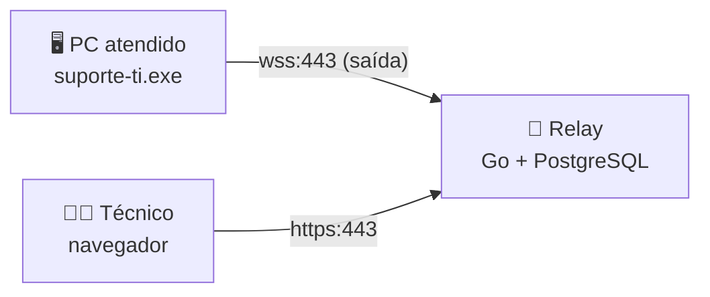
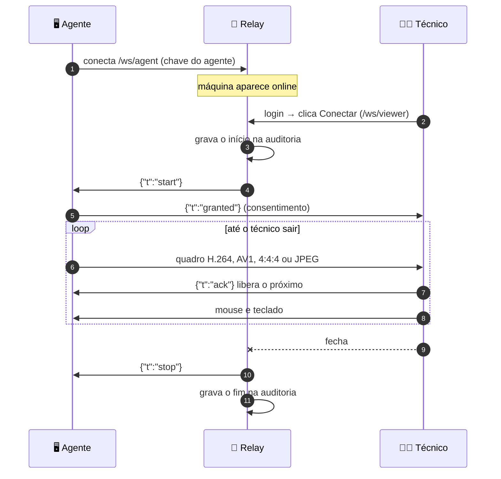

# 🖥️ RemoteIT — acesso remoto a PCs Windows pelo navegador

> 🎓 Projeto de estudo: um TeamViewer/AnyDesk enxuto, escrito em **Go** e **Svelte**. O técnico abre um site, clica em **Conectar** e vê e controla a tela de um PC Windows, que pode estar atrás de qualquer firewall, porque o agente **sai** pela porta 443, como um navegador.

🌐 **Em produção:** https://lab.d4ffy.com



> 🗣️ **Em palavras simples:** o PC atendido e o técnico nunca se conectam direto. Os dois ligam para o **relay**, um servidor no meio que confere quem é quem, liga um ao outro e anota quem acessou o quê. Como o PC só faz uma conexão **de saída** na 443 (a mesma de qualquer site), não é preciso abrir porta, configurar roteador nem pedir nada ao firewall da empresa.

---

## ✨ O que dá para fazer

| | Funcionalidade | Quem |
|---|---|:---:|
| 👀 | **Ver e controlar** a tela remota: mouse, teclado (com acentos), roda, Ctrl+Shift+Esc | técnico |
| ⚡ | **Vídeo H.264 na GPU** (NVENC, Intel QSV, AMD AMF) decodificado pelo navegador; **AV1** em placas novas; **cor 4:4:4** no visualizador e no console; JPEG quando não há GPU. O codec é negociado e cai sozinho para o próximo se falhar | [ADR 0013](docs/DECISOES.md#adr-0013) |
| 🔍 | **Partes paradas da tela sem perda**: o vídeo só pinta o que mudou, e o resto recebe uma cópia exata em ~0,3 s; o vídeo vem do tamanho da janela do técnico | [ADR 0014](docs/DECISOES.md#adr-0014) |
| 🏠 | **Relay em casa sem a volta pela internet**: no PC do relay, o visualizador abre a tela pelo endereço local | [ADR 0014](docs/DECISOES.md#adr-0014) |
| 🎚️ | **Trocar a qualidade** sem reconectar (Ultra-rápido, Equilibrado, Nítido, Máximo) e ver codec, resolução, FPS, banda, RTT, fila, tempos de codificação e decodificação e a rota | técnico |
| 🖵 | **Tela cheia** capturando Win, Alt+Tab e afins (Keyboard Lock API) | técnico |
| 🔒 | **Bloquear a tela** remota (como Win+L) e **logar com outra conta** do Windows | técnico |
| 🛡️ | **Tela de login e de bloqueio** acessíveis no modo serviço | — |
| 🖥️ | **Visualizador do técnico para Windows**: decodificação na GPU, todas as teclas (Win, Alt+Tab) sem tela cheia, área de transferência — junto com o console no navegador | técnico |
| 🔄 | **Atualização automática** do agente e do visualizador: publicar a versão no servidor basta; a assinatura própria do projeto impede versões falsas | — |
| 🔐 | **Cada técnico com as suas máquinas**: o agente baixado (ou mandado por link) já sai no nome dele; só ele e os admins veem a máquina | técnico |
| 🔗 | **Link de instalação** para o cliente baixar sem conta: com prazo e limite de máquinas, ou **permanente** | técnico |
| 🪪 | **Credencial por máquina**: ninguém se passa por outro PC; **remover** revoga na hora | — |
| 👥 | **Usuários e papéis**: administrador e técnico | admin |
| ✉️ | **Criar conta** por e-mail (com aprovação do admin) e **recuperar acesso** por link de uso único | todos |
| 📜 | **Auditoria**: quem acessou qual máquina, de onde, quando e por quanto tempo | admin |
| 🤝 | **Um técnico por máquina**: o segundo assume, e o console mostra quem está usando | — |

---

## 📦 As duas versões do agente

No console há dois botões de download. É o **mesmo programa**, com o comportamento gravado dentro do `.exe` no build: renomear o arquivo não muda nada.

| Botão | Arquivo | Com dois cliques | Precisa de admin? | Tela de bloqueio/login? |
|---|---|---|:---:|:---:|
| ▶️ **Executar agente** | `suporte-ti.exe` | roda na hora, na sessão do usuário; sair da sessão encerra | ❌ | ❌ |
| 🧩 **Instalar como serviço** | `suporte-ti-servico.exe` | instala (ou atualiza) um serviço do Windows que sobe junto com o PC | ✅ (UAC) | ✅ |

> 💡 **Nenhuma das duas mostra caixa de mensagem.** Usuário raramente lê aviso e costuma achar que é defeito. O resultado da instalação fica em `C:\ProgramData\RemoteIT\service.log`. Atualização, remoção e solução de problemas: **[docs/WINDOWS.md](docs/WINDOWS.md#agente)**.

---

## 🚀 Rodar localmente

Pré-requisitos: 🐹 **Go 1.27+**, 🟢 **Node 26+**, 🐳 **Docker** com Compose v2. Opcional: ⚡ [Zig](https://ziglang.org/download) 0.17+ para o encoder H.264 na GPU (sem ele, o agente sai só com JPEG).

**Tudo local, com uma máquina de teste simulada** (quatro terminais):

```bash
git clone https://github.com/caetasousa/remoteIT.git
cd remoteIT
make dev-db        # 🐘 PostgreSQL em localhost:5432
make dev-relay     # 🔀 relay em http://localhost:8080  (admin / dev-admin-pass)
make dev-agent     # 🖥️ agente Linux com tela sintética (aparece como máquina online)
make dev-frontend  # 🎨 console com hot reload em http://localhost:5173
```

👉 Abra **http://localhost:5173**, entre com `admin` / `dev-admin-pass` e clique em **Conectar**.

**Produção com Docker:**

```bash
cp .env.example .env    # 🔑 senhas, chave do agente, admin inicial
RELAY=wss://suporte.seudominio.com.br AGENT_KEY='a-mesma-do-.env' ./build.sh   # dist/: os dois .exe e o relay
docker compose up -d --build                                                    # relay + PostgreSQL em 127.0.0.1:8080
```

| Comando | Para quê |
|---|---|
| `docker compose logs -f relay` | 📜 acompanhar os logs |
| `docker compose down` | ⏹️ parar (o banco fica no volume) |
| `docker compose down -v` | 🧨 parar **e apagar** o banco |

> ⚠️ As credenciais de `make dev-*` e do `.env.example` são **só para uso local**. TLS, Cloudflare Tunnel, e-mail, backup e o servidor com Docker rootless estão em **[docs/DEPLOY.md](docs/DEPLOY.md)**.

---

## 🧰 Tecnologias utilizadas

### 🖥️ Agente (Windows, Go 1.27 + C)

| Peça | Uso |
|---|---|
| 🎞️ DXGI Desktop Duplication + D3D11 | captura a tela na GPU, escala e converte para NV12 sem passar pela CPU |
| ⚡ Media Foundation (C via cgo, compilado com Zig) | encoders H.264 e AV1 de hardware: NVENC, Intel QSV, AMD AMF; fallback software no H.264; shaders D3D11 para o 4:4:4 (AVC444) |
| 🖼️ GDI + `image/jpeg` | fallback universal, sem GPU |
| ⌨️ `SendInput` | injeta mouse e teclado (imprimíveis como Unicode, independentes do layout) |
| 🧩 `golang.org/x/sys/windows/svc` | serviço do Windows que lança o agente na sessão ativa |
| 🔌 `github.com/gorilla/websocket` | conexão com o relay |

### 🔀 Relay (Linux, Go 1.27)

| Peça | Uso |
|---|---|
| `net/http` (stdlib) | API, WebSocket e o console embutido (`go:embed`) |
| 🐘 `github.com/jackc/pgx/v5` + PostgreSQL 19 | usuários, sessões, links de e-mail e auditoria |
| 🧂 `golang.org/x/crypto/bcrypt` | hash de senha |
| ✉️ `github.com/wneessen/go-mail` | e-mails de cadastro e recuperação (SMTP com STARTTLS) |
| 🔐 `golang.org/x/crypto/acme/autocert` | TLS automático (opcional; em produção o TLS termina no túnel) |

### 🎨 Console (navegador)

| Peça | Uso |
|---|---|
| 🧡 Svelte 5 + TypeScript + Vite | interface (SPA) |
| 🎬 WebCodecs (`VideoDecoder`) | decodifica H.264 (e AV1, se a GPU do técnico decodifica) |
| ⌨️ Keyboard Lock API | captura Win, Alt+Tab em tela cheia |

### 🏗️ Infraestrutura

| Peça | Uso |
|---|---|
| 🐳 Docker multi-stage | imagem final distroless, sem shell, usuário não-root |
| ☁️ Cloudflare Tunnel | publica o relay sem abrir portas no servidor |
| 🧪 testcontainers, Mailpit, Playwright | testes de integração e E2E com dependências reais |

---

## ⚙️ Como funciona em 30 segundos



* 🚦 **Controle de fluxo:** o navegador confirma cada quadro, e o agente só deixa alguns quadros sem confirmação no caminho (**2** em rede local, até **8** com internet lenta, para não travar em poucos quadros por segundo), e nenhum esperando mais que o RTT mínimo + 50 ms. Isso evita fila nos buffers do TCP, a principal causa de atraso em acesso remoto. O bitrate segue a fila: cai 25% quando ela passa de 80 ms e sobe 20% por segundo quando a banda foi usada sem fila.
* 🔐 **Sem auditoria não há acesso:** se o banco falhar ao registrar o início, o relay recusa a conexão do técnico.
* 🙋 **Consentimento:** por padrão o usuário do PC aprova cada acesso; o build com `NO_CONSENT=1` dispensa a pergunta (a auditoria continua).

👉 **Todos os fluxos, passo a passo e com diagramas, estão em [docs/FLUXOS.md](docs/FLUXOS.md).**

---

## 📚 Documentação

🧭 **Por onde começar?**

| Eu quero... | Leia |
|---|---|
| 🧭 **entender cada fluxo** (conexão, vídeo, teclado, tela de bloqueio, contas) | [docs/FLUXOS.md](docs/FLUXOS.md) |
| 🪟 **instalar, usar, atualizar ou remover** o agente e o visualizador do técnico, e resolver problemas no Windows | [docs/WINDOWS.md](docs/WINDOWS.md) |
| 🏗️ entender **como o código está organizado**, **as mensagens** entre agente, relay e técnico e **a API HTTP** | [docs/ARQUITETURA.md](docs/ARQUITETURA.md) |
| 📝 saber **por que** cada decisão foi tomada (ADRs) | [docs/DECISOES.md](docs/DECISOES.md) |
| ☁️ **publicar no servidor** | [docs/DEPLOY.md](docs/DEPLOY.md) |
| 🛡️ ver **as defesas de segurança** e os riscos conhecidos | [docs/SEGURANCA.md](docs/SEGURANCA.md) |
| 🗺️ ver **o que já foi feito e o que falta** | [docs/ROADMAP.md](docs/ROADMAP.md) |
| 🤝 **contribuir**, saber **como o projeto é testado** e conhecer **o design do console** | [CONTRIBUTING.md](CONTRIBUTING.md) · [CHANGELOG.md](CHANGELOG.md) |

---

## 🗂️ Estrutura do repositório

```
remoteIT/
├── 📁 cmd/
│   ├── agent/            🖥️ main do agente: só monta as peças e chama Run
│   └── relay/            🔀 main do relay: lê o ambiente, abre o banco, sobe o servidor
├── 📁 internal/
│   ├── protocol/         📡 contrato WebSocket (JSON + cabeçalho binário de 12 bytes)
│   ├── agent/            🖥️ captura, encoder, entrada, serviço do Windows
│   └── relay/            🔀 hub, identidade, auditoria, API, Postgres, e-mail
├── 📁 frontend/          🎨 console Svelte (src/) e testes E2E (e2e/)
├── 📁 test/integration/  🧪 relay + agente + Postgres reais
├── 📁 docs/              📚 documentação detalhada e as decisões (DECISOES.md)
├── 🐳 Dockerfile         build multi-stage (console + relay; agente Windows opcional)
├── 🐳 compose.yaml       relay + PostgreSQL (+ túnel opcional)
├── 🔧 build.sh           gera dist/: os dois .exe do agente e o relay
├── 🔧 Makefile           dev, testes e checagens
└── 🔧 .env.example       variáveis de ambiente, com valores de exemplo
```

---

## 🧑‍💻 Testes

```bash
make check             # 🔎 go vet (Linux e Windows) + svelte-check
make test              # ⚡ unitários
make test-integration  # 🐘 relay + agente + PostgreSQL reais (Docker)
make test-e2e          # 🌐 navegador real (Playwright) contra o compose (Docker)
```

👉 O que cada camada cobre e o checklist manual no Windows: [CONTRIBUTING.md](CONTRIBUTING.md#testes).

---

## ⚠️ Limitações

* 🛡️ **Sem o modo serviço**, não controla janelas elevadas (UAC) nem a tela de bloqueio: o Windows não deixa um programa comum mexer nelas. A sessão mostra "tela protegida" e retoma sozinha.
* 🖵 Só o **monitor principal**; área de transferência só em texto, do técnico para o PC e pelo visualizador nativo; sem arquivos nem áudio.
* 🎨 Cor completa (4:4:4) com a tela em movimento: no visualizador do técnico, e no console quando o navegador tem WebGL2 e o PC dá conta de decodificar em software; senão, em movimento a cor fica em meia resolução (H.264 4:2:0). As partes paradas da tela ficam idênticas às do PC em qualquer caso.
* ⌨️ **Ctrl+Alt+Del** não pode ser simulado (o Windows reserva essa combinação). Se a política do PC exigir Ctrl+Alt+Del antes do login, o login remoto para nessa tela.
* 🌐 Proxy: respeita `HTTP_PROXY`/`HTTPS_PROXY`; proxy autenticado ou PAC do Windows, ainda não.
* 🏚️ Agentes antigos (de antes do cadastro por máquina) são **recusados** em produção (`RELAY_LEGACY_AGENTS=false`); reinstale com um agente baixado do console.
* 🧾 O `.exe` **não é assinado**: SmartScreen e antivírus podem bloquear (veja [docs/WINDOWS.md](docs/WINDOWS.md#antivirus)).
* ❓ **Por que não WebRTC?** Com só a 443 TCP liberada, o WebRTC cairia em TURN sobre TCP: o mesmo transporte, com muito mais complexidade ([ADR 0004](docs/DECISOES.md#adr-0004)).

> 📌 Projeto de estudo. Use só em máquinas suas ou com autorização e aviso aos usuários.

## 📄 Licença

Ainda não definida: sem arquivo LICENSE, todos os direitos reservados ao autor.
