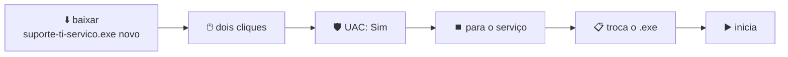

# 🖥️ Agente no Windows: instalar, atualizar, remover e resolver problemas

> 🗣️ **Em palavras simples:** existem dois `.exe` para baixar no console. O **portátil** só roda: dois cliques e o técnico já vê a tela. O **de serviço** instala o agente no Windows para ele subir sozinho com o PC e funcionar também na tela de login e de bloqueio. Nenhum dos dois mostra caixa de mensagem.

---

## 📦 Qual baixar?

| | ▶️ Executar agente | 🧩 Instalar como serviço |
|---|---|---|
| Arquivo | `suporte-ti.exe` | `suporte-ti-servico.exe` |
| Dois cliques | conecta ao relay na hora | instala ou atualiza o serviço |
| Pede administrador? | ❌ nunca | ✅ uma vez (UAC do Windows) |
| Funciona antes do login? | ❌ | ✅ |
| Tela de bloqueio, login, UAC | ❌ mostra "tela protegida" | ✅ vê e controla |
| Sobrevive a reiniciar o PC? | ❌ precisa abrir de novo | ✅ sobe com o Windows |
| Onde fica | onde você salvou (ex.: Downloads) | `C:\Program Files\RemoteIT\suporte-ti.exe` |
| Ideal para | atendimento pontual, usuário sem admin | PCs da empresa, servidores, acesso sem ninguém na frente |

> 💡 É **o mesmo programa**: o build grava a edição dentro do `.exe` (`-X main.edition=servico`). Renomear o arquivo não muda o comportamento.

---

## ▶️ Usar o portátil

1. No console, clique em **Executar agente (.zip)** e salve. O download vem em `.zip` (com o `.exe` e um `LEIA-ME.txt`), que o navegador segura bem menos que um `.exe` solto; se ainda assim segurar, clique em **Manter**.
2. Extraia o `.zip` (botão direito → *Extrair tudo*).
3. Dê **dois cliques** no `suporte-ti.exe`. Se aparecer o SmartScreen ("O Windows protegeu o computador"): *Mais informações* → *Executar assim mesmo*.
4. Em alguns segundos a máquina aparece em **Máquinas online** no console.

✨ **O que aconteceu:** o agente abriu uma conexão de saída na 443 para o relay e ficou esperando um técnico. Ele roda com o usuário atual, sem instalar nada. Para encerrar, saia da sessão do Windows ou finalize `suporte-ti.exe` no Gerenciador de Tarefas.

> ⚠️ Se o **serviço estiver instalado**, o portátil sai em silêncio: o serviço já dá o acesso, e duas cópias com o mesmo nome de máquina ficariam se derrubando no relay.

---

## 🧩 Instalar o serviço

1. No console, clique em **Instalar como serviço (.zip)** e salve (clique em **Manter** se o navegador segurar).
2. Extraia o `.zip` e dê **dois cliques** no `suporte-ti-servico.exe`.
3. O Windows pergunta *"Deseja permitir que este aplicativo faça alterações?"* → **Sim**.
4. Pronto. A máquina aparece no console e continua lá depois de reiniciar o PC.

✨ **O que aconteceu:**

```
suporte-ti-servico.exe (Downloads)
 ├── 📋 copiou-se para  C:\Program Files\RemoteIT\suporte-ti.exe
 ├── 🧩 criou o serviço RemoteITAgent  (automático; reinicia sozinho em caso de falha)
 └── ▶️ iniciou o serviço → que lança o worker na sua sessão, como SYSTEM
```

O arquivo em Downloads pode ser apagado: o serviço usa a cópia do Program Files.

### ⚡ Sem navegador, com um comando

O técnico gera um **link de instalação** no console e copia o comando que aparece embaixo dele. No PC
do cliente, abra o **PowerShell** (não precisa ser como administrador) e cole:

```powershell
irm https://suporte.exemplo.com/i/<código>/ps | iex
```

O comando baixa o agente do próprio link, confere o **SHA-256** que o relay calculou, pede o UAC uma
vez e mostra **"Pronto"** em verde (ou o erro e onde ver o log). Num link **Executar**, o agente vai
para `%LOCALAPPDATA%\RemoteIT` e roda sem instalar nada. Não há aviso de download do navegador nem
arquivo em Downloads. Alguns antivírus corporativos bloqueiam comandos `irm … | iex`; aí use o link
no navegador.

### 💻 Pelo terminal (PowerShell como Administrador)

```powershell
Start-Process "$env:USERPROFILE\Downloads\suporte-ti-servico.exe" -ArgumentList install -Wait
```

> 💡 **Por que `Start-Process -Wait`?** O agente é um programa "de janela" (sem console próprio), e o PowerShell não espera esse tipo de programa terminar. Sem o `-Wait`, a próxima linha roda antes de a instalação acabar.

---

## 🔄 Atualizar

> ✅ **Desde a versão com atualização automática ([ADR 0011](adr/0011-atualizacao-automatica.md)), não precisa fazer nada:** o agente se troca sozinho em até 1 hora depois de uma versão nova ser publicada, sempre fora de um atendimento. A coluna **Versão** do console mostra quem já atualizou. O passo a passo abaixo vale para a primeira instalação de quem ainda tem uma versão anterior a essa.


**É igual a instalar:** baixe o `suporte-ti-servico.exe` novo e dê dois cliques. Ele para o serviço, troca o arquivo no Program Files e inicia de novo. Durante esses segundos, o técnico conectado cai e reconecta.



---

## 🗑️ Remover

PowerShell como Administrador:

```powershell
Start-Process "C:\Program Files\RemoteIT\suporte-ti.exe" -ArgumentList uninstall -Wait
```

Isso para o serviço, remove o serviço e apaga `C:\Program Files\RemoteIT`. Os logs em `C:\ProgramData\RemoteIT` ficam.

**Remoção manual** (se o arquivo não existir mais ou algo der errado):

```powershell
sc.exe stop RemoteITAgent
Start-Sleep 3
sc.exe delete RemoteITAgent
Get-Process suporte-ti* -ErrorAction SilentlyContinue | Stop-Process -Force
Remove-Item "C:\Program Files\RemoteIT" -Recurse -Force -ErrorAction SilentlyContinue
```

---

<a id="conferir-versao"></a>
## 🔎 Conferir o que está instalado

```powershell
Get-Service RemoteITAgent                                                   # está rodando?
(Get-CimInstance Win32_Service -Filter "Name='RemoteITAgent'").PathName     # de qual arquivo?
Get-Process suporte-ti -IncludeUserName | Format-Table Id,SessionId,UserName -AutoSize
Test-Path C:\ProgramData\RemoteIT\machine.json                               # já se cadastrou?
```

| O que olhar | Certo |
|---|---|
| `PathName` | `"C:\Program Files\RemoteIT\suporte-ti.exe" service` |
| Processos | dois, os dois `AUTORIDADE NT\SISTEMA`: o serviço na sessão **0** e o worker na sua sessão (1, 2...) |
| `machine.json` | `True`: a máquina já trocou o código do `.exe` pela credencial dela |

> 💡 **Hash não serve mais para conferir a versão:** cada download sai com o código do técnico gravado, então dois `.exe` baixados nunca têm o mesmo hash. A versão certa é a que você acabou de baixar pelo console ou pelo link.

> ⚠️ Se o worker aparecer com o **seu usuário** (ex.: `PC\ana`) em vez de SISTEMA, é uma versão antiga do agente: ela não consegue digitar na tela de bloqueio. Atualize.

---

## 🪪 Identidade da máquina

| Arquivo | Quem usa | Protegido por |
|---|---|---|
| `C:\ProgramData\RemoteIT\machine.json` | serviço (worker SYSTEM) | DPAPI da máquina: copiar para outro PC não funciona |
| `%LOCALAPPDATA%\RemoteIT\machine.json` | portátil (seu usuário) | DPAPI do usuário |

* Na primeira execução, o agente troca o **código gravado no `.exe`** pela credencial e grava este arquivo. Daí em diante, usa só a credencial.
* Para instalar em vários PCs, gere um **link de instalação** com várias máquinas (até 100) e use o mesmo `.exe` baixado dele em todos. O portátil também aceita o código à mão (`-code <código>` ou `REMOTEIT_CODE`), útil em testes; o serviço usa sempre o código gravado no `.exe`. Implantação por MSI/GPO ainda não existe (veja [MELHORIAS.md](MELHORIAS.md#sem-navegador)).
* Apagar o `machine.json` faz a máquina se cadastrar de novo (se o código ainda valer) e aparecer como **outra** máquina no console.

## 📜 Logs

| Arquivo | Quem escreve | O que tem |
|---|---|---|
| `C:\ProgramData\RemoteIT\service.log` | serviço e instalador | instalou, atualizou, removeu, lançou o worker (sessão, pid) ou **por que não conseguiu** |
| `C:\ProgramData\RemoteIT\agent.log` | worker | conectou ao relay, abriu a captura (qual encoder e codec), "codec indisponível, tentando o próximo" (com o motivo: sem encoder de GPU, d3dcompiler ausente, segunda sessão de NVENC recusada…), não conseguiu seguir o desktop |

```powershell
type C:\ProgramData\RemoteIT\service.log -Encoding UTF8
type C:\ProgramData\RemoteIT\agent.log -Tail 40 -Encoding UTF8
```

> 💡 Sem `-Encoding UTF8`, o PowerShell 5 mostra `serviço` no lugar de `serviço`: o arquivo está certo, só a leitura que não. Cada arquivo recomeça quando passa de 2 MB. O agente portátil não grava log.

Exemplo de um serviço saudável:

```
time=... level=INFO msg="serviço iniciado"
time=... level=INFO msg="worker lançado" sessão=2 pid=2760
time=... level=INFO msg="agente iniciado" modo=1 relay=wss://lab.d4ffy.com
time=... level=INFO msg="conectado ao relay" id=pc1
```

---

## 🩺 Resolver problemas

| Sintoma | Causa provável | O que fazer |
|---|---|---|
| A máquina não aparece no console | o agente não rodou, ou o firewall bloqueia a 443 | `Get-Process suporte-ti`; abra o site do console no próprio PC para testar a 443 |
| Fica "conectado/desconectado" alternando | **duas cópias** do agente com o mesmo nome (ex.: serviço + portátil antigo) | `Get-Process suporte-ti -IncludeUserName`; finalize a cópia que não é SISTEMA |
| "tela protegida por UAC/bloqueio — aguardando" | agente **portátil** na tela de bloqueio/UAC, ou versão antiga do serviço | use o serviço atualizado; veja o `agent.log` |
| Vejo a tela de bloqueio mas não consigo digitar | worker antigo rodando com o usuário, não como SYSTEM | atualize o serviço e confira os processos |
| A máquina não aparece na **minha** lista | o `.exe` foi baixado por outro técnico (a máquina é dele), ou é um agente antigo | baixe o agente (ou gere um link) com a sua conta e reinstale; agentes antigos são recusados pelo relay |
| Aparece "sem versão" no console | agente instalado antes da atualização automática | reinstale uma vez com um `.exe` baixado agora; depois ele se atualiza sozinho |
| A máquina sumiu e não volta | alguém a **removeu** no console: a credencial foi revogada | instale um agente baixado de novo (ele se cadastra como máquina nova) |
| "conectado/desconectado" depois de clonar o PC | a imagem clonada levou o `machine.json` junto | apague `machine.json` no clone e reinicie o serviço: ele se cadastra de novo (se o código do `.exe` ainda valer) |
| O navegador salvou `suporte-ti (1).zip` (ou `.exe`) | já havia um arquivo com o mesmo nome | tudo bem: o nome não importa, a edição está dentro do `.exe` |
| `install` "não fez nada" | o UAC foi negado, ou o PowerShell não esperou | rode com `Start-Process ... -Wait` e leia o `service.log` |
| O PC exige Ctrl+Alt+Del antes do login | política de grupo (*Logon interativo: não exigir Ctrl+Alt+Del* desativada) | o Windows não deixa simular essa combinação; desative a política ou faça o login local |
| Antivírus apagou o arquivo | `.exe` sem assinatura com comportamento de acesso remoto | veja abaixo |

---

<a id="antivirus"></a>
## 🧾 Distribuição e antivírus (IMPORTANTE)

Um `.exe` que captura a tela e injeta mouse e teclado se comporta como um malware de acesso remoto. Sem assinatura digital, o Windows reage assim:

| Proteção | O que faz | Dá para passar? |
|---|---|---|
| 🛡️ **SmartScreen** (padrão) | tela azul "O Windows protegeu o computador" | ✅ *Mais informações → Executar assim mesmo* |
| 🔒 **Smart App Control** (Windows 11 recente) | bloqueia **sem** opção de executar; decide pela reputação do hash exato | ❌ |
| 🦠 **Defender / EDR corporativo** | pode remover o arquivo como ameaça | só com exclusão pelo time de segurança |

**A única solução para "o usuário só executa" é assinar o executável:**

1. Comprar um certificado de *code signing* de uma CA (DigiCert, Sectigo etc.). Exige CNPJ; custa ~US$ 200–400/ano. O **EV** zera SmartScreen e Smart App Control quase na hora; o **OV** só depois de ganhar reputação.
2. Assinar no Windows:
   ```powershell
   signtool sign /fd SHA256 /tr http://timestamp.digicert.com /td SHA256 suporte-ti.exe
   signtool sign /fd SHA256 /tr http://timestamp.digicert.com /td SHA256 suporte-ti-servico.exe
   ```
3. Publicar os `.exe` assinados no `dist/` do servidor.

> ⚠️ Mesmo assinado, um EDR corporativo (CrowdStrike, SentinelOne etc.) pode bloquear por comportamento, como faz com ferramentas pagas. A liberação depende de o time de segurança incluir o certificado ou o hash na allowlist.

---

## 🔬 Como funciona por dentro

* 🧭 O passo a passo com diagramas (serviço, worker SYSTEM, desktops `Default` e `Winlogon`, UIPI, thread descartável da captura): **[FLUXOS.md — Modo serviço](FLUXOS.md#servico)** e **[Instalar, atualizar e remover](FLUXOS.md#instalar)**.
* 📁 Código: [`internal/agent/lifecycle`](../internal/agent/lifecycle) (serviço, instalação, logs), [`internal/agent/desktop`](../internal/agent/desktop) (seguir o desktop ativo), [`internal/agent/lock`](../internal/agent/lock) (bloquear a tela).

| Flag / variável | Descrição |
|---|---|
| `-relay` / `REMOTEIT_RELAY` | URL do relay (o build embute um padrão) |
| `-code` / `REMOTEIT_CODE` | código de cadastro (o download do console já grava um no `.exe`) |
| `-key` / `REMOTEIT_KEY` | chave compartilhada do modo legado (o build embute um padrão) |
| `-noconsent` | não pede consentimento (o build com `NO_CONSENT=1` já embute) |
| `install` / `uninstall` | instala/atualiza ou remove o serviço (pede o UAC) |
| `service` / `worker` | uso interno do Windows e do serviço; não rode à mão |
