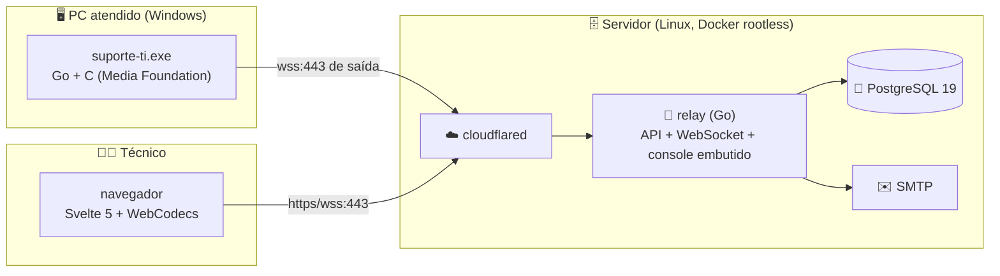
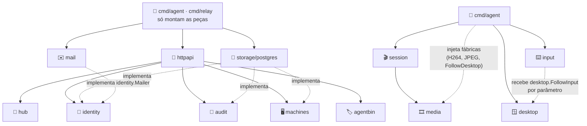
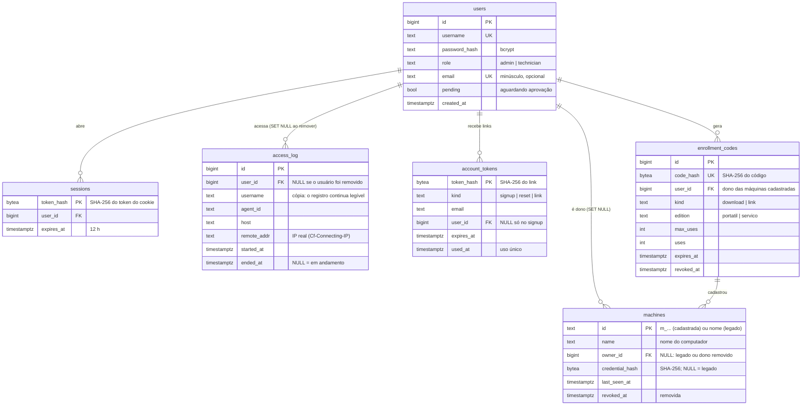

# 🏗️ Arquitetura

> 🗣️ **Em palavras simples:** são **três programas** que só conversam pela rede. O **agente** roda no PC atendido (Windows), o **relay** roda num servidor (Linux, com um banco PostgreSQL) e o **console** roda no navegador do técnico. Dentro de cada um, o código é dividido em "caixas" com um assunto só cada (vídeo, entrada, usuários, auditoria...), e cada caixa só conversa com as outras por fronteiras bem definidas.

## 🧭 Visão geral



Um único binário Go serve **a API** (`/api/...`), **os dois WebSockets** (`/ws/agent` e `/ws/viewer`), **os downloads** do agente e **os arquivos do console** já compilados (`go:embed`). Tudo cabe numa imagem distroless.

---

## 🧩 Contextos delimitados

```
┌────────── Agente (Windows) ──────────┐        ┌───────────── Relay (Linux) ─────────────┐        ┌── Console ──┐
│ lifecycle   portátil / serviço       │        │ httpapi   rotas, cookie, WebSocket      │        │ App.svelte  │
│ relayclient conexão + backoff ───────┼─ wss ─▶│   ├─ hub       agentes online, 1 técnico│◀─ wss ─┤ viewer/*.ts │
│ session     start/stop, consent.     │  443   │   ├─ identity  usuários, login, contas  │  443   │ api.ts      │
│ media       stream, fluxo, bitrate   │        │   └─ audit     registro de acessos      │        └─────────────┘
│  ├ capture/jpeg/gpu                  │        │ storage/postgres ── SQL ──▶ PostgreSQL  │
│ input       SendInput (thread fixa)  │        │ mail      SMTP + textos dos e-mails     │
│ desktop     seguir Default/Winlogon  │        │ server    TLS, shutdown │ web  embed    │
│ lock        LockWorkStation          │        │                                         │
└──────────────── protocol (contrato compartilhado, espelhado em protocol.ts) ───────────────────────────────────┘
```

| Contexto | Pacote | Responsabilidade | Regras que vivem aqui |
|---|---|---|---|
| 📡 Protocolo | `internal/protocol` | mensagens JSON e cabeçalho binário de 12 bytes | o layout do quadro é contrato com o navegador |
| 🔀 Hub | `internal/relay/hub` | agentes online e o técnico de cada um | 1 conexão por ID; 1 técnico por agente; o novo assume; start/stop |
| 👤 Identidade | `internal/relay/identity` | usuários, papéis, login, sessões, contas por e-mail | validação de nome/senha; admin inicial só com banco vazio; ninguém remove a si mesmo; conta nova espera aprovação; link de uso único |
| 📜 Auditoria | `internal/relay/audit` | registro de acessos | sem registro, sem acesso; acessos órfãos de um reinício são encerrados na partida |
| 🖥️ Máquinas | `internal/relay/machines` | dono, credencial e códigos de cadastro | dono = quem gerou o código; acessam só o dono e os admins (sem compartilhamento); removida = credencial revogada; legado só para admins |
| 🎬 Sessão remota | `internal/agent/session` | ciclo de uma transmissão no agente | nada de vídeo, entrada ou bloqueio antes do consentimento |
| 🎞️ Mídia | `internal/agent/media` (+ `capture`, `jpeg`, `gpu`) | captura, encoder, negociação de codec, controle de fluxo, bitrate | máx. 2 quadros em trânsito; codec pela lista do técnico, com fallback até JPEG; thread de captura descartável |
| ⌨️ Entrada remota | `internal/agent/input` | mouse e teclado | imprimíveis como Unicode; nunca descarta tecla nem clique |
| 🪟 Desktop | `internal/agent/desktop` | seguir o desktop que recebe entrada | handle por thread do SO |
| 🔒 Bloqueio | `internal/agent/lock` | bloquear a estação | só a API oficial (`LockWorkStation`) |
| 🪪 Identidade da máquina | `internal/agent/machine` | código gravado no `.exe`, cadastro, credencial (DPAPI) | o marcador do espaço reservado só pode aparecer uma vez no binário |
| ⚙️ Ciclo de vida no SO | `internal/agent/lifecycle` | serviço, worker, instalação, instância única, logs | um worker por sessão interativa; nenhuma janela |

Pacotes de infraestrutura, sem regra de negócio: `agentbin` (grava o código no `.exe` baixado), `httpapi` (traduz HTTP para os contextos), `storage/postgres` (o único que conhece SQL), `mail` (SMTP e textos dos e-mails), `server` (TLS e desligamento), `web` (embed do console), `relayclient` (transporte do agente), `consent` (caixa de consentimento).

---

## 📏 Regras de dependência

> 🗣️ **Em palavras simples:** cada caixa só sabe o mínimo sobre as outras. Assim dá para testar o vídeo no Linux sem Windows, testar o relay sem navegador, e trocar o banco sem mexer nas regras.



1. 🚪 **`cmd/*` monta tudo e não tem lógica:** lê configuração, cria as dependências e chama `Run`.
2. 🧱 **Os contextos do relay não se importam entre si:** `hub`, `identity`, `machines` e `audit` são independentes, e só o `httpapi` os combina (o técnico entra → `machines.CanAccess` → `audit.Begin` → `hub.Attach`). `machines` recebe só o ID do usuário e se ele é admin (`machines.Actor`), sem importar `identity`.
3. 🔗 **A persistência fica atrás de interfaces definidas por quem as usa** (`identity.Repository`, `identity.AccountRepository`, `identity.Mailer`, `audit.Store`), não por quem as implementa.
4. 🎞️ **`media` não conhece as fontes concretas:** recebe fábricas em `media.Encoders` (inclusive `FollowDesktop`). Por isso o pipeline compila e é testado no Linux, e os encoders de GPU com cgo (H.264, AVC444, AV1) ficam isolados em `media/gpu`. `media` não importa pacotes irmãos do agente.
5. 🪟 **Código de plataforma fica em `_windows.go` / `_other.go`** dentro do pacote dono do assunto. Fora do Windows, os `_other.go` são stubs (o agente Linux da E2E usa uma tela sintética).

---

## 🗂️ Pacotes, arquivo por arquivo

```
cmd/
├── agent/main.go                    🚪 flags, edição, versão; monta session + media + input + lock + update
├── relay/main.go                    🚪 ambiente, banco, migrations, admin inicial, httpapi, server
├── signupdate/main.go               🔑 chave de atualização e update.json assinado (usado pelo build.sh)
└── viewer/                          🖥️ visualizador nativo do técnico (remoteit-tecnico.exe)
internal/
├── protocol/                        📡 Message (+ Accepts), Stats, CursorPos, AppendFrame/ParseFrame (12 bytes), AppendAVC444
├── avc444/                          🎨 referência do 4:4:4 em duas visões 4:2:0 (Pack/Combine), seguida pelo shader e pelo visualizador
├── agent/
│   ├── lifecycle/
│   │   ├── lifecycle.go             modos: Portable, Worker, Handled
│   │   ├── lifecycle_windows.go     Dispatch, Init (instância única), serviço, supervisor, launchInSession (token SYSTEM)
│   │   ├── install_windows.go       install/uninstall silenciosos, UAC, cópia para Program Files, service.log
│   │   ├── update_windows.go        ApplyUpdate: serviço roda o install do .exe novo; portátil se troca e reabre
│   │   └── lifecycle_other.go       stubs
│   ├── relayclient/                 WebSocket com backoff, keepalive; credenciais vêm de um Auth
│   ├── machine/                     código gravado no .exe, cadastro, credencial em DPAPI (Keeper)
│   ├── update/                      checa a versão no relay, confere assinatura e hash, chama ApplyUpdate
│   ├── session/                     Controller: start/stop, consentimento, roteia hello/cfg/kf/ack/lock/entrada
│   ├── consent/                     caixa "Permitir o acesso remoto?" (ou Always com -noconsent)
│   ├── media/
│   │   ├── media.go                 Source, Encoders, Presets, NextBitrate
│   │   ├── flow.go                  FlowControl: 2 em trânsito, RTT, ack perdido
│   │   ├── stream.go                Run: hello, thread de captura descartável, laço de quadros, stats
│   │   ├── capture/                 GDI BitBlt + formato do cursor
│   │   ├── jpeg/                    Source JPEG
│   │   └── gpu/                     H.264, AVC444 e AV1: rcenc.h (DXGI + D3D11 + Media Foundation, em C); obu.go
│   ├── input/                       SendInput numa thread fixa; keymap.go (code → virtual-key)
│   ├── desktop/                     FollowInput: OpenInputDesktop + SetThreadDesktop, handle por thread
│   └── lock/                        Station: LockWorkStation
└── relay/
    ├── hub/                         agentes online, Attach/Detach, DisconnectUser
    ├── identity/                    service.go (login, sessões, usuários), accounts.go (links por e-mail)
    ├── audit/                       Begin → função que grava o fim; CloseOrphans na partida
    ├── machines/                    donos, credenciais, códigos e links de instalação
    ├── agentbin/                    Stamp: grava o código no espaço reservado do .exe
    ├── httpapi/                     rotas, auth/admin, WebSockets, downloads, limites por IP
    ├── mail/                        SMTP (go-mail) + templates/ dos e-mails
    ├── storage/postgres/            repositórios + migrations/*.sql (aplicadas ao iniciar)
    ├── server/                      HTTP/TLS (autocert ou certificado), desligamento gracioso
    └── web/                         embed do build do console (dist/)
internal/viewer/
├── client/                          API e protocolo do técnico, sem Windows (testado no Linux)
├── decode/                          H.264, AVC444 e AV1 via Media Foundation (rcdec.h, GPU/CPU); yuv.h; JPEG/PNG → BGRA
└── win/                             Win32: login, lista, janela de sessão, GDI, hook de teclado
frontend/src/
├── App.svelte                       🧭 roteamento por hash e abas
├── lib/api.ts                       🔌 cliente da API
├── lib/protocol.ts                  📡 espelho de internal/protocol
├── lib/route.ts                     rotas #/criar-conta, #/nova-senha, #/confirmar-email
├── lib/viewer/session.ts            🎬 WebSocket, parse de quadros, VideoDecoder, acks (fora do Svelte)
├── lib/viewer/input.ts              ⌨️ eventos do navegador → mensagens; Keyboard Lock
└── components/                      Login, AgentList, Viewer, Users, Audit, contas; layout/ (Frame, Entrance, Sequence)
```

---

## 🐘 Banco de dados

As migrations ficam em [`internal/relay/storage/postgres/migrations`](../internal/relay/storage/postgres/migrations) e rodam sozinhas quando o relay inicia.



* 🧠 **O que fica em memória, não no banco:** quais agentes estão online e quem está vendo cada um (`hub`). Quem é dono de cada máquina fica no banco (`machines`), e a lista do console junta os dois. Reiniciar o relay derruba as conexões, que se refazem sozinhas ([ADR 0002](adr/0002-postgres-usuarios-auditoria.md)).
* 🔚 **Reinício do relay:** as sessões abertas perdem a função que grava o fim; na partida seguinte, `audit.CloseOrphans` encerra essas linhas com o horário do reinício.

---

## 🔁 Uma sessão, atravessando os pacotes

```
técnico clica Conectar
  └─ GET /ws/viewer?id=pc1 (cookie)           httpapi.auth → identity.Authenticate
       ├─ audit.Begin                           grava o início; falhou → fecha com 1011
       ├─ hub.Attach                            derruba o técnico anterior, envia {"t":"start"} ao agente
       │    agente: session.start → {"t":"waiting"} → consent
       │      sim → {"t":"granted"} → media.Stream.Run (thread de captura própria)
       │             laço: FlowControl.Congested? → Source.Next → protocol.AppendFrame → envia
       │      navegador: parseFrame → VideoDecoder → canvas → {"t":"ack","s":n}
       └─ técnico sai → hub.Detach ({"t":"stop"}) → a função devolvida por audit.Begin grava o fim
```

👉 A mesma história com diagramas de sequência: [FLUXOS.md](FLUXOS.md).

---

## 📝 Decisões (ADRs)

| # | Decisão |
|---|---|
| [0001](adr/0001-contextos-delimitados.md) | Pacotes por contexto delimitado em `internal/` |
| [0002](adr/0002-postgres-usuarios-auditoria.md) | PostgreSQL para usuários, sessões e auditoria; estado online em memória |
| [0003](adr/0003-svelte-no-console.md) | Svelte no console, com o caminho dos quadros fora do framework |
| [0004](adr/0004-websocket-sobre-tcp.md) | WebSocket sobre TCP 443 em vez de WebRTC |
| [0005](adr/0005-testes-com-dependencias-reais.md) | Testes de integração e E2E com dependências reais |
| [0006](adr/0006-contas-por-email.md) | Contas por e-mail, com confirmação e aprovação |
| [0007](adr/0007-modo-servico-system.md) | Worker do serviço como SYSTEM, seguindo o desktop ativo |
| [0008](adr/0008-duas-edicoes-do-agente.md) | Duas edições do agente e nenhuma janela |
| [0009](adr/0009-refresh-de-nitidez.md) | Refresh de nitidez em PNG com a tela parada |
| [0010](adr/0010-maquinas-por-tecnico.md) | Máquinas por técnico, com credencial por máquina |
| [0011](adr/0011-atualizacao-automatica.md) | Atualização automática do agente, com assinatura própria |
| [0012](adr/0012-visualizador-nativo.md) | Visualizador nativo para Windows, junto com o console |
| [0013](adr/0013-codecs-e-negociacao.md) | Codecs por negociação: H.264 de base, AVC444 (4:4:4) e AV1 opcional |
