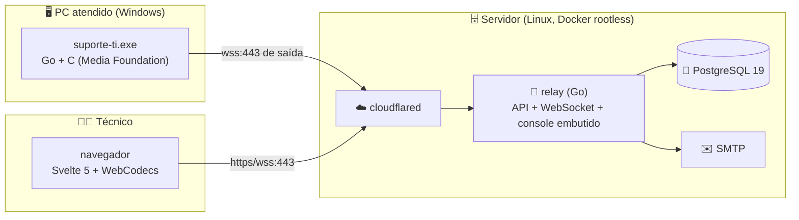
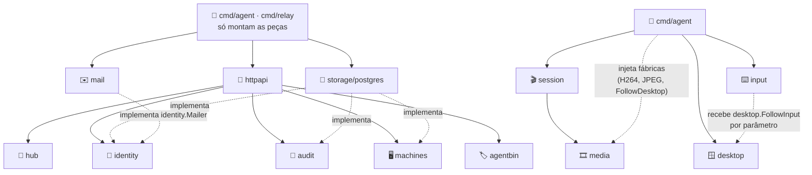
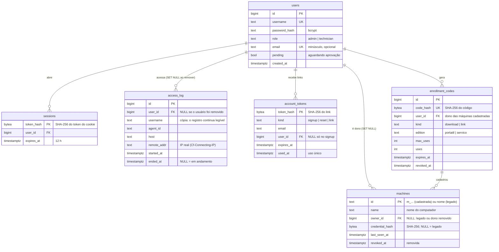
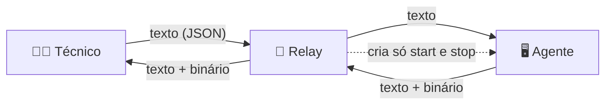
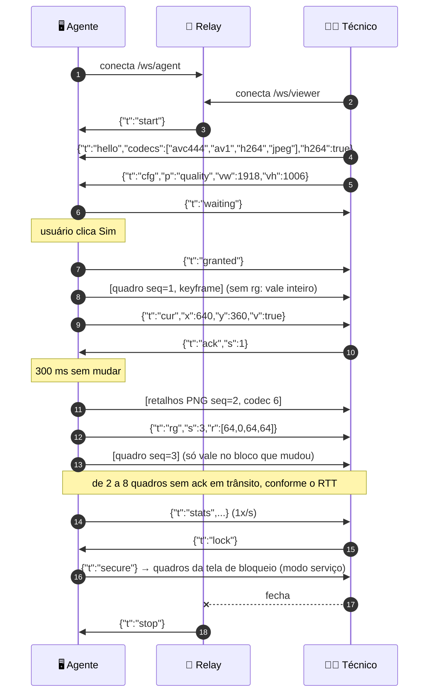

# 🏗️ Arquitetura

> 🗣️ **Em palavras simples:** são **três programas** que só conversam pela rede. O **agente** roda no PC atendido (Windows), o **relay** roda num servidor (Linux, com um banco PostgreSQL) e o **console** roda no navegador do técnico. Dentro de cada um, o código é dividido em "caixas" com um assunto só cada (vídeo, entrada, usuários, auditoria...), e cada caixa só conversa com as outras por fronteiras bem definidas. O técnico também pode usar o **visualizador nativo** para Windows, que fala com o relay exatamente como o console.

| Parte | O que tem |
|---|---|
| [🧭 Visão geral](#visao-geral) e [contextos](#contextos) | as peças, as regras de dependência e os pacotes, arquivo por arquivo |
| [🐘 Banco de dados](#banco) | as tabelas e o que fica só em memória |
| [📡 Protocolo WebSocket](#protocolo) | as mensagens entre agente, relay e técnico e o formato binário dos quadros |
| [🔌 API HTTP](#api) | cada rota, quem pode chamar e o que devolve |

O porquê de cada escolha está em [DECISOES.md](DECISOES.md); os fluxos passo a passo, em [FLUXOS.md](FLUXOS.md).

<a id="visao-geral"></a>
## 🧭 Visão geral



Um único binário Go serve **a API** (`/api/...`), **os dois WebSockets** (`/ws/agent` e `/ws/viewer`), **os downloads** do agente e **os arquivos do console** já compilados (`go:embed`). Tudo cabe numa imagem distroless.

---

<a id="contextos"></a>
## 🧩 Contextos delimitados

```
┌────────── Agente (Windows) ──────────┐        ┌───────────── Relay (Linux) ─────────────┐        ┌── Console ──┐
│ lifecycle   portátil / serviço       │        │ httpapi   rotas, cookie, WebSocket      │        │ App.svelte  │
│ relayclient conexão + backoff ───────┼─ wss ─▶│   ├─ hub       agentes online, 1 técnico│◀─ wss ─┤ viewer/*.ts │
│ session     start/stop, consent.     │  443   │   ├─ identity  usuários, login, contas  │  443   │ api.ts      │
│ media       stream, fluxo, bitrate   │        │   └─ audit     registro de acessos      │        └─────────────┘
│  ├ capture/jpeg/gpu                  │        │ storage/postgres ── SQL ──▶ PostgreSQL  │
│ input       SendInput (thread fixa)  │        │ mail      SMTP + textos dos e-mails     │
│ desktop     seguir Default/Winlogon  │        │ server    TLS, shutdown │ web  embed    │
│ lock        LockWorkStation          │        │                                         │
└──────────────── protocol (contrato compartilhado, espelhado em protocol.ts) ───────────────────────────────────┘
```

| Contexto | Pacote | Responsabilidade | Regras que vivem aqui |
|---|---|---|---|
| 📡 Protocolo | `internal/protocol` | mensagens JSON e cabeçalho binário de 12 bytes | o layout do quadro é contrato com o navegador |
| 🔀 Hub | `internal/relay/hub` | agentes online e o técnico de cada um | 1 conexão por ID; 1 técnico por agente; o novo assume; start/stop |
| 👤 Identidade | `internal/relay/identity` | usuários, papéis, login, sessões, contas por e-mail | validação de nome/senha; admin inicial só com banco vazio; ninguém remove a si mesmo; conta nova espera aprovação; link de uso único |
| 📜 Auditoria | `internal/relay/audit` | registro de acessos | sem registro, sem acesso; acessos órfãos de um reinício são encerrados na partida |
| 🖥️ Máquinas | `internal/relay/machines` | dono, credencial e códigos de cadastro | dono = quem gerou o código; acessam só o dono e os admins (sem compartilhamento); removida = credencial revogada; legado só para admins |
| 🎬 Sessão remota | `internal/agent/session` | ciclo de uma transmissão no agente | nada de vídeo, entrada ou bloqueio antes do consentimento |
| 🎞️ Mídia | `internal/agent/media` (+ `capture`, `jpeg`, `gpu`) | captura, redução, encoder, negociação de codec, controle de fluxo, bitrate, refresh sem perda | de 2 a 8 quadros em trânsito, conforme o RTT; fila máxima de RTT mín. + 50 ms; bitrate pela fila; vídeo do tamanho da área do técnico; vídeo só nos blocos que mudaram (`rg`); codec pela lista do técnico, com fallback até JPEG; thread de captura descartável |
| ⌨️ Entrada remota | `internal/agent/input` | mouse e teclado | imprimíveis como Unicode; nunca descarta tecla nem clique |
| 🪟 Desktop | `internal/agent/desktop` | seguir o desktop que recebe entrada | handle por thread do SO |
| 🔒 Bloqueio | `internal/agent/lock` | bloquear a estação | só a API oficial (`LockWorkStation`) |
| 🪪 Identidade da máquina | `internal/agent/machine` | código gravado no `.exe`, cadastro, credencial (DPAPI) | o marcador do espaço reservado só pode aparecer uma vez no binário |
| ⚙️ Ciclo de vida no SO | `internal/agent/lifecycle` | serviço, worker, instalação, instância única, logs | um worker por sessão interativa; nenhuma janela |

Pacotes de infraestrutura, sem regra de negócio: `agentbin` (grava o código no `.exe` baixado), `httpapi` (traduz HTTP para os contextos), `storage/postgres` (o único que conhece SQL), `mail` (SMTP e textos dos e-mails), `server` (TLS e desligamento), `web` (embed do console), `relayclient` (transporte do agente), `consent` (caixa de consentimento).

---

## 📏 Regras de dependência

> 🗣️ **Em palavras simples:** cada caixa só sabe o mínimo sobre as outras. Assim dá para testar o vídeo no Linux sem Windows, testar o relay sem navegador, e trocar o banco sem mexer nas regras.



1. 🚪 **`cmd/*` monta tudo e não tem lógica:** lê configuração, cria as dependências e chama `Run`.
2. 🧱 **Os contextos do relay não se importam entre si:** `hub`, `identity`, `machines` e `audit` são independentes, e só o `httpapi` os combina (o técnico entra → `machines.CanAccess` → `audit.Begin` → `hub.Attach`). `machines` recebe só o ID do usuário e se ele é admin (`machines.Actor`), sem importar `identity`.
3. 🔗 **A persistência fica atrás de interfaces definidas por quem as usa** (`identity.Repository`, `identity.AccountRepository`, `identity.Mailer`, `audit.Store`), não por quem as implementa.
4. 🎞️ **`media` não conhece as fontes concretas:** recebe fábricas em `media.Encoders` (inclusive `FollowDesktop`). Por isso o pipeline compila e é testado no Linux, e os encoders de GPU com cgo (H.264, AVC444, AV1) ficam isolados em `media/gpu`. `media` não importa pacotes irmãos do agente.
5. 🪟 **Código de plataforma fica em `_windows.go` / `_other.go`** dentro do pacote dono do assunto. Fora do Windows, os `_other.go` são stubs (o agente Linux da E2E usa uma tela sintética).

---

## 🗂️ Pacotes, arquivo por arquivo

```
cmd/
├── agent/main.go                    🚪 flags, edição, versão; monta session + media + input + lock + update
├── relay/main.go                    🚪 ambiente, banco, migrations, admin inicial, httpapi, server
├── signupdate/main.go               🔑 chave de atualização e update.json assinado (usado pelo build.sh)
└── viewer/                          🖥️ visualizador nativo do técnico (remoteit-tecnico.exe)
internal/
├── protocol/                        📡 Message (+ Accepts), Stats, CursorPos, AppendFrame/ParseFrame (12 bytes), AppendAVC444
├── avc444/                          🎨 referência do 4:4:4 em duas visões 4:2:0 (Pack/Combine), seguida pelo shader, pelo visualizador e pelo console
├── scale/                           📐 Fit (tamanho de saída) e Area (redução pela média da área), referência do shader do agente
├── agent/
│   ├── lifecycle/
│   │   ├── lifecycle.go             modos: Portable, Worker, Handled
│   │   ├── lifecycle_windows.go     Dispatch, Init (instância única), serviço, supervisor, launchInSession (token SYSTEM)
│   │   ├── install_windows.go       install/uninstall silenciosos, UAC, cópia para Program Files, service.log
│   │   ├── update_windows.go        ApplyUpdate: serviço roda o install do .exe novo; portátil se troca e reabre
│   │   └── lifecycle_other.go       stubs
│   ├── relayclient/                 WebSocket com backoff, keepalive; credenciais vêm de um Auth
│   ├── machine/                     código gravado no .exe, cadastro, credencial em DPAPI (Keeper)
│   ├── update/                      checa a versão no relay, confere assinatura e hash, chama ApplyUpdate
│   ├── session/                     Controller: start/stop, consentimento, roteia hello/cfg/kf/ack/lock/entrada
│   ├── consent/                     caixa "Permitir o acesso remoto?" (ou Always com -noconsent)
│   ├── media/
│   │   ├── media.go                 Source, Encoders, Presets, NextBitrate
│   │   ├── flow.go                  FlowControl: de 2 a 8 em trânsito conforme o RTT, fila máxima, ack perdido
│   │   ├── rate.go                  RateControl: bitrate pela fila (RTT − RTT mínimo)
│   │   ├── tiles.go                 blocos de 64 px: o que o técnico mostra com e sem perda; regiões (rg)
│   │   ├── still.go                 refresh sem perda: retalhos PNG dos blocos parados
│   │   ├── stream.go                Run: hello, área do técnico, thread de captura descartável, laço de quadros, stats
│   │   ├── capture/                 GDI BitBlt + formato do cursor
│   │   ├── jpeg/                    Source JPEG
│   │   └── gpu/                     H.264, AVC444 e AV1: rcenc.h (DXGI + D3D11 + Media Foundation, em C); obu.go
│   ├── input/                       SendInput numa thread fixa; keymap.go (code → virtual-key)
│   ├── desktop/                     FollowInput: OpenInputDesktop + SetThreadDesktop, handle por thread
│   └── lock/                        Station: LockWorkStation
└── relay/
    ├── hub/                         agentes online, Attach/Detach, DisconnectUser
    ├── identity/                    service.go (login, sessões, usuários), accounts.go (links por e-mail)
    ├── audit/                       Begin → função que grava o fim; CloseOrphans na partida
    ├── machines/                    donos, credenciais, códigos e links de instalação
    ├── agentbin/                    Stamp: grava o código no espaço reservado do .exe
    ├── httpapi/                     rotas, auth/admin, WebSockets, downloads, limites por IP
    ├── mail/                        SMTP (go-mail) + templates/ dos e-mails
    ├── storage/postgres/            repositórios + migrations/*.sql (aplicadas ao iniciar)
    ├── server/                      HTTP/TLS (autocert ou certificado), desligamento gracioso
    └── web/                         embed do build do console (dist/)
internal/viewer/
├── client/                          API e protocolo do técnico, sem Windows (testado no Linux)
├── decode/                          H.264, AVC444 e AV1 via Media Foundation (rcdec.h, GPU/CPU), direto na textura ou na memória; yuv.h; Canvas (tela composta do GDI); JPEG/PNG → BGRA
├── render/                          desenho em Direct3D 11 (rcrend.h): cor em shader, composição por região, ajuste à janela
├── ui/                              o que as janelas mostram (lista, telemetria, aviso do 4:4:4, erros), Go puro e testado
└── win/                             Win32: desenha o que sai de ui/ (GDI, owner-draw), mouse, hook de teclado
frontend/src/
├── App.svelte                       🧭 roteamento por hash e abas
├── lib/api.ts                       🔌 cliente da API
├── lib/protocol.ts                  📡 espelho de internal/protocol
├── lib/route.ts                     rotas #/criar-conta, #/nova-senha, #/confirmar-email
├── lib/viewer/session.ts            🎬 WebSocket, parse de quadros, VideoDecoder, acks, fila de desenho em ordem, 4:4:4 em software (fora do Svelte)
├── lib/viewer/render.ts             🖌️ desenho: WebGL2 (região, retalhos, recomposição 4:4:4) ou 2D
├── lib/viewer/input.ts              ⌨️ eventos do navegador → mensagens; Keyboard Lock
└── components/                      Login, AgentList, Viewer, Users, Audit, contas; layout/ (Frame, Entrance, Sequence)
```

---

<a id="banco"></a>
## 🐘 Banco de dados

As migrations ficam em [`internal/relay/storage/postgres/migrations`](../internal/relay/storage/postgres/migrations) e rodam sozinhas quando o relay inicia.



* 🧠 **O que fica em memória, não no banco:** quais agentes estão online e quem está vendo cada um (`hub`). Quem é dono de cada máquina fica no banco (`machines`), e a lista do console junta os dois. Reiniciar o relay derruba as conexões, que se refazem sozinhas ([ADR 0002](DECISOES.md#adr-0002)).
* 🔚 **Reinício do relay:** as sessões abertas perdem a função que grava o fim; na partida seguinte, `audit.CloseOrphans` encerra essas linhas com o horário do reinício.

---

## 🔁 Uma sessão, atravessando os pacotes

```
técnico clica Conectar
  └─ GET /ws/viewer?id=pc1 (cookie)           httpapi.auth → identity.Authenticate
       ├─ audit.Begin                           grava o início; falhou → fecha com 1011
       ├─ hub.Attach                            derruba o técnico anterior, envia {"t":"start"} ao agente
       │    agente: session.start → {"t":"waiting"} → consent
       │      sim → {"t":"granted"} → media.Stream.Run (thread de captura própria)
       │             laço: FlowControl.Congested? → Source.Next → protocol.AppendFrame → envia
       │      navegador: parseFrame → VideoDecoder → canvas → {"t":"ack","s":n}
       └─ técnico sai → hub.Detach ({"t":"stop"}) → a função devolvida por audit.Begin grava o fim
```

👉 A mesma história com diagramas de sequência: [FLUXOS.md](FLUXOS.md).

---

<a id="protocolo"></a>
## 📡 Protocolo WebSocket

> 🗣️ **Em palavras simples:** agente e navegador conversam por duas "línguas" na mesma conexão: **texto** (JSON, para comandos como "mexa o mouse" ou "recebi o quadro 12") e **binário** (os quadros de vídeo, com um cabeçalho de 12 bytes na frente). O relay só repassa; ele não abre nem entende o conteúdo.

📌 **Fonte da verdade:** [`internal/protocol`](../internal/protocol) (Go), espelhado em [`frontend/src/lib/protocol.ts`](../frontend/src/lib/protocol.ts). **Os dois mudam juntos.** O teste `TestFrameLayout` fixa o layout binário byte a byte.

---

### 🔌 Conexões

| Quem | URL | Autenticação |
|---|---|---|
| 🖥️ Agente → relay | `wss://relay/ws/agent?mid=&host=&user=` | `Authorization: Bearer <credencial da máquina>` (cadastro em [FLUXOS.md](FLUXOS.md#maquinas)) |
| 🏚️ Agente legado → relay | `wss://relay/ws/agent?id=&host=&user=&key=` | `key` = `RELAY_AGENT_KEY`, só com `RELAY_LEGACY_AGENTS` |
| 🧑‍💻 Técnico → relay | `wss://relay/ws/viewer?id=<agente>` | cookie de sessão + `Origin` igual ao host |



* 🔀 O relay repassa as mensagens **sem inspecioná-las**: texto do técnico vai para o agente; texto e binário do agente vão para o técnico. As únicas mensagens que o relay cria são `start` e `stop`.
* 💓 **Keepalive:** o relay envia ping ao agente a cada 20 s e derruba a conexão após 60 s sem tráfego.

---

### 💬 Mensagens de texto (JSON)

Todas têm o campo `t` com o tipo. Campos com valor zero são omitidos.

#### 🧑‍💻 → 🖥️ Técnico para agente

| `t` | Campos | Significado |
|---|---|---|
| `hello` | `codecs: [..]`, `h264: bool` | o que o técnico decodifica, **em ordem de preferência** (`avc444`, `av1`, `h264`, `jpeg`; veja [abaixo](#codecs)). `h264` é para agentes de antes da negociação. Sem `hello` em 1,5 s, o agente assume JPEG. Um `hello` novo troca de codec sem reconectar |
| `cfg` | `p: turbo \| balanced \| quality \| quality60`, `vw`, `vh` | preset de qualidade ([tabela](FLUXOS.md#video)) e a área onde o técnico mostra a tela, em pixels físicos: o agente reduz o vídeo para caber nela (0 x 0, ou ausente em técnicos antigos = nativa). Os dois vão sempre juntos |
| `kf` | | pede keyframe (decoder reiniciado); descarta os quadros em trânsito |
| `ack` | `s: uint32` | quadro `s` recebido (mande assim que chegar, antes de decodificar); libera o controle de fluxo |
| `mm` | `x, y` em [0,1] | mouse move, relativo à tela remota |
| `md` / `mu` | `x, y, b` (0 esq., 1 meio, 2 dir.) | botão pressionado / solto |
| `wh` | `d` (múltiplos de 120) | roda do mouse |
| `kd` / `ku` | `code, key` (do `KeyboardEvent`) | tecla pressionada / solta |
| `clip` | `text` (até 1 MiB) | põe o texto na área de transferência do PC remoto (o técnico cola com Ctrl+V lá). Exige consentimento |
| `lock` | | bloquear a estação (`LockWorkStation`, como Win+L). **Não** conta como entrada, mas também exige consentimento |

> 🔒 `mm`, `md`, `mu`, `wh`, `kd` e `ku` são **entrada** (`Message.IsInput()`): o agente só as aplica depois do consentimento.

#### 🔀 → 🖥️ Relay para agente

| `t` | Significado |
|---|---|
| `start` | um técnico entrou: pedir consentimento e transmitir |
| `stop` | o técnico saiu: parar a transmissão |

#### 🖥️ → 🧑‍💻 Agente para técnico

| `t` | Campos | Significado |
|---|---|---|
| `waiting` | | caixa de consentimento aberta |
| `granted` | | consentimento dado (ou tela liberada depois de `secure`) |
| `denied` | | o usuário recusou |
| `secure` | | captura bloqueada (UAC, tela de bloqueio sem o modo serviço); retoma sozinho |
| `stats` | `enc, fps, kbps, target, rtt, w, h, rttmin, encus` | 1x/s: encoder, quadros, banda, alvo de bitrate, RTT em ms, resolução, menor RTT recente (`rtt − rttmin` = fila) e captura + codificação em µs. Os dois últimos faltam em agentes antigos |
| `rg` | `s`, `r: [x, y, w, h, …]` | onde o quadro de vídeo `s` (o próximo a chegar) vale, em pixels do quadro; fora dele o técnico mantém o que tem, que veio sem perda. `r` vazio = em lugar nenhum (o quadro só refina o decodificador). Sem `rg`, o quadro vale inteiro ([ADR 0014](DECISOES.md#adr-0014)) |
| `cs` | `c` | nome CSS do cursor remoto (`default`, `text`, `pointer`...) |
| `cur` | `x, y` (pixels), `v` | posição do cursor, desenhado por cima do vídeo |

---

### 🎞️ Quadros de vídeo (binário, agente → técnico)

```
offset  tamanho  campo
0       1        codec: 1 = H.264 (Annex-B), 2 = JPEG, 3 = PNG (refresh),
                         4 = AVC444 (dois H.264), 5 = AV1 (OBUs),
                         6 = retalhos PNG (refresh por partes)
1       1        flags: bit 0 = keyframe
2       2        largura   (big-endian)
4       2        altura    (big-endian)
6       4        sequência (big-endian, circular)
10      2        reservado (zero)
12      N        payload
```

```
 0               1               2               3
 0 1 2 3 4 5 6 7 0 1 2 3 4 5 6 7 0 1 2 3 4 5 6 7 0 1 2 3 4 5 6 7
├───────────────┼───────────────┼───────────────────────────────┤
│     codec     │  flags (K=b0) │            largura            │
├───────────────┴───────────────┼───────────────────────────────┤
│            altura             │      sequência (alto)         │
├───────────────────────────────┼───────────────────────────────┤
│       sequência (baixo)       │          reservado            │
├───────────────────────────────┴───────────────────────────────┤
│        payload (H.264, AVC444, AV1, JPEG ou PNG) ...          │
```

* 🔢 A `sequência` é a mesma que o navegador devolve no `ack`.
* 🔑 Depois de um `kf`, de trocar de preset ou de reabrir a captura, o próximo quadro de vídeo é keyframe.
* 🔍 **PNG (codec 3) e retalhos PNG (codec 6) são o refresh sem perda:** imagens exatas das partes da
  tela paradas há 300 ms ([ADR 0009](DECISOES.md#adr-0009), [ADR 0014](DECISOES.md#adr-0014)). O
  codec 3 é a tela inteira; o 6 traz vários retalhos, cada um `x (2) | y (2) | tamanho (4) | PNG`,
  big-endian, e o cabeçalho leva o tamanho do quadro inteiro. Não são vídeo: o técnico os desenha
  por cima, se o quadro tiver o mesmo tamanho, **na ordem em que chegaram** em relação aos quadros de
  vídeo (mesmo que os PNG decodifiquem em paralelo). Também recebem `ack`. Técnicos antigos ignoram o
  codec 6.
* 🎨 **AVC444 (codec 4)** é cor 4:4:4 em dois fluxos H.264 Annex-B independentes, a visão principal e a
  auxiliar ([ADR 0013](DECISOES.md#adr-0013); arranjo dos planos em
  [`internal/avc444`](../internal/avc444/avc444.go)). Payload:

  ```
  offset  tamanho  campo
  0       1        flags: bit 0 = principal é keyframe, bit 1 = auxiliar é keyframe
  1       4        n = tamanho da principal (big-endian)
  5       n        H.264 da visão principal (pode ser vazio)
  5+n     resto    H.264 da visão auxiliar (pode ser vazio)
  ```

  Uma das partes pode faltar num quadro (o encoder entregou a saída atrasada): o técnico combina a
  última de cada uma. O `keyframe` do cabeçalho só vale 1 quando as duas são keyframe.
* 🪶 **AV1 (codec 5):** OBUs com campo de tamanho ("low overhead"), uma unidade temporal por quadro,
  como o `EncodedVideoChunk` espera. Todo keyframe traz o cabeçalho de sequência.

<a id="codecs"></a>
#### 🎚️ Negociação de codecs

O técnico manda no `hello` o que decodifica, do preferido ao último recurso. O agente percorre a lista
e abre o primeiro codec que conseguir; se um falhar na abertura ou no meio da sessão, fica marcado e o
próximo entra. JPEG fecha sempre a lista.

| Nome | Codec | Quem oferece | O agente usa quando |
|---|---|---|---|
| `avc444` | 4 | visualizador nativo com H.264, ou console com WebGL2 e H.264 em software; **Cor 4:4:4** ligada | há encoder H.264 de GPU e o preset não reduz por conta própria (Nítido, Máximo) |
| `av1` | 5 | navegador ou visualizador que decodifica AV1 **na GPU** | há encoder AV1 de GPU (RTX 40+, Arc / Core Ultra, RX 7000+) |
| `h264` | 1 | quem decodifica H.264 | há encoder H.264 (GPU ou o software da Microsoft) |
| `jpeg` | 2 | todos | sempre |

O técnico também desiste sozinho: três falhas seguidas do decodificador tiram o codec da lista, e um
`hello` novo faz o agente trocar ([ADR 0013](DECISOES.md#adr-0013)).

---

### 🔁 Sequência típica



### ✏️ Mudando o protocolo

1. Altere [`internal/protocol/protocol.go`](../internal/protocol/protocol.go) **e** [`frontend/src/lib/protocol.ts`](../frontend/src/lib/protocol.ts).
2. Se for entrada, inclua em `IsInput()` (senão o agente a ignora ou, pior, a aplica antes do consentimento).
3. Atualize esta página e, se mudar o binário, o `TestFrameLayout`.
4. Agentes já distribuídos não conhecem a mensagem nova: o relay continua repassando, e o agente antigo a ignora.

---

<a id="api"></a>
## 🔌 API HTTP do console

> 🗣️ **Em palavras simples:** tudo o que o console faz (entrar, listar máquinas, cadastrar técnicos, ver a auditoria) é um pedido HTTP com JSON para o relay. Esta página lista cada rota, quem pode chamar e o que ela devolve, para quem quiser integrar outro sistema ou testar pelo terminal.

📌 Implementação: [`internal/relay/httpapi`](../internal/relay/httpapi). Cliente: [`frontend/src/lib/api.ts`](../frontend/src/lib/api.ts).

### 📏 Regras gerais

- Corpo e respostas em JSON. Requisições com corpo **devem** usar `Content-Type: application/json`
  (senão 415), o que reforça a proteção contra CSRF.
- Autenticação por cookie `remoteit_session` (`HttpOnly`, `SameSite=Strict`, `Secure` em HTTPS),
  válido por 12 h.
- Erros: `{"error": "mensagem"}` com o status HTTP correspondente.

### 🗺️ Rotas

| Método e rota | Acesso | Corpo | Resposta |
| --- | --- | --- | --- |
| `POST /api/login` | público | `{username, password}` | 200 `User` + cookie · 401 · 403 pendente |
| `POST /api/logout` | qualquer | | 204, cookie apagado |
| `GET /api/account/config` | público | | 200 `{accounts}`: cadastro por e-mail ligado? |
| `POST /api/account/signup` | público | `{email}` | 202 exista ou não a conta · 400 · 429 · 503 |
| `POST /api/account/signup/complete` | link | `{token, username, password}` | 201 `User` · 400 · 409 nome em uso |
| `POST /api/account/reset` | público | `{email}` | 202 exista ou não a conta · 400 · 429 · 503 |
| `POST /api/account/reset/complete` | link | `{token, password}` | 204, sessões e telas abertas encerradas · 400 |
| `POST /api/account/email` | logado | `{email, password}` | 202 · 403 senha errada · 409 já tem e-mail |
| `POST /api/account/email/complete` | logado + link | `{token}` | 200 `User` · 400 |
| `GET /api/me` | logado | | 200 `User` · 401 |
| `GET /api/agents` | logado | | 200 `Machine[]`: as que o usuário acessa (admin: todas), online e offline |
| `DELETE /api/machines/{id}` | dono ou admin | | 204; o agente é desconectado e passa a receber 403 |
| `GET /api/links` | logado | | 200 `InstallLink[]` válidos do usuário |
| `POST /api/links` | logado | `{edition: portatil \| servico, hours: 1–168 ou 0 = sem prazo, uses: 1–100 ou 0 = sem limite}` | 201 `InstallLink` + `path` (`/i/<código>`, só nesta resposta) · 400 |
| `DELETE /api/links/{id}` | dono do link ou admin | | 204 · 404 |
| `GET /api/agent/update?mid=&edition=` | credencial da máquina | | 200 `{version, sha256, signature, size}` do `update.json` · 204 sem atualização publicada · 401/403 |
| `GET /api/agent/update/{edition}?mid=` | credencial da máquina | | o `.exe` da edição, **sem** código gravado ([ADR 0011](DECISOES.md#adr-0011)) |
| `GET /download/viewer.exe` | logado | | o visualizador nativo do técnico (`remoteit-tecnico.exe`) |
| `GET /download/viewer.zip` | logado | | o mesmo, num `.zip` com `LEIA-ME.txt` (o botão do console usa este) |
| `GET /api/viewer/update` | logado | | oferta assinada da edição `tecnico` · 204 sem atualização |
| `GET /api/viewer/route` | logado | | 200 `{local, instance}`: o endereço local do relay (`RELAY_LOCAL_URL`) e a identidade deste processo · 204 sem endereço local |
| `GET /api/relay` | público | | 200 `{instance}`: a identidade do processo do relay, sorteada no início. O visualizador confere por ela, sem cookie, que o endereço local é este mesmo relay ([ADR 0014](DECISOES.md#adr-0014)) |
| `GET /api/viewer/update.exe` | logado | | o visualizador, para a atualização automática |
| `GET /i/{código}` | **público** | | `.zip` com o `.exe` da edição do link, marcado com o código, e um `LEIA-ME.txt` · 404 inválido/vencido/esgotado · 429 (200/dia por IP) |
| `GET /i/{código}/exe` | **público** | | o `.exe` cru do link (o que o script do PowerShell baixa e confere) · mesmos 404/429 |
| `GET /i/{código}/ps` | **público** | | script PowerShell para `irm <link>/ps \| iex`: baixa o `.exe` do mesmo link, confere o SHA-256 e instala (serviço com UAC, ou portátil em `%LOCALAPPDATA%\RemoteIT`). `text/plain; charset=utf-8`, `no-store` · mesmos 404/429 do link |
| `POST /api/agent/enroll` | **público** + código | `{code, name}` | 201 `{id, secret}` · 403 código inválido · 400 · 429 (120/h por IP) |
| `GET /api/users` | admin | | 200 `User[]` · 403 |
| `POST /api/users` | admin | `{username, password, role}` | 201 `User` · 400 inválido · 409 duplicado |
| `POST /api/users/{id}/approve` | admin | | 200 `User` · 404 |
| `DELETE /api/users/{id}` | admin | | 204 · 400 a si mesmo · 404 |
| `GET /api/audit` | admin | | 200 `AuditEntry[]` (últimos 200, mais novo primeiro) |
| `GET /ws/viewer?id=` | quem acessa a máquina | | WebSocket ([protocolo](#protocolo)) · 404 sem acesso ou offline · close 1011 sem auditoria |
| `GET /ws/agent?mid=&host=&user=&ver=` | credencial (`Authorization: Bearer`) | | WebSocket · 401 credencial inválida · 403 máquina removida |
| `GET /ws/agent?id=&host=&user=&key=` | chave (legado) | | WebSocket · 403 (ou com `RELAY_LEGACY_AGENTS=false`) |
| `GET /download/agent.exe` | logado | | `suporte-ti.exe` **marcado com um código novo do usuário** (30 dias, até 50 máquinas); `Cache-Control: no-store, private` · 503 se o `.exe` do servidor não tem o espaço do código |
| `GET /download/agent-servico.exe` | logado | | o mesmo, edição de serviço (`-agent-service-exe`, padrão: ao lado do `-agent-exe`) |
| `GET /download/agent.zip`, `/download/agent-servico.zip` | logado | | os mesmos `.exe` marcados, num `.zip` com `LEIA-ME.txt` (os botões do console usam estes) |
| `GET /healthz` | público | | 200 `ok` · 503 banco fora |

### 🧾 Tipos

```ts
User       { id, username, email?, pending, role: "admin" | "technician", createdAt }
Machine     { id, name, owner?, legacy, createdAt, lastSeenAt?,
              online, user?, since?, busy, viewedBy?, mine, canManage }
InstallLink { id, kind, edition, maxUses (1 000 000 = sem limite), uses, createdAt,
              expiresAt (daqui a 100 anos = sem prazo), path? (só na criação) }
AuditEntry { id, userId (0 se removido), username, agentId, host, remoteAddr, startedAt, endedAt? }
```

### 🚦 Limites e regras

`POST /api/login` responde **429** depois de 10 senhas erradas para o mesmo usuário ou 20 do mesmo IP
em 15 minutos (só falhas contam). Todas as respostas levam `Content-Security-Policy`,
`X-Frame-Options: DENY`, `X-Content-Type-Options: nosniff` e `Referrer-Policy: no-referrer`.

`username` no login aceita o nome ou o e-mail. Sem SMTP, as rotas de `/api/account/*` (menos
`config`) respondem 503. Limites de e-mail: 20 pedidos/h por IP; 3/h por destinatário e tipo; por dia,
30 de cadastro, 30 de recuperação e 20 de vínculo.

Regras de cadastro: nome com 3 a 32 caracteres `a-z 0-9 . _ -`; senha de 8 a 72 caracteres.

### 💻 Exemplo pelo terminal

```bash
# entrar e guardar o cookie
curl -c cookie.txt -H 'Content-Type: application/json' \
  -d '{"username":"admin","password":"dev-admin-pass"}' http://localhost:8080/api/login

# máquinas online
curl -b cookie.txt http://localhost:8080/api/agents

# baixar o agente de serviço
curl -b cookie.txt -o suporte-ti-servico.exe http://localhost:8080/download/agent-servico.exe
```

> ⚠️ Sem `Content-Type: application/json`, o `POST` responde **415**: é de propósito ([SEGURANCA.md](SEGURANCA.md)).
