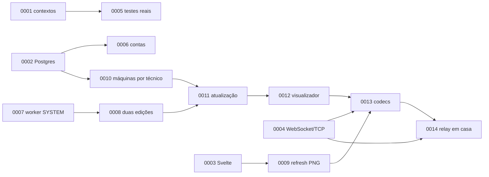

# 📝 Decisões de arquitetura (ADRs)

> 🗣️ **Em palavras simples:** cada seção desta página conta **uma decisão**: o problema que existia, o que foi escolhido e o preço da escolha. Serve para quem chega depois não refazer uma discussão já resolvida, nem desfazer sem querer algo que tinha motivo.

Formato: **Contexto** (o problema), **Decisão** (o que foi feito) e **Consequências** (o que se ganha e o que se perde). Quando uma decisão é revista, o texto dela passa a dizer como é **hoje**, e a mudança fica registrada em **Histórico**, com a data. Uma decisão que substitui outra por inteiro ganha um número novo, e a antiga é marcada como substituída. Para registrar uma nova, acrescente uma seção no fim com o próximo número e a âncora `adr-NNNN`.

## 🗺️ Índice

| # | Tema | Decisão | Em uma frase |
|---|---|---|---|
| [0001](#adr-0001) | 🏗️ código | 🧩 Pacotes por contexto delimitado | cada pacote em `internal/` tem um assunto só, e as fronteiras são explícitas |
| [0002](#adr-0002) | 🏗️ código | 🐘 PostgreSQL para usuários e auditoria | o que precisa sobreviver vai para o banco; quem está online fica em memória |
| [0003](#adr-0003) | 🏗️ código | 🧡 Svelte no console | o framework cuida das telas; o caminho dos quadros de vídeo fica fora dele |
| [0004](#adr-0004) | 🎞️ vídeo | 📡 WebSocket sobre TCP 443 | passa em qualquer firewall; o controle de fluxo compensa o TCP |
| [0005](#adr-0005) | 🏗️ código | 🧪 Testes com dependências reais | banco, relay e agente de verdade, em vez de mocks |
| [0006](#adr-0006) | 🔐 acesso | ✉️ Contas por e-mail | cadastro com confirmação e aprovação; recuperação por link de uso único |
| [0007](#adr-0007) | 🖥️ agente | 🛡️ Worker SYSTEM seguindo o desktop | o único jeito de ver e controlar a tela de bloqueio e de login |
| [0008](#adr-0008) | 🖥️ agente | 📦 Duas edições e nenhuma janela | "executar" e "instalar" são downloads diferentes, e nada mostra aviso |
| [0009](#adr-0009) | 🎞️ vídeo | 🔍 Refresh de nitidez em PNG | vídeo enquanto a tela mexe, imagem sem perda quando ela para |
| [0010](#adr-0010) | 🔐 acesso | 🔐 Máquinas por técnico | o `.exe` sai com o código do técnico; cada máquina tem credencial própria |
| [0011](#adr-0011) | 🖥️ agente | 🔄 Atualização automática | o agente se troca sozinho; assinatura própria (Ed25519) no lugar de certificado |
| [0012](#adr-0012) | 🎞️ vídeo | 🖥️ Visualizador nativo | programa Windows do técnico, junto com o console; todas as teclas e decodificação na GPU |
| [0013](#adr-0013) | 🎞️ vídeo | 🎞️ Codecs por negociação | H.264 de base; 4:4:4 em dois H.264 (AVC444); AV1 só com GPU nova |
| [0014](#adr-0014) | 🎞️ vídeo | 🏠 Qualidade e latência com o relay em casa | rota local, vídeo do tamanho da janela, áreas sem perda, fila medida, desenho na GPU |

### 🔗 Como as decisões se apoiam

- **Vídeo:** o transporte é TCP ([0004](#adr-0004)), então a qualidade vem do controle de fluxo e dos codecs. O navegador só decodifica 4:2:0 na GPU, o que levou ao refresh PNG com a tela parada ([0009](#adr-0009)). Para ter cor completa também em movimento veio o AVC444 ([0013](#adr-0013)), primeiro no programa próprio do técnico ([0012](#adr-0012)) e depois também no console. Com o relay num PC de casa, a maior parte do atraso era o caminho, não o código: daí a rota local, o vídeo do tamanho da janela e as áreas sem perda ([0014](#adr-0014)).
- **Agente no Windows:** o serviço como SYSTEM ([0007](#adr-0007)) pede uma edição própria ([0008](#adr-0008)). As duas edições se atualizam sozinhas ([0011](#adr-0011)), o que só é seguro porque cada máquina tem credencial ([0010](#adr-0010)).
- **Acesso:** usuários e auditoria no banco ([0002](#adr-0002)) são a base das contas por e-mail ([0006](#adr-0006)) e das máquinas por técnico ([0010](#adr-0010)).

---

## 0001 — Pacotes por contexto delimitado em `internal/`

**Situação:** em vigor. **Ligações:** a divisão em pacotes é o que torna possíveis os testes com dependências reais ([0005](#adr-0005)).

### Contexto

O código original tinha tudo em `package main`, em dois diretórios. Os arquivos não eram grandes
(o maior tinha ~340 linhas), mas cada um misturava assuntos: `platform_windows.go` tinha captura,
input, consentimento e instância única; `stream.go` tinha protocolo, controle de fluxo e bitrate.
O relay guardava estado em variáveis globais. Nada disso era testável isoladamente.

### Decisão

Dividir por responsabilidade em pacotes de `internal/`, um por contexto (veja a tabela em
[ARQUITETURA.md](ARQUITETURA.md#contextos)), com o `main` só montando as peças. Não adotar camadas formais de DDD
(domain/application/infrastructure): para ~3 mil linhas, essa cerimônia custaria mais do que
ajudaria. A separação que importa é **regra de negócio × infraestrutura**, e ela aparece como
interfaces pequenas definidas por quem as usa.

### Consequências

- Positivo: as regras (1 técnico por máquina, sem consentimento sem vídeo, sem auditoria sem acesso)
  têm um único lugar e testes próprios; o agente compila e é testado no Linux.
- Positivo: `internal/` impede que outros módulos importem esses pacotes por acidente.
- Negativo: mais arquivos e imports. Uma mudança no protocolo toca `protocol`, `media` e o frontend.

---

## 0002 — PostgreSQL para usuários, sessões e auditoria

**Situação:** em vigor. **Ligações:** é a base das contas por e-mail ([0006](#adr-0006)) e das máquinas por técnico ([0010](#adr-0010)).

### Contexto

O relay não tinha persistência: uma senha única de console (HTTP Basic) e uma chave compartilhada
pelos agentes. O próximo passo do produto é cadastrar usuários, e acesso remoto pede rastreabilidade
(quem acessou o quê e quando), inclusive pela LGPD.

### Decisão

- **PostgreSQL 19** como banco do relay, acessado com **pgx v5** (driver nativo, sem `database/sql`).
- **Migrations em SQL puro**, embutidas no binário e aplicadas ao iniciar por um migrador próprio de
  ~40 linhas (`postgres.DB.Migrate`), com advisory lock contra duas instâncias ao mesmo tempo. Foi
  escolhido em vez de goose ou golang-migrate por ser pequeno e didático; vale trocar se as
  migrations precisarem de rollback.
- **Senhas com bcrypt** (custo padrão). **Sessões** com token aleatório de 256 bits no cookie e só o
  SHA-256 no banco, válidas por 12 h.
- **Agentes online continuam em memória** (`hub`): é estado efêmero, reconstruído quando os agentes
  reconectam. Colocá-lo no banco só criaria inconsistência.
- **Auditoria copia o nome do usuário** para o registro sobreviver à remoção do usuário (`user_id`
  vira NULL).

Considerado: SQLite (`modernc.org/sqlite`, sem CGO). Mais simples de operar, mas o projeto já roda
em Docker Compose, e Postgres permite testes com banco real descartável e é o que se encontra no mercado.

### Consequências

- Positivo: usuários, papéis e auditoria; o banco pode ser consultado e copiado com ferramentas padrão.
- Negativo: o relay deixa de ser um binário autossuficiente e passa a precisar de um banco disponível.
  `/healthz` reporta o banco, e o compose espera o banco ficar saudável antes de subir o relay.
- Negativo: uma instância só de relay. Várias instâncias exigiriam compartilhar o `hub` (Redis,
  `LISTEN/NOTIFY`), fora do escopo atual.

---

## 0003 — Svelte no console, com o caminho dos quadros fora do framework

**Situação:** em vigor. **Ligações:** o limite do decodificador do navegador levou ao refresh PNG ([0009](#adr-0009)) e, depois, ao visualizador nativo ([0012](#adr-0012)).

### Contexto

O console era um `index.html` de ~240 linhas, com lista de máquinas e visualizador. Com usuários e
auditoria ele ganha telas, formulários e estado de login, e um arquivo único fica difícil de manter.
A parte que pesa é o vídeo: até 60 quadros/s decodificados e desenhados em um canvas.

### Decisão

- **Svelte 5 + TypeScript + Vite.** Svelte compila para JavaScript sem Virtual DOM; o bundle final
  tem ~26 KB gzip.
- O **caminho de cada quadro** (WebSocket → `parseFrame` → `VideoDecoder`/`createImageBitmap` →
  canvas → ACK) e a captura de input ficam em **classes TypeScript puras** (`src/lib/viewer/`). O
  Svelte só recebe status e estatísticas, uma vez por segundo.
- O build vai para `internal/relay/web/dist` e é embutido no binário com `go:embed`: o relay
  continua sendo um único arquivo para distribuir.
- **TypeScript 6.0.3** em vez do 7: o `svelte-check` 4.7 ainda só suporta até o 6.

Considerado: React (o modelo de re-render brigaria com o canvas) e Vue (viável, runtime maior).

### Consequências

- Positivo: componentes separados (Login, AgentList, Viewer, Users, Audit), tipos espelhando o
  protocolo Go, hot reload no desenvolvimento.
- Positivo: desempenho do vídeo igual ao da versão sem framework, porque o framework não está no
  caminho dos quadros.
- Negativo: o build do relay depende de Node. Sem o build, o relay compila e serve uma página
  avisando para rodar `make frontend`.

---

## 0004 — WebSocket sobre TCP 443 em vez de WebRTC

**Situação:** em vigor, revisada em 25/11/2026 (janela do controle de fluxo). **Ligações:** a escolha de codecs ([0013](#adr-0013)) mantém o WebRTC e o WebTransport de fora pelo mesmo motivo.

### Contexto

As redes atendidas liberam só HTTPS de saída (443, às vezes 8080), muitas vezes com proxy
corporativo. As máquinas ficam atrás de NAT e não aceitam conexões de entrada.

### Decisão

Agente e técnico abrem **WebSocket de saída** para o relay, que faz a ponte. Vídeo vai em mensagens
binárias e controle em JSON, na mesma conexão. Para compensar o TCP, o agente faz **controle de
fluxo fim a fim**: só codifica um novo quadro enquanto houver poucos quadros sem ACK do técnico.

- **Janela de quadros em trânsito:** acompanha o **menor** RTT visto, com os quadros que cabem nele
  mais um, de 2 a 8 (`media.FlowControl.Window`). Em rede local ficam 2; numa internet lenta, até 8.
- **Proteção contra fila:** um quadro sem ACK há mais que o menor RTT + 50 ms (`QueueBudget`) segura
  o envio, para o atraso não se acumular nos buffers do TCP. O bitrate também segue a fila (o RTT
  médio menos o menor RTT): cai quando ela passa de 80 ms ([0014](#adr-0014)).
- O técnico confirma cada quadro **assim que ele chega**, antes de decodificar, para o RTT medir só a
  rede.

WebRTC foi descartado: sem UDP, ele cairia em TURN sobre TCP (mesmo transporte, com ICE, DTLS, SRTP
e um servidor TURN a mais para operar).

### Consequências

- Positivo: passa em qualquer firewall ou proxy que libera HTTPS; uma única porta; o relay é só um pipe.
- Negativo: perda de pacote no TCP atrasa os quadros seguintes (head-of-line blocking). O controle de
  fluxo limita o atraso, mas não o elimina. Se UDP estiver disponível em algum cenário, WebRTC volta
  a ser candidato.
- A janela maior não diminui o atraso de cada quadro: com o relay longe, o RTT continua alto, só
  deixa de travar o FPS. O atraso em si só cai com um relay mais perto ou conexão direta na mesma
  rede ([ROADMAP.md](ROADMAP.md#desempenho)).

### Histórico

- **25/11/2026:** a janela era fixa em **2** quadros sem ACK. Com o relay atrás de um Cloudflare
  Tunnel numa internet doméstica, o RTT de um quadro chega a ~140 ms, e a janela fixa limitava a
  transmissão a ~14 fps. Passou a acompanhar o RTT, e o ACK passou a sair antes da decodificação.
- **25/11/2026 (noite):** o limite do quadro velho era 3× o menor RTT, o que deixava a fila chegar a
  ~420 ms com RTT de 140 ms; passou a RTT mínimo + 50 ms, e o bitrate passou a seguir a fila
  ([0014](#adr-0014)).

---

## 0005 — Testes de integração e E2E com dependências reais

**Situação:** em vigor. **Ligações:** depende da divisão em pacotes ([0001](#adr-0001)); o que não roda no CI vai para o checklist manual.

### Contexto

Os erros que mais importam aqui aparecem na combinação das partes: um quadro que não atravessa o
relay, um ACK que não destrava o fluxo, uma sessão que continua válida depois de o usuário ser
removido. Mocks de banco e de WebSocket não pegam esse tipo de erro.

### Decisão

Formato "troféu": poucos testes unitários (lógica pura), a maior parte em **integração** e alguns
**E2E** nos fluxos críticos. Detalhes em [CONTRIBUTING.md](../CONTRIBUTING.md#testes).

- Integração com **PostgreSQL real** via testcontainers, **relay real** (`httptest`) e **agente real**
  (relayclient + session + media + JPEG), atrás da build tag `integration`.
- O agente roda no Linux graças à tela sintética de `capture_other.go`.
- Fakes só onde o recurso real não existe no CI: SendInput (`recordingInjector`), caixa de
  consentimento e tela.
- E2E com **Playwright** (Chromium) contra o `compose.e2e.yaml`: relay, banco e agente em containers.

### Consequências

- Positivo: os testes exercitam o mesmo caminho da produção, incluindo migrations e SQL.
- Negativo: integração e E2E precisam de Docker e levam de dezenas de segundos a minutos.
- Limite: captura GDI/DXGI, SendInput, serviço Windows e os encoders e decodificadores de GPU não
  rodam em CI Linux; o E2E cobre o caminho JPEG. Os shaders do 4:4:4 são conferidos no Wine
  ([0013](#adr-0013)). O resto fica no checklist manual de [CONTRIBUTING.md](../CONTRIBUTING.md#testes).

---

## 0006 — Contas por e-mail com aprovação

**Situação:** em vigor. **Ligações:** usa o banco de [0002](#adr-0002); quem aprova as contas são os admins, que também veem todas as máquinas ([0010](#adr-0010)).

### Contexto

O admin inicial vinha de uma senha no ambiente, só um admin criava contas e não havia recuperação. O
console é público na internet e qualquer conta ativa controla todas as máquinas e baixa o agente,
que tem a chave embutida.

### Decisão

- **E-mail confirmado não basta:** a conta nasce pendente e um admin aprova. A exceção é o
  `RELAY_ADMIN_EMAIL`, que permite criar o primeiro admin sem senha no ambiente.
- **A senha é escolhida depois do link.** Se fosse no pedido, alguém cadastraria o e-mail do admin
  com uma senha própria e viraria admin quando ele clicasse em confirmar (*account pre-hijacking*).
- **O vínculo de e-mail exige a senha e a sessão de quem pediu.** Sem isso, o clique de um terceiro
  ligaria o e-mail dele à conta de outra pessoa.
- **Tokens** de 256 bits, só o SHA-256 no banco, uso único garantido por `UPDATE ... RETURNING` na
  transação da mudança. Vão no fragmento da URL, que não chega a logs de servidor. Só um POST os
  consome: antivírus que abre links não os gasta.
- **Resposta igual exista ou não a conta:** o pedido entra numa fila e responde 202 antes de
  consultar o banco, então nem o tempo de resposta revela.
- **Limites por IP, por destinatário e por dia**, separados por tipo, porque a cota SMTP é dividida
  com outros sistemas.
- **Trocar a senha ou remover a conta derruba também o WebSocket aberto**, que não passa de novo
  pela autenticação.
- **go-mail** para MIME, STARTTLS e cabeçalhos, em vez de montar a mensagem à mão.

Considerado: cadastro aberto sem aprovação (entregaria as máquinas a qualquer pessoa), lista de
domínios permitidos (não serve para quem usa e-mail pessoal) e fila de e-mail no banco como a do
StakTrack (mais código; aqui basta pedir o link de novo).

### Consequências

- Positivo: criação e recuperação sem editar o servidor, sem ampliar quem acessa as máquinas.
- Negativo: a fila e o limite por IP ficam em memória e se perdem ao reiniciar.
- Negativo: quem esgotar o teto diário de cadastros impede novos cadastros por até 24 h; a
  recuperação tem teto próprio e continua.
- Negativo: quem controla a caixa de e-mail controla a conta; a do admin merece 2FA.

---

## 0007 — Worker do serviço como SYSTEM, seguindo o desktop ativo

**Situação:** em vigor. **Ligações:** a edição de serviço que instala isso é a de [0008](#adr-0008); é o worker SYSTEM que aplica as atualizações sem UAC ([0011](#adr-0011)).

### Contexto

No modo serviço, o processo do serviço roda na sessão 0, que nunca vê a tela, e lança uma cópia do
agente (o worker) na sessão do console. A primeira versão lançava o worker com o **token do usuário
logado** e com a captura e a entrada presas ao desktop `Default`. Isso falhou na tela de bloqueio:

1. **Tela congelada:** a tela de bloqueio e a de login vivem no desktop `Winlogon`. GDI, DXGI e
   `SendInput` só alcançam o desktop da thread que os chama.
2. **Cliques e teclas ignorados:** mesmo trocando de desktop, um processo de integridade média (o
   token do usuário) não injeta entrada na LogonUI, que roda como SYSTEM (UIPI).
3. **"Tela protegida" para sempre:** `SetThreadDesktop` falha numa thread que já tem janelas, e o
   Media Foundation cria janelas ocultas na thread da captura.
4. **Sem worker antes do login:** sem usuário logado, `WTSQueryUserToken` não devolve token.

### Decisão

- O serviço copia o **próprio token (LocalSystem)**, muda a sessão dele com
  `SetTokenInformation(TokenSessionId)` e lança o worker com `CreateProcessAsUser`. O ambiente
  (`USERNAME`, `USERPROFILE`) vem do usuário logado, quando há um. É o arranjo usado por
  ferramentas comerciais de acesso remoto.
- O pacote `internal/agent/desktop` segue o desktop que recebe entrada (`OpenInputDesktop` +
  `SetThreadDesktop`), guardando um handle por thread do SO.
- A captura roda numa thread do SO **descartável** (`LockOSThread` sem `Unlock`): se a troca de
  desktop falhar e a captura não abrir, a thread morre e o laço recomeça numa nova.
- A entrada é injetada numa **thread fixa**, alimentada por um canal, que confere o desktop ativo no
  máximo uma vez por segundo e tenta de novo quando o `SendInput` recusa.
- Bloquear e desbloquear não relançam mais o worker (só login e logout), para não derrubar o
  técnico justo na tela de bloqueio.
- Worker e serviço gravam log em `%ProgramData%\RemoteIT\`, porque não têm console.

### Consequências

- Positivo: tela de bloqueio, login e UAC visíveis e controláveis; acesso antes de qualquer login;
  diagnóstico possível pelo log.
- Negativo: o worker roda com o privilégio máximo da máquina, então uma falha nele é uma falha como
  SYSTEM. O worker só aceita entrada depois do consentimento e só fala com o relay autenticado, mas
  a superfície de ataque é maior do que no modo portátil (veja [SEGURANCA.md](SEGURANCA.md#riscos)).
- Ainda não resolve Ctrl+Alt+Del (exigiria `SendSAS` e política de grupo).

---

## 0008 — Duas edições do agente e nenhuma janela

**Situação:** em vigor. **Ligações:** a edição de serviço instala o worker de [0007](#adr-0007); o `install` idempotente é o mesmo caminho que a atualização automática usa ([0011](#adr-0011)); desde [0010](#adr-0010), cada download sai marcado com o código do técnico.

### Contexto

O agente tinha um `.exe` só, com subcomandos `install`/`uninstall` e caixas de mensagem para cada
resultado ("Serviço já estava instalado", "Execute como Administrador"...). Na prática:

- usuários não leem as caixas e acham que qualquer aviso é defeito;
- `install` com o serviço já existente só o iniciava de novo, e o serviço seguia rodando o `.exe`
  antigo de Downloads sem ninguém perceber;
- o PowerShell não espera um programa de janela terminar, e `uninstall` seguido de `Stop-Process`
  matava o próprio desinstalador no meio;
- quem queria "só executar" e quem queria "instalar" baixavam o mesmo arquivo e dependiam de lembrar
  um subcomando.

### Decisão

- O build gera **duas edições do mesmo código**, distinguidas por `-X main.edition=servico`:
  `suporte-ti.exe` (dois cliques = roda) e `suporte-ti-servico.exe` (dois cliques = `install`). A
  edição fica dentro do binário, então o nome do arquivo não importa.
- O console oferece dois downloads, **Executar agente** e **Instalar como serviço** (em `.zip`, com
  um `LEIA-ME.txt`, desde 25/11/2026).
- **Nenhuma janela.** `install`/`uninstall` gravam o resultado em `service.log` e, se vieram de um
  terminal, escrevem nele (`AttachConsole`). Sem admin, pedem elevação pelo UAC em vez de falhar.
- `install` é **idempotente e serve para atualizar**: copia o `.exe` para `%ProgramFiles%\RemoteIT`,
  para o serviço se ele existir, troca o arquivo, atualiza o caminho e inicia.
- A edição portátil **nunca mexe no serviço**: com o serviço rodando, ou com outra cópia aberta, sai
  em silêncio.
- O relay serve os downloads com `Cache-Control: no-store, private`, e o link do console muda a cada
  carregamento.

### Consequências

- Positivo: a escolha é explícita; reinstalar ou atualizar é sempre "baixar e dar dois cliques"; o
  serviço nunca depende de um arquivo em Downloads; nenhum aviso assusta o usuário.
- Negativo: dois builds com cgo (o dobro do tempo de compilação); um erro na instalação só aparece no
  log, não na tela. Abrir o portátil num PC com o serviço instalado "não faz nada" de propósito.

---

## 0009 — Refresh de nitidez em PNG

**Situação:** em vigor, revisada em 25/11/2026. **Ligações:** o limite que sobrou (cor em movimento) foi resolvido no visualizador nativo pelo AVC444 ([0013](#adr-0013)); no navegador, continua.

### Contexto

Pelo navegador, a imagem perdia qualidade em relação a programas instalados. Eram três causas
diferentes:

- **Cor em meia resolução.** O agente converte a tela para NV12 antes do H.264. Nesse formato
  (4:2:0) o brilho tem resolução total, mas a cor só metade. Em vídeo ninguém nota; em tela de
  computador aparece como texto colorido borrado e franjas no ClearType. Programas instalados usam
  H.264 **4:4:4**, mas o `VideoDecoder` dos navegadores, na prática, só decodifica 4:2:0. Essa é a
  única das três causas que vem do navegador em si.
- **Tela parada não fica perfeita.** O encoder roda em baixa latência com bitrate controlado; as
  duas recodificações do quadro parado (`FlagRepeat`) melhoram o brilho, mas não recuperam a cor.
- **Interpolação no console.** O canvas era ampliado ou reduzido para caber no palco com um fator
  quebrado e centralizado por flex, às vezes em meio pixel. Com o Windows em 125% ou 150%, nem o
  "tamanho certo" em CSS px correspondia a pixels do monitor.

### Decisão

- **Refresh sem perda:** cada bloco de 64 px da tela que fica 300 ms sem mudar ganha um retalho
  **PNG** exato, lido da própria imagem (já no tamanho do vídeo) na GPU e comprimido numa
  goroutine. Vários retalhos vão num quadro só (codec 6); com 60% da tela pronta, vai a tela
  inteira (codec 3). Antes de cada quadro de vídeo, a mensagem `rg` diz onde ele vale: só nos
  blocos que mudaram desde o último retalho; fora deles o técnico mantém os pixels exatos. Um
  retalho é descartado se a área dele mudou durante a compressão (geração por bloco), se o quadro
  mudou de tamanho ou se passar de 2 s de banda do alvo. A fonte JPEG (sem GPU) continua com a
  captura GDI da tela inteira, só na resolução nativa. Detalhes em [0014](#adr-0014).
- **Exibição em pixels físicos:** o console calcula tamanho e margens do canvas em
  `CSS px × devicePixelRatio`, arredondados para inteiros, e ganha o modo **1:1 (Tamanho real)**.
  No modo ajustado, se sobra até 10% de espaço, usa 1:1 em vez de ampliar.
- **Bitrate menos nervoso:** só corta 25% com congestionamento real (≥ 10 esperas por ack no
  segundo); num soluço, mantém; e sobe 20% por segundo em vez de 10%.

### Alternativas descartadas

- **H.264 4:4:4 ou HEVC/AV1 4:4:4:** o navegador não decodifica de forma confiável.
- **Dois fluxos 4:2:0 combinados (truque do AVC444 da Microsoft) no navegador:** dobra o custo do
  encoder e exige recompor as cores num shader no navegador, complexo demais para o ganho. Continua
  descartado para o navegador; no visualizador nativo, foi adotado em [0013](#adr-0013), com a
  recomposição em C na CPU, sem shader.
- **Refresh por regiões (só o que mudou):** descartado na primeira versão por exigir os
  retângulos alterados, que o DXGI só entrega dentro do código C do encoder. Adotado depois
  ([0014](#adr-0014)): o encoder passou a expor a grade de blocos que mudaram.

### Consequências

- Positivo: com a tela parada a imagem fica **idêntica** à do PC, inclusive texto colorido. Ler um
  log ou uma planilha remota deixa de cansar a vista. O modo 1:1 elimina a interpolação do navegador.
- Negativo: um pico de banda a cada parada (centenas de KB a alguns MB, conforme o fundo; desde
  [0014](#adr-0014), só das partes que pararam); a imagem sem perda vem da mesma captura do vídeo
  (DXGI), então conteúdo protegido ou em overlay de hardware (vídeo DRM) sai preto nela como no
  vídeo. A cada parada há uma leitura da imagem na GPU e uma compressão PNG no PC remoto.
- No **navegador**, enquanto a tela **mexe**, a cor continua em 4:2:0. No visualizador nativo, ela
  vem completa desde [0013](#adr-0013).

### Histórico

- **25/11/2026:** o "não resolvido" original (cor em 4:2:0 com a tela em movimento, que "só um
  programa instalado com 4:4:4 resolve") foi resolvido no visualizador nativo pelo AVC444.
- **25/11/2026 (noite):** o refresh era uma captura GDI da tela inteira, invalidada por qualquer
  mudança (até mexer o mouse) e coberta inteira pelo quadro de vídeo seguinte: um cursor de texto
  piscando deixava a tela alternando entre nítida e borrada. Passou a ser por blocos, com a região
  de cada quadro ([0014](#adr-0014)).

---

## 0010 — Máquinas por técnico, com credencial por máquina

**Situação:** em vigor, revisada em 25/11/2026 (sem compartilhamento, links permanentes). **Ligações:** a credencial da máquina é o que autentica a atualização automática ([0011](#adr-0011)); os admins vêm das contas de [0006](#adr-0006).

### Contexto

Até aqui o relay tinha um modelo de acesso plano:

- **qualquer técnico logado via e acessava todas as máquinas**; um técnico de um cliente abria a
  tela de um PC de outro cliente;
- o `.exe` era o mesmo para todo mundo, com **uma chave compartilhada** embutida, então o relay não
  sabia quem tinha distribuído cada agente; vazou de um `.exe`, valia para todos, e não dava para
  revogar uma máquina só;
- o ID da máquina era **o nome do computador**, e uma conexão nova com o mesmo ID derrubava a
  anterior. Dois PCs com o mesmo nome (comum com imagem clonada, ou "PC-RECEPCAO" em dois clientes)
  se derrubavam, e quem tivesse um `.exe` podia se registrar com o nome de outra máquina, derrubar a
  verdadeira e esperar o técnico digitar uma senha numa tela falsa.

Decidido com o usuário: **só o dono** (sem compartilhamento, sem organizações e equipes) e
**sem certificado de assinatura de código**.

### Decisão

- **O `.exe` sai marcado com um código do técnico.** O agente reserva um espaço fixo no binário
  (`protocol.EnrollMarker` + 40 caracteres); no download, o relay grava ali um código de cadastro
  novo (`internal/relay/agentbin`), sem recompilar. Códigos de download valem 30 dias e até 50
  máquinas (o técnico leva o mesmo arquivo a vários PCs).
- **Na primeira execução, o agente troca o código por uma credencial da máquina**
  (`POST /api/agent/enroll`): um ID aleatório (`m_` + base32) e um segredo de 256 bits. O banco guarda
  o SHA-256 do segredo; o agente o guarda protegido pelo DPAPI do Windows
  (`%ProgramData%\RemoteIT\machine.json` no serviço, `%LOCALAPPDATA%\RemoteIT` no portátil).
  O nome do computador vira só nome de exibição. A mesma ID com outra credencial é recusada.
- **O dono da máquina é quem gerou o código.** Acessam e gerenciam (remover): o dono e os
  administradores. Não há compartilhamento entre técnicos. O relay responde 404 tanto para "não
  existe" quanto para "não é sua".
- **Remover revoga:** a credencial passa a receber 403 e o agente não se cadastra de novo sozinho.
  Um 401 (credencial desconhecida, por exemplo banco recriado) faz o agente se cadastrar de novo,
  se ainda tiver um código válido.
- **Links de instalação** (`/i/<código>`): o técnico gera no console, com validade (1 hora a 7 dias,
  ou **sem prazo**) e número de máquinas (1 a 100, ou **sem limite**); quem recebe baixa o agente já
  marcado, sem conta. Um link permanente é o "link do técnico" que ele manda a todos os clientes;
  revogá-lo não afeta as máquinas já cadastradas. O código só é mostrado na criação. O mesmo link
  serve o `.zip` para o navegador, o `.exe` cru em `/exe` e o script de `irm <link>/ps | iex` em `/ps`.
- **Migração:** agentes antigos (só a chave) foram aceitos como **legados**, visíveis só para
  administradores, até todas as máquinas serem reinstaladas. `RELAY_LEGACY_AGENTS=false` os recusa
  (é o que está em produção desde 25/11/2026). Um legado nunca pode usar um ID `m_...`.

#### Como marcar o `.exe` (alternativas)

| Opção | Como funciona | Prós | Contras |
|---|---|---|---|
| ✅ **A. Texto reservado no binário** (escolhida) | o build deixa um espaço fixo com um marcador conhecido, e o relay o preenche no download | simples; sem recompilar; funciona com o `.exe` sem assinatura | o build precisa reservar o espaço sempre no mesmo formato; cada download tem um hash diferente |
| B. Código no nome do arquivo | `suporte-ti_AB12CD.exe` | zero mudança no binário | o navegador renomeia (`(1)`), o usuário renomeia |
| C. Código digitado ou colado | `suporte-ti-servico.exe install --codigo AB12-CD34` | funciona com qualquer `.exe`, inclusive implantação em massa (GPO, Intune) | um passo a mais; o portátil "sem janela" não tem onde digitar |
| D. Área não assinada do Authenticode | o código vai no espaço do certificado | não mexe no binário assinado | depende de certificado |

O portátil aceita o código à mão (`-code` ou `REMOTEIT_CODE`), um pedaço da opção C útil em testes. A
opção C completa, para implantação em massa, ficou para depois ([ROADMAP.md](ROADMAP.md#sem-navegador)).

Também considerado e deixado para depois: **organizações e equipes** (separar clientes, vários
técnicos atendendo o mesmo conjunto de máquinas, permissões por máquina ou equipe) — veja
[ROADMAP.md](ROADMAP.md#acesso).

### Consequências

- Positivo: um técnico não vê nem abre máquinas alheias; nenhuma máquina se passa por outra; cada
  máquina pode ser removida sozinha; o cliente instala por um link, sem conta.
- Negativo: cada download gera um `.exe` com hash diferente (conferir hash publicado deixa de fazer
  sentido para o arquivo baixado); o relay lê o `.exe` inteiro (~7 MB) a cada download; o portátil e
  o serviço no mesmo PC são duas máquinas no console.
- Quem obtiver um link permanente só consegue cadastrar máquinas **novas** no nome do técnico (que as
  vê e pode removê-las); não ganha acesso a nenhuma máquina existente.
- Enquanto `RELAY_LEGACY_AGENTS` estiver ligado, a falha antiga (se passar por uma máquina legada)
  continua possível para as máquinas legadas.
- Uma máquina com ID duplicado é recusada, mas ninguém é avisado ([ROADMAP.md](ROADMAP.md#login)).

### Histórico

- **24/11/2026:** primeira versão, com **compartilhamento** (o dono dava acesso a outro técnico).
- **25/11/2026:** na prática, cada técnico atende os próprios clientes pelo próprio link, e o
  compartilhamento só somava tela e regra. Foi retirado (migration `0004_no_shares`). Pelo mesmo
  motivo, o link de instalação ganhou as opções **sem prazo** e **sem limite**. No mesmo dia, as
  máquinas antigas foram removidas e os agentes legados passaram a ser recusados em produção.

---

## 0011 — Atualização automática do agente, com assinatura própria

**Situação:** em vigor. **Ligações:** autentica-se com a credencial da máquina ([0010](#adr-0010)); aplica a versão nova pelo mesmo `install` de [0008](#adr-0008), rodado pelo worker SYSTEM de [0007](#adr-0007); o visualizador do técnico usa o mesmo mecanismo ([0012](#adr-0012)).

### Contexto

Cada versão nova do agente exigia, em cada PC: baixar de novo, instalar, conferir. Numa única noite
de testes, atualizar exigiu baixar de novo, descobrir que veio do cache, conferir o hash, desinstalar,
perceber que o PowerShell não esperou, reinstalar e conferir o caminho do serviço. Com mais de um
cliente isso não escala. Não há certificado de assinatura de código (decisão do usuário), então a
garantia de que o `.exe` novo é legítimo não pode vir do Authenticode.

### Decisão

- **Versão no build:** o `build.sh` grava `main.version` (data UTC, `AAAA.MM.DD.hhmm`) nos `.exe`.
- **Chave do projeto (Ed25519):** a primeira execução do `build.sh` cria a chave privada em
  `~/.config/remoteit/update-ed25519.key` (fora do repositório e **nunca** no servidor). A chave
  pública vai embutida em cada `.exe` (`main.updatePublicKey`).
- **Manifesto assinado:** o `build.sh` grava `dist/update.json` com a versão e, por edição, o SHA-256
  do `.exe` e a assinatura de `remoteit-update-v1\n<edição>\n<versão>\n<sha256>`
  (`protocol.UpdateMessage`, ferramenta `cmd/signupdate`).
- **Relay só repassa:** `GET /api/agent/update?mid=&edition=` devolve a oferta do manifesto;
  `GET /api/agent/update/{edição}?mid=` devolve o `.exe` sem código gravado. As duas exigem a
  credencial da máquina; agentes legados não se atualizam. O relay lê o `update.json` e os `.exe` a
  cada pedido, então publicar não exige reiniciar o relay.
- **O agente decide** (`internal/agent/update`): ao conectar e a cada hora, compara a versão
  anunciada com a dele; se for **diferente**, confere a assinatura com a chave embutida, espera não
  haver técnico conectado (tenta de novo a cada minuto), baixa, confere o SHA-256 e aplica. Uma oferta ou um arquivo que não confere é descartado e fica registrado no log.
- **Aplicar** (`lifecycle.ApplyUpdate`): no serviço, o worker (SYSTEM) grava o `.exe` em
  `%ProgramData%\RemoteIT\update` e roda `install` com ele — o mesmo caminho testado de "baixar e dar
  dois cliques", agora sem UAC. No portátil, renomeia o `.exe` em uso para `.old`, grava o novo no
  lugar, solta o mutex de instância e se reabre.
- **Rollback:** "diferente", não "maior". Publicar no relay os `.exe` e o `update.json` de uma versão
  anterior faz os agentes voltarem para ela.
- **Fora desta decisão** (ficaram para depois, [ROADMAP.md](ROADMAP.md#atualizacao)): canais
  estável/teste, escolher horário por máquina e a volta automática se a versão nova não conectar.

### Consequências

- Positivo: publicar uma versão é só trocar os arquivos de `dist/` no servidor; em até 1 hora (ou na
  próxima reconexão, se o relay reiniciar) todas as máquinas atualizam sozinhas, sem ninguém no PC.
  A coluna **Versão** do console mostra quem já atualizou.
- Positivo: um relay invadido não consegue distribuir um `.exe` próprio: sem a chave privada, a
  assinatura não confere.
- Negativo: **a chave privada é ponto único**. Perdê-la significa que os agentes instalados não
  aceitam mais nenhuma atualização (é preciso reinstalar à mão uma vez, com um build de chave nova).
  Vazá-la permite assinar `.exe` maliciosos. Guarde uma cópia offline e fora do servidor.
- Negativo: sem verificação de saúde depois da troca; se uma versão nova não conectar, o rollback é
  publicar a anterior, mas uma versão que nem chega a conectar não vai buscá-la. Por isso: testar a
  versão numa máquina antes de publicar.
- Os agentes instalados **antes** desta versão não têm o atualizador: precisam de uma última
  instalação manual.

---

## 0012 — Visualizador nativo para Windows, junto com o console

**Situação:** em vigor. **Ligações:** existe por causa dos limites do navegador ([0003](#adr-0003), [0009](#adr-0009)); atualiza-se como o agente ([0011](#adr-0011)); recebe a cor 4:4:4 e o AV1 de [0013](#adr-0013).

### Contexto

No navegador, o vídeo passa pelo `VideoDecoder` e pela composição do Chromium, e o sistema do técnico
toma para si Win, Alt+Tab e afins (a Keyboard Lock API só ajuda em tela cheia). O usuário pediu um
programa instalado para o técnico, **usado junto** com o console no navegador (que continua sendo a
porta de entrada para gestão, auditoria e acesso de qualquer lugar).

### Decisão

- **Go nativo, Win32 puro** (`cmd/viewer` → `remoteit-tecnico.exe`), sem runtime a instalar. Escolhido
  no lugar de Tauri/WebView2 porque este reaproveitaria o decodificador do Chromium e não abriria
  caminho para cor 4:4:4. Outras camadas gráficas cogitadas (Gio, Fyne, SDL) trariam dependências
  sem resolver nada que o Win32 não resolva.
- **Camadas:** `internal/viewer/client` (API e protocolo, Go puro, testado no Linux contra relay e
  agente reais), `internal/viewer/decode` (H.264, AVC444 e AV1 pelo Media Foundation do Windows em C
  via cgo — mesmo padrão do encoder do agente —, com DXVA na GPU quando possível e CPU como reserva;
  JPEG/PNG pela biblioteca padrão), `internal/viewer/render` (desenho em Direct3D 11: a saída do
  decodificador fica na GPU, e shaders convertem a cor e compõem a tela), `internal/viewer/ui` (o
  que as janelas mostram, Go puro e testado) e `internal/viewer/win` (janelas, mouse, teclado; GDI
  quando não há Direct3D 11 que sirva).
- **Mesma conta e mesmo protocolo** do console: login em `/api/login` (cookie de sessão, guardado com
  DPAPI do usuário), lista em `/api/agents`, tela em `/ws/viewer`. Sem rotas novas para a sessão.
- **Teclado por hook de baixo nível:** com a janela da sessão em primeiro plano, todas as teclas
  (inclusive Win, Alt+Tab, Ctrl+Esc) vão para o PC remoto, sem tela cheia; Ctrl+Alt+F alterna a tela
  cheia localmente. Teclas mortas são compostas no layout local, como no navegador. A tabela de teclas
  passou para `internal/protocol` (`KeyToVK` / `CodeForVK`), compartilhada com o agente.
- **Área de transferência:** mensagem nova `clip` (técnico → PC), aplicada só com consentimento; o
  técnico cola com Ctrl+V no PC remoto.
- **Atualização automática** como a do agente, edição `tecnico` no `update.json`, autenticada pela
  sessão do técnico (`/api/viewer/update`).

### Consequências

- Positivo: todas as teclas sem tela cheia; desenho direto, sem a composição do navegador; cor 4:4:4
  com a tela em movimento ([0013](#adr-0013)); base para vários monitores e transferência de arquivos.
- Negativo: mais um programa para manter, e a parte de janela/decodificação só é exercitada no
  Windows (aqui ela é compilada e passa por um teste de fumaça no Wine; a decodificação na GPU, o
  hook de teclado e o DPAPI precisam de teste manual).
- A captura do teclado inteiro significa que, com a sessão em primeiro plano, Alt+Tab não troca de
  janela no PC do técnico: desligue em **Teclado** ou clique fora da janela.

### Histórico

- **25/11/2026 (manhã):** a 1ª versão decodificava o mesmo H.264 4:2:0 do navegador.
- **25/11/2026 (tarde):** com a mudança no encoder do agente, passou a receber 4:4:4 em dois fluxos
  H.264 (AVC444) e AV1 quando há suporte; ganhou a barra de telemetria e o diagnóstico de vídeo.
- **25/11/2026 (noite):** desenho na GPU (antes: cópia para a memória, conversão de cor em C e GDI,
  ~5 ms por quadro em 1080p e ~18 ms em 4K só de conversão) e rota local para o relay no mesmo PC
  ([0014](#adr-0014)).

---

## 0013 — Codecs: H.264 de base, AVC444 para cor 4:4:4 e AV1 opcional, por negociação

**Situação:** em vigor. **Ligações:** resolve a cor em movimento que [0009](#adr-0009) deixou em aberto, no visualizador de [0012](#adr-0012); mantém o transporte de [0004](#adr-0004).

### Contexto

Até aqui o agente tinha um codec de vídeo só, o H.264 4:2:0 do Media Foundation, e o técnico dizia
apenas "decodifico H.264, sim ou não" (`hello {h264: bool}`). Faltavam duas coisas:

- **Cor com a tela em movimento.** O 4:2:0 guarda a cor em meia resolução nas duas direções. Em tela
  de computador, isso borra texto colorido: código com destaque de sintaxe, planilha, link, mensagem
  de erro em vermelho. O refresh PNG ([0009](#adr-0009)) resolveu a tela **parada** com uma imagem
  sem perda, mas com a tela **mexendo** a cor continuava pela metade.
- **Banda.** O AV1 tem ferramentas para conteúdo de tela (paleta, cópia intra-bloco) e gasta bem
  menos bits com texto. Só que o encoder AV1 de hardware só existe em placas de 2022 em diante.

Antes de decidir, comparamos as opções pensando no **PC atendido**, que é qualquer PC de escritório,
muitas vezes antigo e com vídeo integrado Intel:

| Opção | Problema para o RemoteIT |
|---|---|
| H.264 4:4:4 direto | nenhum navegador decodifica de forma confiável. O decodificador H.264 do Windows vai só até o perfil High (4:2:0), e os encoders de GPU expostos pelo Media Foundation também são 4:2:0 |
| x264 com 4:4:4 | só CPU (pesa no PC atendido) e licença GPL para distribuir no agente |
| NVENC SDK com 4:4:4 | só placas NVIDIA |
| HEVC | o navegador decodifica de forma irregular (o Firefox não decodifica) e as patentes são confusas |
| VP9 | encoder de hardware raro no Windows, e em software é pesado |
| FFmpeg / OpenH264 | binário grande, mais cgo, sem ganho sobre o que o Windows já oferece |

### Decisão

1. **H.264 do Media Foundation continua sendo a base.** É o único codec que funciona em qualquer PC
   atendido e em qualquer navegador.
2. **Negociação de codecs.** O `hello` passa a levar `codecs`, a lista do que o técnico decodifica
   **em ordem de preferência** (`avc444`, `av1`, `h264`, `jpeg`). O agente percorre a lista e abre o
   primeiro codec que conseguir; o que falhar (na abertura ou no meio da sessão) fica marcado e não é
   tentado de novo naquela sessão. JPEG fecha sempre a lista. Um hello novo reabre a captura: é assim
   que o técnico troca de codec ou desiste de um que o decodificador dele não aguentou. O campo
   `h264` continua no hello para agentes antigos, e um hello sem `codecs` é lido como antes
   (`protocol.Message.Accepts`).
3. **AVC444 para a cor 4:4:4, no visualizador nativo** (o mesmo truque do RDP da Microsoft). O agente
   codifica **duas** imagens 4:2:0 comuns:
   - **principal:** brilho inteiro e cor dos pixels (par, par), ou seja, um H.264 normal;
   - **auxiliar:** as amostras de cor que a principal deixou de fora (linhas ímpares de U e V no
     plano Y; colunas ímpares das linhas pares no plano UV).

   Juntas, as duas têm todas as amostras de cor. O arranjo está em `internal/avc444`, que é a
   referência: o shader do agente e a recomposição em C do visualizador seguem esse código, e os
   testes comparam os dois com ele. No agente, shaders D3D11 escrevem direto nos planos NV12 (visões
   R8 e R8G8, como o OBS faz) e dois encoders H.264 de GPU trabalham ao mesmo tempo, com 60% do
   bitrate para a principal. O quadro vai com o codec 4 e um payload `flags | tamanho | principal |
   auxiliar` ([formato](ARQUITETURA.md#protocolo)). A cor usa BT.709 em **faixa completa** (0-255),
   porque as duas pontas são nossas.
   - Só na **resolução nativa** (com redução de resolução a nitidez já se perde) e só com **encoder
     de GPU** (em software, seriam dois encoders pesando no PC atendido).
   - Funciona com o encoder H.264 que todo PC já tem: nada a instalar e nenhuma licença nova.
   - No visualizador nativo, ligado por padrão em **Qualidade → Cor 4:4:4**. No console, também
     (botão **4:4:4**), quando o navegador tem WebGL2 e decodifica H.264 em software: as duas
     visões saem na memória, onde dá para ler os planos crus, e um shader recompõe a cor. A
     decodificação na GPU do navegador não serve para isso: ela devolve a imagem já convertida
     em RGB, sem os planos.
4. **AV1 opcional.** O agente usa o encoder AV1 de GPU do Media Foundation quando a placa tem
   (NVIDIA RTX 40+, Intel Arc / Core Ultra, AMD RX 7000+), sem reserva em software. O técnico só
   oferece AV1 quando decodifica **na GPU**: no navegador, `isConfigSupported` com
   `prefer-hardware`; no visualizador nativo, o decodificador AV1 do Windows (Extensão de Vídeo AV1
   da Microsoft Store). Se o encoder só guarda o cabeçalho de sequência no tipo de mídia, o agente o
   repõe em cada keyframe (`gpu.WithSequenceHeader`). Ordem no navegador: AV1, H.264. No visualizador
   nativo: 4:4:4, AV1, H.264.
5. **O técnico desiste sozinho de um codec que não funciona.** Três falhas seguidas do decodificador
   (ou, no AV1 do navegador, 120 quadros entregues sem sair imagem) tiram o codec do hello, e o agente
   troca para o próximo. Uma falha isolada só reinicia o decodificador e pede keyframe.
6. **WebRTC e WebTransport continuam fora** ([0004](#adr-0004)): sem UDP nas redes atendidas, não
   mudam nada.

### Medição

Uma captura 1280x720 com texto colorido (editor de código em fundo escuro e planilha com valores em
cores), codificada como keyframe com x264 em vários QPs. O 4:2:0 é o de hoje: cor pela média de cada
bloco 2x2, repetida na volta (como o visualizador nativo faz). PSNR em RGB:

| QP | 4:2:0: bytes | 4:2:0: dB | AVC444: bytes (principal + auxiliar) | AVC444: dB |
|---:|---:|---:|---:|---:|
| 18 | 106.720 | 31,0 | 220.479 (110.847 + 109.632) | 50,7 |
| 24 | 82.264 | 30,9 | 169.523 (86.781 + 82.742) | 45,0 |
| 30 | 60.156 | 30,5 | 120.687 (64.514 + 56.173) | 39,2 |
| 36 | 41.079 | 29,5 | 77.912 (45.307 + 32.605) | 34,1 |

- O 4:2:0 fica preso em ~31 dB em **qualquer** bitrate: o teto é a cor descartada, não a compressão.
  Sem compressão nenhuma, o 4:2:0 dá 31,1 dB e o AVC444, 65 dB.
- Com bytes parecidos, o AVC444 ganha com folga: 78 KB a 34,1 dB contra 82 KB a 30,9 dB.
- Num keyframe, a auxiliar custa quase o mesmo que a principal. Nos quadros seguintes de uma tela de
  escritório, as duas visões mudam pouco e custam pouco.

### Alternativas descartadas

- **Trocar o H.264 por AV1 ou HEVC:** deixaria sem vídeo rápido os PCs sem encoder novo, que são a
  maioria dos atendidos.
- **AVC444 com um encoder só, alternando as visões quadro a quadro** (como o RDP pode fazer): exige
  controlar as referências de longo prazo de cada visão, o que o Media Foundation não expõe de forma
  portável entre NVIDIA, Intel e AMD.
- **AVC444 em CPU** (conversão e dois encoders software): pesaria no PC atendido, o oposto do que o
  agente promete.
- **AVC444 no navegador com decodificação na GPU:** exigiria copiar os planos de volta para a
  CPU (`copyTo`), o que anula o ganho de decodificar na GPU. O console decodifica as duas visões
  em software ([0014](#adr-0014)); se o PC do técnico não der conta (a fila do decodificador
  cresce), o 4:4:4 sai do hello sozinho.

### Consequências

- Positivo: no visualizador nativo, texto colorido fica nítido também com a tela em movimento, nos
  PCs com encoder H.264 de GPU (praticamente todos). PCs com GPU nova gastam menos banda com AV1. E
  um codec que falha na máquina de um cliente não derruba a sessão: o agente e o técnico caem para o
  próximo sozinhos.
- Negativo: o AVC444 dobra o trabalho do encoder de GPU (duas sessões de codificação por quadro) e,
  num keyframe, quase dobra os bytes. Placas NVIDIA de consumo limitam as sessões simultâneas de
  NVENC; se a segunda não abrir, o agente cai para H.264 4:2:0.
- **Testado aqui, sem GPU:** o arranjo das visões (Go), a recomposição em C (byte a byte contra o
  Go), os **shaders HLSL** contra a referência (Direct3D 11 do Wine, com o compilador de shaders do
  Wine), a negociação e o fallback (unitários e integração com agente real), e a decodificação AV1 do
  navegador (Chromium com fluxos do SVT-AV1 em 720p e 4K, usando as codec strings do console).
- **Só num PC Windows real:** desenhar direto nos planos NV12, os dois encoders H.264 em paralelo,
  o encoder AV1 do Media Foundation (formato da saída e cabeçalho de sequência) e os decodificadores
  do Windows. Ficam no checklist manual de [CONTRIBUTING.md](../CONTRIBUTING.md#testes). Se algo
  falhar ali, o fallback leva a sessão para H.264 4:2:0, e o motivo fica em `agent.log`.

---

## 0014 — Qualidade e latência com o relay em casa

**Situação:** em vigor. **Ligações:** muda o controle de fluxo de [0004](#adr-0004), o refresh de [0009](#adr-0009), o desenho do visualizador de [0012](#adr-0012) e leva o 4:4:4 de [0013](#adr-0013) ao console.

### Contexto

O relay roda numa distro WSL no PC de casa do usuário, publicado por um Cloudflare Tunnel, e não
há VPS. Uma análise de 25/11/2026 mediu onde estavam o atraso e a perda de imagem:

| Medida | Resultado |
|---|---|
| Este PC → relay pelo endereço local | 4–6 ms |
| Este PC → Cloudflare (Curitiba) → túnel QUIC (São Paulo) → relay | 85–100 ms |
| Internet de casa: ida e volta ociosa / com o upload cheio (41 Mbps) | 30 ms / até 105 ms |
| Keyframe × quadro comum numa tela de escritório (720p, x264, digitando) | ~100 KB × ~320 B (~300×) |
| Conversão de cor do visualizador na CPU (i7-12700H, zig -O2) | 4,9 ms (1080p), 7,3 ms (1440p), 18 ms (4K) por quadro |
| Trabalho do Go por quadro no agente (cópias e alocação) | ~6 µs |

Ou seja, atendendo do próprio PC do relay, o vídeo saía de casa, ia a São Paulo e voltava pelo
túnel duas vezes, inclusive pelo upload de casa, onde a fila do roteador soma até 75 ms. O código
somava problemas:

- keyframe a cada 1 s (GOP = fps): um pico de banda e de atraso por segundo;
- quando só o mouse mexia, o agente codificava e mandava a mesma imagem, e isso também zerava o
  refresh PNG;
- o buffer do encoder era de **1 s** de vídeo (o valor é em bytes; o comentário dizia "1 quadro");
- o limite da fila era proporcional ao RTT (3×, ~420 ms com 140 ms);
- o bitrate subia com a tela parada e não descia abaixo de 15 Mbps no preset padrão;
- uma tela 4K numa janela 1080p chegava inteira, para o técnico reduzir;
- o visualizador desenhava pela CPU.

### Decisão

1. **Rota local.** Com `RELAY_LOCAL_URL` (ex.: `http://localhost:3000`), o visualizador pergunta,
   logado, o endereço local (`/api/viewer/route`). Ele confere em `/api/relay`, sem cookie, que do
   outro lado está o mesmo processo (uma identidade sorteada no início). Só então abre a tela por
   ali, com a sessão num cabeçalho. No navegador, basta abrir o console pelo endereço local.
   É opcional: sem a variável, tudo vai pelo domínio. Em produção fica **desligada**, por decisão
   do usuário (todo acesso pelo domínio), e o desvio de ~90 ms em casa continua.
2. **Vídeo do tamanho da janela.** O `cfg` leva a área de exibição em pixels físicos (`vw`, `vh`;
   0 x 0 no "Tamanho real"). O agente reduz a tela para caber nela, sem ampliar, pela média da área,
   com um shader que segue `internal/scale.Area`. O Video Processor passou a só converter a cor.
   O encoder só reabre se o tamanho de saída mudar, e o técnico espera 400 ms a janela parar.
3. **Áreas sem perda.** A cada quadro, o DXGI informa os retângulos alterados, que viram uma grade
   de blocos de 64 px. Cada bloco parado há 300 ms ganha um retalho PNG lido da imagem reduzida
   (codec 6, ou a tela inteira, codec 3). Antes de cada quadro, a mensagem `rg` diz onde o vídeo
   vale: só nos blocos com perda. Retalho de bloco que mudou durante a compressão é descartado. O
   técnico aplica vídeo e retalhos na ordem de chegada, mesmo decodificando em paralelo.
4. **Fila medida.**
   - O quadro mais velho pode esperar o RTT mínimo + 50 ms (`QueueBudget`).
   - O bitrate cai com fila acima de 80 ms, segura entre 30 e 80 ms e só sobe se o alvo foi de
     fato usado.
   - Pisos baixos (1–5 Mbps) e início moderado (4–25 Mbps).
   - O RTT mínimo é o menor da janela de 10 s.
5. **Encoder.**
   - GOP no maior valor aceito: keyframe só no início, em trocas e quando pedido. GOP 0 não é
     "infinito" no Media Foundation.
   - Buffer de 4 quadros.
   - Qualidade × velocidade começa em 100 (qualidade) e baixa sozinha (50, depois 0) se captura +
     codificação passam de 60% do tempo de um quadro por 2 s.
   - Quando só o mouse mexeu, nada é codificado; a posição vai à parte.
6. **Desenho na GPU.**
   - **Visualizador:** decodificador e desenho no mesmo dispositivo Direct3D 11; NV12 lido por
     shader; composição por região numa textura com a tela inteira; Present sem esperar o vsync.
     Sem Direct3D 11 que leia NV12 em shader, fica o GDI, com a mesma composição.
   - **Console:** WebGL2 com o mesmo papel (ou o 2D de antes) e 4:4:4 recomposto em shader a partir
     de duas decodificações em software.
   - O espaço de cor do H.264/AV1 vai explícito no decodificador do navegador (BT.709, faixa
     limitada).
7. **Telemetria por etapa.** O `stats` ganhou o RTT mínimo (dá a fila) e o tempo de captura +
   codificação. O técnico mostra também o tempo de decodificação + desenho e a rota (local ou
   internet).

### Alternativas descartadas

- **VPS em São Paulo:** daria ~40–60 ms a qualquer técnico, mas não há VPS. Continua sendo o
  próximo passo se o atendimento sair de casa.
- **P2P (WebRTC):** a rede da empresa atendida só libera TCP 443/8080, então o UDP não passa; e,
  com o técnico no PC do relay, a rota local já tira o desvio pela internet do lado dele.
  Fica para redes com UDP.
- **Expor o relay sem o túnel (porta aberta em casa):** economiza pouco (o link de casa continua no
  caminho) e expõe o IP de casa.
- **Reescrever em Rust:** o Go custa ~6 µs por quadro; captura, codificação e decodificação já são
  da GPU, em C; a conversão lenta do visualizador era C e custaria o mesmo em Rust. O ganho veio da
  arquitetura (desenho na GPU), não da linguagem. Reescrever seriam ~11 mil linhas de Go, 1,4 mil
  de C e ~4 mil de testes.
- **Intra-refresh** no lugar do keyframe periódico: sem keyframe periódico, não precisa.

### Consequências

- Positivo: atendendo do PC do relay, o RTT esperado cai de ~140 ms para ~50 ms (só o caminho do
  PC atendido até a Cloudflare e o túnel) e o vídeo deixa de usar o upload de casa. Sem o pico de
  keyframe a cada segundo. Texto exato em tudo o que parou, mesmo com outra parte da tela mexendo.
  A janela pequena gasta proporcionalmente menos banda. O visualizador desenha sem cópia para a
  memória.
- Negativo: os retalhos PNG são rajadas de banda quando a tela para (limitadas a 2 s do alvo); a
  região confia nos retângulos do DXGI (um erro ali deixaria uma área velha até ela mudar de novo);
  redimensionar a janela custa um keyframe; o 4:4:4 no console usa a CPU do técnico; há mais
  código em C, HLSL e GLSL.
- **Testado aqui:** o filtro de redução (Go, e o shader no Wine contra ele), os blocos, a região e
  os retalhos (unitários com fonte falsa), a fila e o bitrate, a rota local e a resolução pela
  janela (integração com relay e agente reais), os shaders do desenho do visualizador no Wine
  (conversão, 4:4:4, composição, redução), a recomposição 4:4:4 e a composição no WebGL do
  Chromium contra a referência em Go, e o visualizador inteiro no Wine (login, rota local, vídeo,
  barra), pelo caminho do GDI.
- **Só num PC Windows real:** o NV12 lido por shader e a cópia da saída do DXVA, a redução e a
  leitura sem perda no agente com GPU de verdade, a qualidade × velocidade de cada fabricante, os
  retângulos do DXGI e a decodificação H.264 em software do Chrome para o 4:4:4 do console. Ficam
  no checklist de [CONTRIBUTING.md](../CONTRIBUTING.md#testes).
