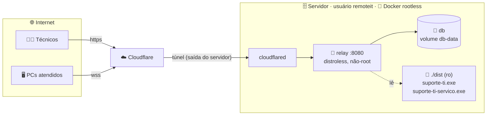
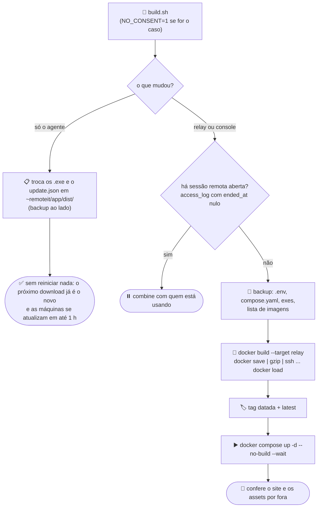

# ☁️ Deploy

> 🗣️ **Em palavras simples:** em produção, o relay e o banco rodam em containers Docker num servidor Linux, e um túnel da Cloudflare publica o site sem abrir nenhuma porta. Os dois `.exe` do agente ficam numa pasta que o relay serve para download. Atualizar o agente é trocar o arquivo; atualizar o relay é trocar a imagem e reiniciar o container.



## 🐳 Docker Compose (recomendado)

```bash
cp .env.example .env     # senhas, chave do agente, admin inicial
RELAY=wss://suporte.seudominio.com.br AGENT_KEY='mesma-do-.env' ./build.sh   # gera os dois .exe e o relay em dist/
docker compose up -d --build
docker compose logs -f relay
```

- `db`: PostgreSQL 19 com volume `db-data`. Não é exposto fora da rede do compose.
- `relay`: imagem distroless (sem shell), usuário não-root, HTTP em `127.0.0.1:${RELAY_PORT}`. Aplica
  as migrations e cria o admin inicial ao iniciar. Serve `./dist/suporte-ti.exe` em `/download/agent.exe` e `./dist/suporte-ti-servico.exe` em `/download/agent-servico.exe`, sempre com `Cache-Control: no-store, private`.
- `tunnel` (opcional, `--profile tunnel`): Cloudflare Tunnel com `TUNNEL_TOKEN`; a rota no painel da
  Cloudflare deve apontar para `http://relay:8080`.

O relay roda com `-insecure` porque o TLS termina no túnel ou proxy. Para TLS no próprio relay, rode o
binário com `-domain` (Let's Encrypt, porta 443 pública) ou `-cert/-key`.

## 🔧 Variáveis de ambiente

| Variável | Usada por | Descrição |
| --- | --- | --- |
| `POSTGRES_PASSWORD` | db, relay | Senha do banco. Vai em URL: evite `@ : / ? #` |
| `RELAY_AGENT_KEY` | relay | ≥ 16 caracteres; a chave dos agentes **legados**, a mesma embutida no agente pelo `build.sh` |
| `RELAY_LEGACY_AGENTS` | relay | `true` (padrão) aceita agentes antigos, sem cadastro, visíveis só para admins; `false` os recusa — use depois de reinstalar todas as máquinas |
| `RELAY_ADMIN_USER` / `RELAY_ADMIN_PASS` | relay | Admin criado só se o banco não tiver usuários |
| `RELAY_BIND` / `RELAY_PORT` | compose | Onde publicar o relay (padrão `127.0.0.1:8080`) |
| `RELAY_CLIENT_IP_HEADER` | relay | Cabeçalho com o IP real do técnico para a auditoria (`Cf-Connecting-IP` atrás do Cloudflare Tunnel). Só use se o relay não for acessível sem o túnel: o cabeçalho pode ser falsificado |
| `RELAY_PUBLIC_URL` | relay | Base dos links dos e-mails (`https://dominio`). Nunca vem do cabeçalho `Host`, que pode ser forjado |
| `RELAY_ADMIN_EMAIL` | relay | Quem confirmar esta caixa no cadastro vira admin aprovado; recebe aviso de conta pendente |
| `SMTP_HOST` / `SMTP_PORT` | relay | Servidor SMTP (porta padrão 587). Sem host, cadastro e recuperação ficam desligados |
| `SMTP_USER` / `SMTP_PASSWORD` / `SMTP_STARTTLS` | relay | Credenciais; com senha, STARTTLS é obrigatório |
| `EMAIL_REMETENTE` / `EMAIL_REMETENTE_NOME` | relay | Remetente verificado no provedor |
| `TUNNEL_TOKEN` | tunnel | Token do Cloudflare Tunnel |

## 🚩 Flags do relay

| Flag | Descrição |
| --- | --- |
| `-addr` | endereço de escuta (padrão `:443`) |
| `-domain` | TLS automático Let's Encrypt para o domínio (precisa da 443 pública) |
| `-cert-cache` | pasta dos certificados do `-domain` (padrão `certs`) |
| `-cert` / `-key` | TLS com certificado próprio |
| `-insecure` | HTTP puro, atrás de proxy reverso ou túnel (é o modo do compose) |
| `-agent-exe` | `.exe` portátil servido em `/download/agent.exe` |
| `-agent-service-exe` | `.exe` de serviço em `/download/agent-servico.exe` (padrão: `suporte-ti-servico.exe` ao lado do `-agent-exe`) |
| `-healthcheck` | consulta `/healthz` e sai com 0 se saudável (para o Docker) |

## ✉️ Contas por e-mail

1. Faça backup do banco (a migration `0002_accounts` roda ao iniciar).
2. Preencha `RELAY_PUBLIC_URL`, `RELAY_ADMIN_EMAIL`, `SMTP_*` e `EMAIL_*` no `.env`.
3. Atualize também o `compose.yaml` do servidor: é ele que repassa as variáveis ao container.
4. Suba o relay. Quem já tinha conta entra como antes e associa um e-mail pela faixa do console.

**Admin sem senha no ambiente:** num banco novo, deixe `RELAY_ADMIN_PASS` vazio e crie a conta com o
`RELAY_ADMIN_EMAIL`. Num banco existente, associe esse e-mail ao admin atual **ou** crie uma conta
com ele: um e-mail pertence a uma conta só.

**Entrega:** remetente `@gmail.com` enviado por outro servidor não passa no DMARC e pode cair no spam.
O definitivo é autenticar um domínio próprio no provedor (DKIM e DMARC) e trocar `EMAIL_REMETENTE`.

**Voltar para uma versão sem contas:** ela não conhece `pending` e deixaria contas não aprovadas
entrarem. Antes de voltar, rode `DELETE FROM users WHERE pending;`.

## 🔁 Migração do deploy anterior (systemd + HTTP Basic)

O protocolo do agente não mudou: **agentes já distribuídos continuam funcionando** se o relay novo
usar o mesmo `RELAY_AGENT_KEY`. O que muda é o login do console (usuário e senha) e a necessidade de
um banco.

1. Faça backup do `relay.env` atual.
2. No `.env` do compose: `RELAY_AGENT_KEY` = o mesmo do `relay.env`; `RELAY_ADMIN_PASS` = a senha do
   console atual (vira a senha do usuário `admin`); `RELAY_PORT` = a porta para onde o túnel aponta hoje.
3. `sudo systemctl stop remoteit-relay && sudo systemctl disable remoteit-relay` e `docker compose up -d --build`.
4. Teste o login com `admin` e cadastre os técnicos. Para voltar, pare o compose e reative o serviço.

## 👤 Servidor com Docker rootless (um usuário por app)

É o modelo do servidor de produção: cada app tem um usuário Linux com seu próprio Docker rootless, e
nenhum container roda como root no host. Montagem para o RemoteIT (como admin):

```bash
sudo useradd -m -s /bin/bash remoteit
sudo usermod --add-subuids <início>-<fim> --add-subgids <início>-<fim> remoteit   # faixa livre de 65536 em /etc/subuid
sudo loginctl enable-linger remoteit           # serviços do usuário sobem no boot, sem login
sudo -u remoteit XDG_RUNTIME_DIR=/run/user/$(id -u remoteit) dockerd-rootless-setuptool.sh install
sudo -u remoteit XDG_RUNTIME_DIR=/run/user/$(id -u remoteit) systemctl --user enable docker   # o setuptool nem sempre habilita
```

O app fica em `~remoteit/app/` (`compose.yaml`, `.env` com modo 600, `dist/suporte-ti.exe` e `dist/suporte-ti-servico.exe` com modo 644).
Sem registry, a imagem vai por `docker save remoteit-relay:latest | gzip | ssh ... docker load`, e o
compose sobe com `docker compose up -d --no-build --wait`. Com o Docker rootless, o IP de origem que o
container vê é o do slirp4netns, por isso o `RELAY_CLIENT_IP_HEADER` é necessário para auditar o IP real.

## 💾 Backup do banco

```bash
docker compose exec -T db pg_dump -U remoteit -Fc remoteit > remoteit-$(date +%F).dump   # backup
docker compose exec -T db pg_restore -U remoteit -d remoteit --clean < remoteit-AAAA-MM-DD.dump  # restauração
```

## 🛠️ Build do agente sem instalar Zig

```bash
RELAY=wss://suporte.seudominio.com.br AGENT_KEY='...' docker build --target agent-windows \
  --secret id=relay,env=RELAY --secret id=agent_key,env=AGENT_KEY --output dist .
```

A chave entra por `--secret` e não fica no histórico da imagem, mas fica embutida no `.exe`, como no
`build.sh`: quem tem o `.exe` tem a chave.

## 🙋 Agente sem a caixa de consentimento

`NO_CONSENT=1 RELAY=... AGENT_KEY=... ./build.sh` gera um `.exe` que transmite sem pedir "Permitir
acesso remoto?". A auditoria continua registrando todos os acessos. Use apenas com o aviso ou
consentimento da empresa aos usuários — sem isso, a pessoa pode ser observada sem perceber. O padrão
(sem a variável) é pedir confirmação. UAC e o SmartScreen do Windows são do sistema e não somem por
aqui: só com um `.exe` assinado por certificado ou política de domínio.

## 🔑 Chave de atualização (guarde uma cópia!)

O `build.sh` assina cada versão com a chave em `~/.config/remoteit/update-ed25519.key` (criada na
primeira vez; `UPDATE_KEY` muda o caminho). Os agentes só aceitam atualizações assinadas por ela
([ADR 0011](adr/0011-atualizacao-automatica.md)).

* 💾 **Faça uma cópia offline** (pendrive, cofre de senhas). Perdê-la obriga a reinstalar todos os
  agentes à mão uma vez.
* 🚫 **Nunca** copie a chave para o servidor nem para o repositório: o servidor recebe só o
  `dist/update.json`, que tem as assinaturas.
* 🧪 Teste a versão nova numa máquina antes de publicar: em até 1 hora todas se atualizam sozinhas.

## 🚀 Publicar uma versão nova



| Passo | Comando |
|---|---|
| Ver sessões abertas | `docker compose exec -T db psql -U remoteit -d remoteit -Atc "select count(*) from access_log where ended_at is null"` |
| Trocar um `.exe` | `install -o remoteit -g remoteit -m 644 suporte-ti-servico.exe ~remoteit/app/dist/` |
| Voltar o relay | `docker tag remoteit-relay:<tag-anterior> remoteit-relay:latest && docker compose up -d --no-build --wait` |

> ⚠️ Reiniciar o relay com uma sessão aberta derruba o técnico e deixa a linha da auditoria com `ended_at` nulo. Os agentes reconectam sozinhos em segundos.

> 💡 O relay grava o código do técnico em cada `.exe` baixado, então o hash do arquivo em `dist/` não é o hash que o técnico recebe. Um `.exe` de um build antigo (sem o espaço do código) faz o download responder **503 "agente do servidor desatualizado"**: refaça o `build.sh`.
