# 🧭 Fluxos do RemoteIT

> 🗣️ **Em palavras simples:** este documento conta, passo a passo, o que acontece por baixo de cada coisa que o usuário faz: abrir o agente, o técnico clicar em **Conectar**, um quadro de vídeo atravessar a internet, uma tecla chegar ao Windows, a tela de bloqueio aparecer, alguém criar uma conta. Cada fluxo tem um diagrama e aponta o código que o implementa.

Os diagramas são [Mermaid](https://mermaid.js.org/): o GitHub os desenha sozinho.

| # | Fluxo | Em uma frase |
|---|---|---|
| 1️⃣ | [Agente entra no ar](#agente) | o PC liga para o relay e fica esperando |
| 2️⃣ | [Login do técnico](#login) | usuário e senha viram um cookie de 12 h |
| 3️⃣ | [Sessão remota](#sessao) | do clique em **Conectar** ao primeiro quadro, e o fim |
| 4️⃣ | [Pipeline de vídeo](#video) | da GPU do PC à GPU do técnico |
| 5️⃣ | [Controle de fluxo e bitrate](#fluxo) | por que a imagem não "atrasa" |
| 6️⃣ | [Mouse e teclado](#entrada) | do evento no navegador ao `SendInput` |
| 7️⃣ | [Bloquear a tela e trocar de usuário](#bloqueio) | Win+L remoto e login com outra conta |
| 8️⃣ | [Modo serviço: tela de login e bloqueio](#servico) | o serviço, o worker SYSTEM e os desktops do Windows |
| 9️⃣ | [Instalar, atualizar e remover](#instalar) | o que cada `.exe` faz com dois cliques |
| 🔟 | [Dois técnicos na mesma máquina](#dois-tecnicos) | o segundo assume |
| 1️⃣1️⃣ | [Contas por e-mail](#contas) | cadastro, aprovação, recuperação e vínculo |
| 1️⃣2️⃣ | [Entregar uma versão nova do agente](#entrega) | por que o download nunca vem do cache |
| 1️⃣3️⃣ | [Máquinas por técnico](#maquinas) | o `.exe` marcado, o cadastro e o link de instalação |
| 1️⃣4️⃣ | [Atualização automática](#atualizacao) | o agente se troca sozinho pela versão que o relay anuncia |
| 1️⃣5️⃣ | [Visualizador do técnico](#visualizador) | o mesmo protocolo, num programa Windows: teclado inteiro e área de transferência |

---

<a id="agente"></a>
## 1️⃣ Agente entra no ar

> 🗣️ **Em palavras simples:** ao abrir, o agente liga para o relay como um navegador abriria um site seguro e se apresenta com a **credencial da máquina** (o "RG" que ela ganhou no cadastro, [fluxo 13](#maquinas)). Se ainda não tem, ele se cadastra primeiro com o código que veio gravado no `.exe`. Depois fica com a linha aberta; se ela cair, liga de novo, esperando cada vez um pouco mais (até 30 s).

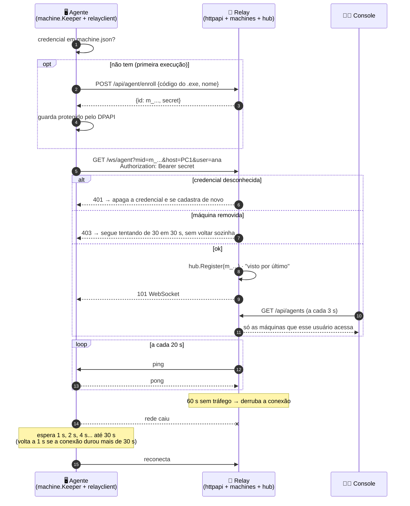

| Detalhe | Valor | Onde |
|---|---|---|
| ID da máquina | aleatório, `m_` + 16 caracteres; o nome do computador é só exibição | `internal/relay/machines` |
| Credencial | 256 bits; no banco só o SHA-256; no PC, DPAPI em `machine.json` | `internal/agent/machine` |
| Backoff | 1 s, dobrando até 30 s; volta a 1 s após 30 s conectado | `internal/agent/relayclient` |
| Keepalive | ping a cada 20 s; leitura expira em 60 s | `relayclient`, `httpapi` |
| Mesma máquina duas vezes | a conexão nova substitui a antiga (só com a mesma credencial) | `internal/relay/hub` |
| Agente antigo (sem cadastro) | `?id=nome&key=chave`: com `RELAY_LEGACY_AGENTS=true`, aceito como **legado** (só admins veem); em produção está `false` e ele recebe 403 | `RELAY_LEGACY_AGENTS` |

> ⚠️ **Duas cópias com a mesma credencial se derrubam** em loop ("conectado/desconectado" no log do relay). Por isso o agente portátil sai em silêncio quando já há outra cópia ou o serviço rodando ([fluxo 9](#instalar)). Portátil e serviço no mesmo PC têm credenciais diferentes e aparecem como duas máquinas.

---

<a id="login"></a>
## 2️⃣ Login do técnico

> 🗣️ **Em palavras simples:** a senha nunca é guardada, só um "resumo" dela (bcrypt), que não dá para desfazer. Ao acertar a senha, o relay entrega ao navegador um número aleatório (o token da sessão) num cookie que o JavaScript não consegue ler. No banco fica só o resumo desse número: quem roubar o banco não consegue se passar por ninguém.

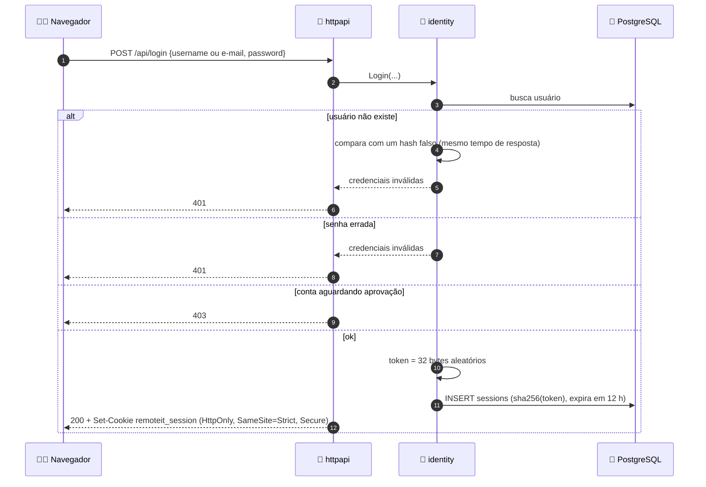

* 🕵️ **Mesmo tempo para "não existe" e "senha errada":** sem isso, medir o tempo da resposta revelaria quais usuários existem.
* 🍪 **`SameSite=Strict` + `Content-Type: application/json` obrigatório:** um site de terceiros não consegue disparar ações com o cookie do técnico (CSRF). Veja [SEGURANCA.md](SEGURANCA.md).

---

<a id="sessao"></a>
## 3️⃣ Sessão remota: do clique ao primeiro quadro

> 🗣️ **Em palavras simples:** quando o técnico clica em **Conectar**, o relay primeiro **anota** o acesso (se não conseguir anotar, não deixa entrar), depois avisa o agente. O agente pergunta ao usuário do PC se ele permite (a não ser no build sem consentimento), e só então começa a mandar a tela e a aceitar mouse e teclado.

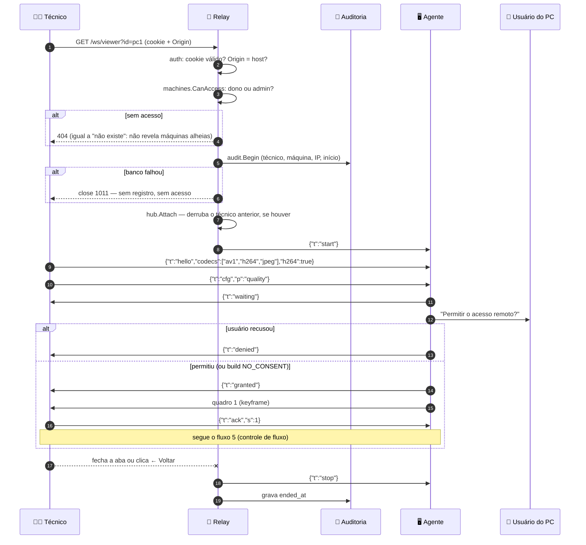

### 🔄 Estados da sessão no agente

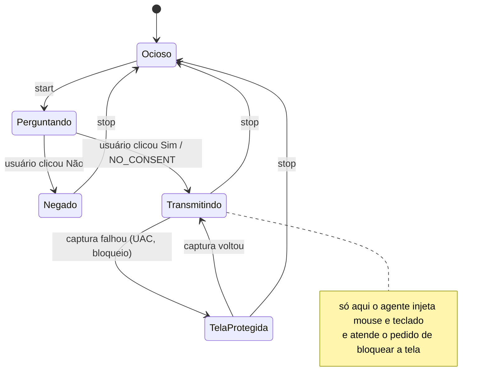

| Mensagem para o técnico | O console mostra |
|---|---|
| `waiting` | "aguardando o usuário permitir" |
| `granted` | a tela remota |
| `denied` | "o usuário recusou" |
| `secure` | "tela protegida por UAC/bloqueio — aguardando" (retoma sozinho) |

* 🔒 **Entrada só depois do consentimento:** o agente descarta mouse, teclado e o pedido de bloqueio enquanto `granted` não for verdadeiro ([`internal/agent/session`](../internal/agent/session)). O teste `TestInputOnlyAfterConsent` prova isso.
* 🎬 **Qual codec:** o `hello` traz a lista do que o técnico decodifica, em ordem de preferência; o agente abre o primeiro que conseguir ([negociação](#codecs)). Sem `hello` em 1,5 s, o agente assume JPEG.

---

<a id="video"></a>
## 4️⃣ Pipeline de vídeo: da GPU do PC à GPU do técnico

> 🗣️ **Em palavras simples:** a tela é copiada direto da placa de vídeo, reduzida para o tamanho da janela do técnico e comprimida ali mesmo em H.264 (o mesmo formato de um vídeo do YouTube), sem passar pelo processador. O técnico descomprime também na placa de vídeo dele. Só as partes da tela que **mudaram** recebem vídeo; as que pararam ganham, logo depois, uma cópia **exata** (PNG), que fica até mudarem de novo. Placas novas podem usar AV1, que gasta menos internet; o visualizador do técnico e o console podem pedir a cor completa (4:4:4). Sem placa de vídeo, o plano B é tirar "fotos" JPEG da tela.

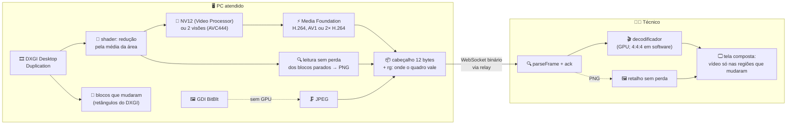

| Etapa | Código | Observação |
|---|---|---|
| Captura + redução + encoder | [`internal/agent/media/gpu`](../internal/agent/media/gpu) (C em `rcenc.h`) | H.264, AVC444 e AV1; a redução é um shader com o filtro de [`internal/scale`](../internal/scale) (testado contra ele no Wine); compilado com Zig; sem Zig, o build sai só com JPEG |
| Blocos que mudaram e sem perda | [`media/tiles.go`](../internal/agent/media/tiles.go), [`media/still.go`](../internal/agent/media/still.go) | grade de 64 px: o que o técnico mostra com perda (vídeo) e sem perda (PNG) |
| Arranjo do 4:4:4 | [`internal/avc444`](../internal/avc444/avc444.go) | a referência que o shader do agente, o visualizador e o console seguem |
| Fallback | [`media/capture`](../internal/agent/media/capture), [`media/jpeg`](../internal/agent/media/jpeg) | GDI + `image/jpeg`; qualidade 25–85 conforme o bitrate; redução pela média da área |
| Laço de transmissão | [`media/stream.go`](../internal/agent/media/stream.go) | abre a fonte, mede, manda região e retalhos, stats 1x/s |
| Formato do quadro | [`internal/protocol`](../internal/protocol) + [`frontend/src/lib/protocol.ts`](../frontend/src/lib/protocol.ts) | veja [ARQUITETURA.md](ARQUITETURA.md#protocolo) |
| Desenho no console | [`session.ts`](../frontend/src/lib/viewer/session.ts), [`render.ts`](../frontend/src/lib/viewer/render.ts) | fila de desenho em ordem; WebGL2 (ou 2D); fora do Svelte ([ADR 0003](DECISOES.md#adr-0003)) |
| Desenho no visualizador | [`internal/viewer/render`](../internal/viewer/render) (C em `rcrend.h`) | Direct3D 11; sem ele, GDI ([fluxo 15](#visualizador)) |

<a id="codecs"></a>
### 🎞️ Codecs e negociação

| Codec | Quem decodifica | Quando o agente usa |
|---|---|---|
| **H.264 4:4:4 (AVC444)** | o visualizador nativo (Media Foundation) e o console (duas visões em software, cor recomposta em WebGL), com **Cor 4:4:4** ligada | encoder H.264 de GPU e preset sem redução própria (Nítido, Máximo) |
| **AV1** | navegador ou visualizador que decodifica AV1 na GPU | encoder AV1 de GPU (RTX 40+, Arc / Core Ultra, RX 7000+) |
| **H.264** | qualquer navegador; o visualizador | sempre que há encoder (GPU ou software) |
| **JPEG** | todos | sem encoder de vídeo, ou se os outros falharam |

* 📋 **Quem decide é a lista do técnico:** o `hello` leva os codecs em ordem de preferência (4:4:4, AV1, H.264, JPEG; o console só oferece 4:4:4 com WebGL2 e decodificação H.264 em software). O agente abre o primeiro que conseguir e pula o que não serve para o preset (4:4:4 nos presets que reduzem por conta própria). Código: [`media/stream.go`](../internal/agent/media/stream.go) (`openCodec`).
* 🩹 **Falhou, troca sozinho:** um encoder que não abre, ou que quebra no meio, fica marcado e o próximo entra. Do lado do técnico, três falhas seguidas do decodificador (ou AV1 que engole 120 quadros sem mostrar nada, ou o 4:4:4 em software que não dá conta e acumula fila) tiram o codec do `hello`, e o agente troca.
* 🎨 **Como o 4:4:4 cabe no H.264 comum:** o agente manda duas imagens 4:2:0. A principal é um H.264 normal; a auxiliar carrega a cor que a principal descarta. O técnico junta as duas e recupera a cor de cada pixel. Detalhes e medições: [ADR 0013](DECISOES.md#adr-0013).
* 🗝️ **Keyframe só quando precisa:** no começo, ao trocar de codec ou de tamanho, e quando o técnico pede (`kf`). Sobre TCP nada se perde, e um keyframe numa tela de escritório custa ~300× um quadro comum ([ADR 0014](DECISOES.md#adr-0014)).

### 🎚️ Presets de qualidade

| Preset (`cfg.p`) | No console | Largura máx. | FPS | Bitrate (mín. · início · máx.) |
|---|---|---|:---:|---|
| `turbo` | Ultra-rápido | 1280 px | 60 | 1 · 4 · 10 Mbps |
| `balanced` | Equilibrado | 1920 px | 60 | 2 · 8 · 20 Mbps |
| `quality` (padrão) | Nítido | a da janela | 60 | 3 · 12 · 40 Mbps |
| `quality60` | Máximo | a da janela | 60 | 5 · 25 · 80 Mbps |

* 📐 **O vídeo sai do tamanho da janela do técnico:** o `cfg` leva, junto com o preset, a área onde a tela aparece, em pixels físicos (`vw`, `vh`). O agente reduz a tela para caber nela, nunca amplia, e só reabre o encoder se o tamanho de saída mudar de fato (o técnico espera 400 ms a janela parar de mudar antes de mandar). No **Tamanho real (1:1)** a área vai como 0 x 0: a resolução nativa. Assim uma tela 4K numa janela 1080p não manda 4× os pixels para o navegador jogar fora reduzindo com um filtro pior. Código: `Stream.SetViewport`, [`internal/scale`](../internal/scale).
* 🖱️ **Cursor por cima do vídeo:** o agente manda a posição (`cur`) e o formato (`cs`) do cursor separados, e o técnico desenha o cursor local. Ele se move na hora, mesmo que o quadro ainda esteja a caminho. Mexer só o mouse não gera quadro: o DXGI avisa, mas a imagem não mudou.
* 🔁 **Refino com a tela parada:** quando nada muda, o agente recodifica o último quadro mais duas vezes (`FlagRepeat`) para deixar o vídeo mais nítido, só se ainda há área mostrando vídeo.
* 🔍 **Sem perda, por partes:** cada bloco de 64 px que fica 300 ms sem mudar ganha um retalho **PNG** exato, lido da própria imagem reduzida na GPU (codec 6, vários retalhos num quadro só; com 60% da tela pronta, vai a tela inteira, codec 3). Antes de cada quadro de vídeo, a mensagem **`rg`** diz onde ele vale: só nos blocos que mudaram desde o último retalho. Fora deles, o técnico mantém os pixels exatos. Um cursor de texto piscando num canto não borra mais a tela toda. Um retalho cuja área mudou durante a compressão é descartado (mostraria conteúdo velho), e tudo cabe em 2 s de banda do alvo. Código: [`media/tiles.go`](../internal/agent/media/tiles.go), [`media/still.go`](../internal/agent/media/still.go); decisões: [ADR 0009](DECISOES.md#adr-0009) e [ADR 0014](DECISOES.md#adr-0014).
* 🧮 **Ordem no técnico:** os quadros de vídeo decodificam em paralelo e os PNG também; o técnico aplica tudo na ordem de chegada (uma fila de desenho), para um retalho não ser coberto por um vídeo mais velho nem cobrir um mais novo.
* 🔎 **Exibição sem interpolação:** o console posiciona e dimensiona o canvas em **pixels físicos** do monitor (`devicePixelRatio`), não em CSS px, e arredonda para pixels inteiros. No modo **1:1 (Tamanho real)** cada pixel remoto ocupa exatamente um pixel do monitor, com rolagem se não couber; no modo ajustado, se sobra até 10% de espaço ele também usa 1:1 em vez de ampliar um pouco e borrar tudo. A escolha fica no `localStorage`.

---

<a id="fluxo"></a>
## 5️⃣ Controle de fluxo e bitrate

> 🗣️ **Em palavras simples:** se o agente mandasse quadros mais rápido do que a internet aguenta, eles ficariam numa fila, e o técnico veria a tela de segundos atrás. Por isso o técnico **confirma** cada quadro que recebe, e o agente só deixa alguns sem confirmação no caminho: **dois** numa rede local e até **oito** quando a internet é lenta. E ele mede a **fila**: quanto o RTT de agora passa do menor RTT recente. Fila crescendo é sinal de que a banda não dá conta: a qualidade cai antes de o atraso aparecer. A qualidade só sobe quando a banda foi de fato usada sem fila.

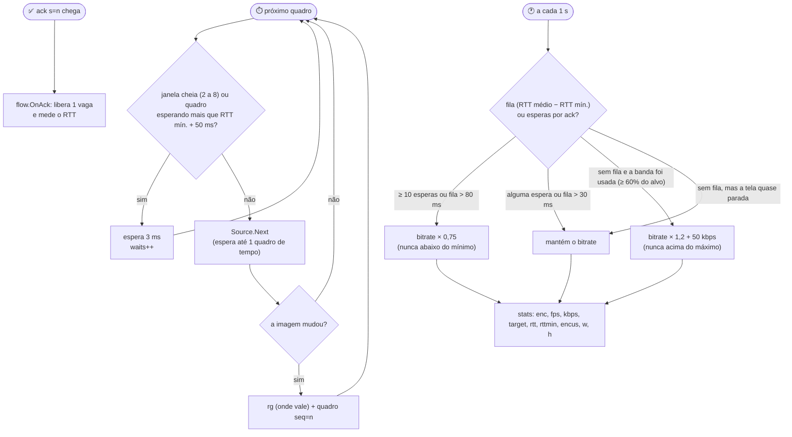

| Regra | Valor | Onde |
|---|---|---|
| Quadros em trânsito | a janela: os quadros que cabem no menor RTT visto, mais um, entre 2 e 8. Com 60 fps: 2 em LAN, 5 com 50 ms, 8 com 140 ms (~57 fps). Usa o **menor** RTT para a própria fila não aumentar a janela | [`media/flow.go`](../internal/agent/media/flow.go) (`Window`, `TestFlowControlWindowFollowsRTT`) |
| Quadro velho sem ack | se o mais antigo passa do menor RTT + 50 ms (`QueueBudget`; mínimo 50 ms), espera mesmo com vaga na janela: é fila se formando. Um valor fixo, não proporcional ao RTT: o antigo 3× deixava a fila chegar a ~420 ms com o relay atrás de um túnel | `TestFlowControlWideWindowStillStopsOnQueue` |
| Menor RTT | o menor dos últimos 10 s (não a última amostra, que pode estar inflada pela própria fila) | `FlowControl.ResetMinRTT` |
| Quando o técnico confirma | assim que o quadro chega, antes de decodificar (navegador e visualizador): o tempo de decodificar não entra no RTT | `session.ts`, `viewer/client` |
| Ack perdido | depois de 3 s sem ack, o agente supõe que ele se perdeu e libera a vaga | `flow.go` (teste `TestFlowControlLostAck`) |
| Ack falso ou repetido | ignorado | `TestFlowControlIgnoresBogusAcks` |
| Queda de bitrate | −25% por segundo com fila de verdade: ≥ 10 esperas de 3 ms (`CongestedThreshold`) ou fila > 80 ms (`QueueHigh`) | [`media/rate.go`](../internal/agent/media/rate.go), `TestRateControl` |
| Segura | 1 a 9 esperas, ou fila entre 30 e 80 ms (`QueueLow`). Pela Cloudflare um atraso pontual é comum e não deve derrubar a qualidade | `RateControl.Next` |
| Subida de bitrate | +20% + 50 kbps por segundo sem fila, **só se o alvo foi de fato usado** (≥ 60%). Com a tela quase parada o encoder manda bem menos que o alvo; subir nesse tempo (como antes) fazia a primeira rolagem sair com o bitrate máximo e entupir o link | `RateControl.Next` |
| Encoder lento | captura + codificação acima de 60% do tempo de um quadro por 2 s seguidos: o encoder passa a priorizar velocidade (qualidade × velocidade 100 → 50 → 0) | `SpeedTuner`, `TestStatsAndSlowEncoder` |
| Buffer do encoder | 4 quadros no bitrate alvo (~67 ms a 60 fps): nenhum quadro leva mais que isso para passar num link que dá conta do alvo | `rcenc.h` (`enc_buffers`) |
| Keyframe sob pedido | `kf` descarta o que está em trânsito | `Stream.RequestKeyframe` |

---

<a id="entrada"></a>
## 6️⃣ Mouse e teclado

> 🗣️ **Em palavras simples:** o navegador transforma a posição do mouse em "porcentagem da tela" (0 a 1), para funcionar com qualquer resolução. As teclas vão com o nome físico (`KeyA`) e o caractere (`a`, `ç`). No Windows, letras e acentos são digitados como **caractere**, e não como tecla: assim o `ç` sai certo mesmo que o teclado do PC remoto seja americano.

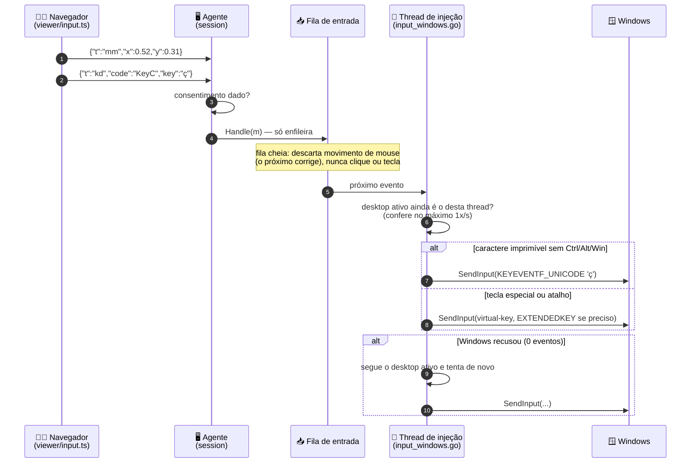

* 🧵 **Por que uma thread só para isso?** No Windows, cada thread está presa a um **desktop** (a área de trabalho normal ou a tela de login), e o `SendInput` só alcança o desktop da thread que o chama. A goroutine que lê a conexão pula de thread em thread, então a injeção roda numa thread fixa que acompanha o desktop ativo ([fluxo 8](#servico)).
* 🧭 **Coordenadas:** `x, y` em [0,1] viram coordenadas absolutas do Windows (0–65535) no monitor principal.
* ⌨️ **Tabela de teclas:** `KeyboardEvent.code` → virtual-key em [`internal/agent/input/keymap.go`](../internal/agent/input/keymap.go) (testada em `keymap_test.go`).
* 🖵 **Tela cheia:** a Keyboard Lock API deixa o navegador capturar Win, Alt+Tab e Esc, que normalmente o sistema do técnico tomaria para si.

---

<a id="bloqueio"></a>
## 7️⃣ Bloquear a tela e trocar de usuário

> 🗣️ **Em palavras simples:** o Windows **não aceita** Win+L simulado: é uma proteção para um programa não conseguir trancar a sessão de alguém. Então o botão 🔒 do console manda uma mensagem própria, e o agente chama a função oficial do Windows que bloqueia a tela. Para depois logar com outra conta pela tela de bloqueio, o agente precisa estar no **modo serviço**.

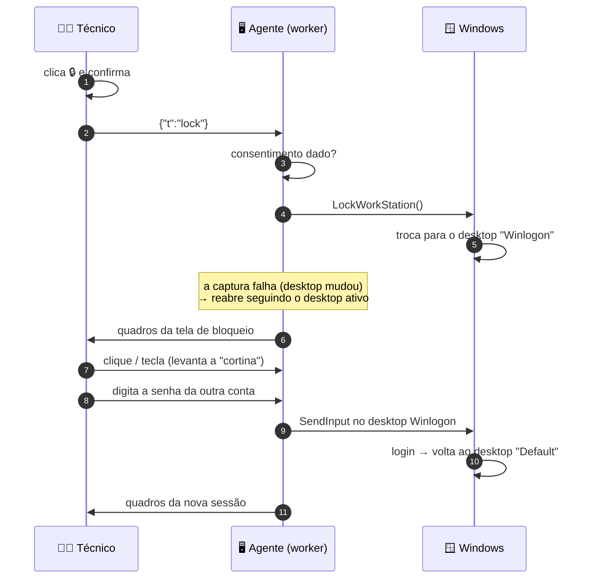

| Agente | 🔒 bloqueia? | Vê a tela de bloqueio? | Digita a senha? |
|---|:---:|:---:|:---:|
| ▶️ Portátil (`suporte-ti.exe`) | ✅ | ❌ "tela protegida" | ❌ |
| 🧩 Serviço (`suporte-ti-servico.exe`) | ✅ | ✅ | ✅ |

> ⚠️ Se o PC exigir **Ctrl+Alt+Del** antes do login (política de grupo), o login remoto para nessa tela: o Windows não deixa nenhum programa simular essa combinação.

---

<a id="servico"></a>
## 8️⃣ Modo serviço: a tela de login e de bloqueio

> 🗣️ **Em palavras simples:** a tela de login do Windows é especial. Ela roda como o próprio sistema, numa "mesa" separada (o desktop **Winlogon**), e o Windows ignora cliques e teclas que venham de programas comuns. Para alcançá-la, o agente precisa rodar **como o sistema** (SYSTEM) e **mudar de mesa** junto com o Windows.

### 🏢 Quem roda onde

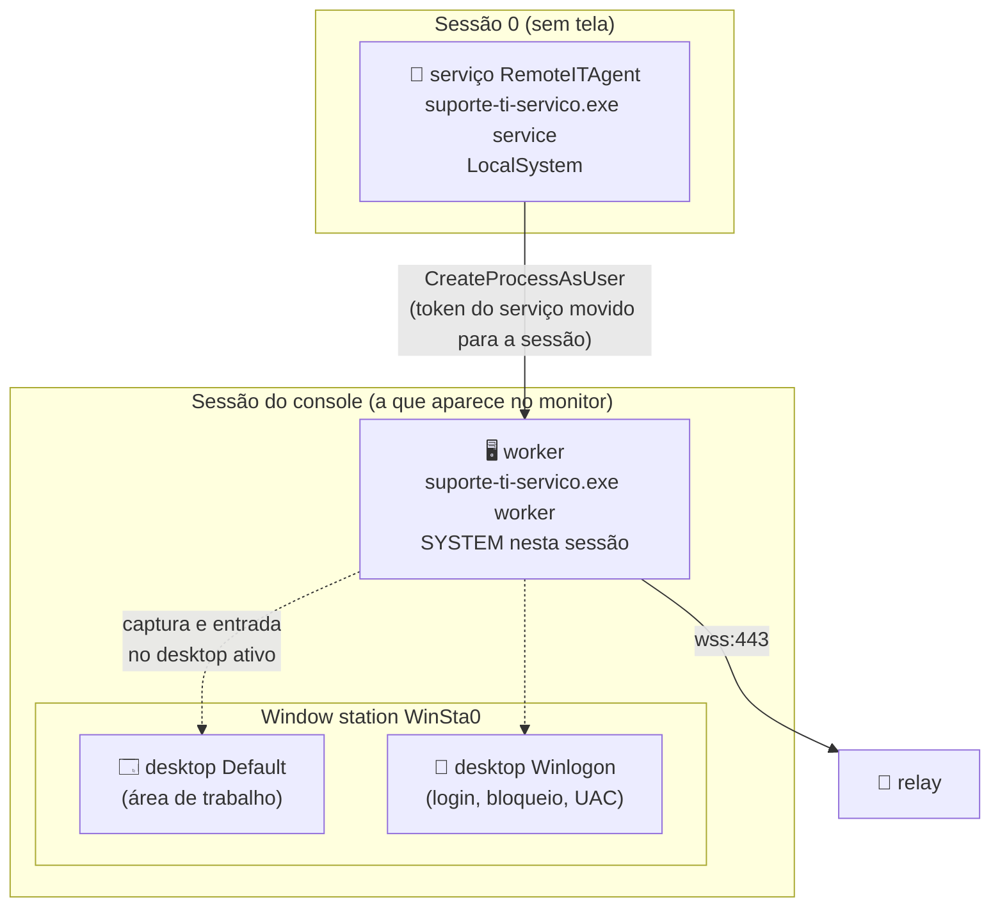

### 🔁 O serviço vigia a sessão

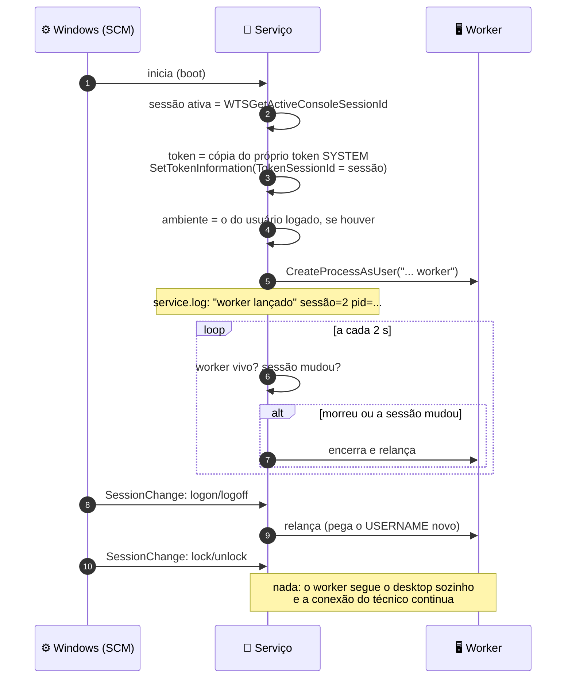

### 🧵 Por que SYSTEM, e por que trocar de thread

| Problema | Sintoma que aparecia | Solução no código |
|---|---|---|
| A captura via o desktop errado | tela congelada ao bloquear | toda (re)abertura da captura chama `desktop.FollowInput` → `OpenInputDesktop` + `SetThreadDesktop` ([`internal/agent/desktop`](../internal/agent/desktop)) |
| **UIPI**: o Windows descarta entrada de um processo de integridade média para a tela de login (SYSTEM) | a tela de bloqueio aparecia, mas cliques e teclas não chegavam | o worker roda com o **token SYSTEM** do serviço, movido para a sessão ([`lifecycle_windows.go`](../internal/agent/lifecycle/lifecycle_windows.go)) |
| `SetThreadDesktop` falha numa thread que já tem janelas, e o Media Foundation cria janelas ocultas | "tela protegida — aguardando" para sempre | a captura roda numa thread do SO **descartável**: se não conseguir mudar de desktop, a thread morre e a captura recomeça numa nova ([`media/stream.go`](../internal/agent/media/stream.go), teste `TestStreamRecoversWhenDesktopCanBeFollowedAgain`) |
| A injeção rodava em qualquer thread | entrada sumia no desktop Winlogon | thread fixa de injeção que segue o desktop ([fluxo 6](#entrada)) |


---

<a id="instalar"></a>
## 9️⃣ Instalar, atualizar e remover

> 🗣️ **Em palavras simples:** o `suporte-ti.exe` só roda. O `suporte-ti-servico.exe` instala: pede a permissão de administrador do Windows, se copia para `C:\Program Files\RemoteIT` e cria o serviço. Rodar um `suporte-ti-servico.exe` mais novo em cima **atualiza**. Nada abre janela, e tudo fica anotado em `C:\ProgramData\RemoteIT\service.log`.


| Comando | O que faz |
|---|---|
| dois cliques em `suporte-ti-servico.exe` | o mesmo que `install` |
| `suporte-ti-servico.exe install` | instala ou atualiza (UAC se preciso) |
| `suporte-ti-servico.exe uninstall` | para, remove o serviço e apaga `%ProgramFiles%\RemoteIT` |
| `suporte-ti.exe` | portátil; `install`/`uninstall` também funcionam nele |

👉 Passo a passo para o usuário, e o que fazer quando algo dá errado: [WINDOWS.md](WINDOWS.md#agente).

---

<a id="dois-tecnicos"></a>
## 🔟 Dois técnicos na mesma máquina

> 🗣️ **Em palavras simples:** cada máquina atende um técnico por vez. Se um segundo técnico conecta, ele assume; o primeiro é desconectado, e cada acesso fica registrado separadamente.

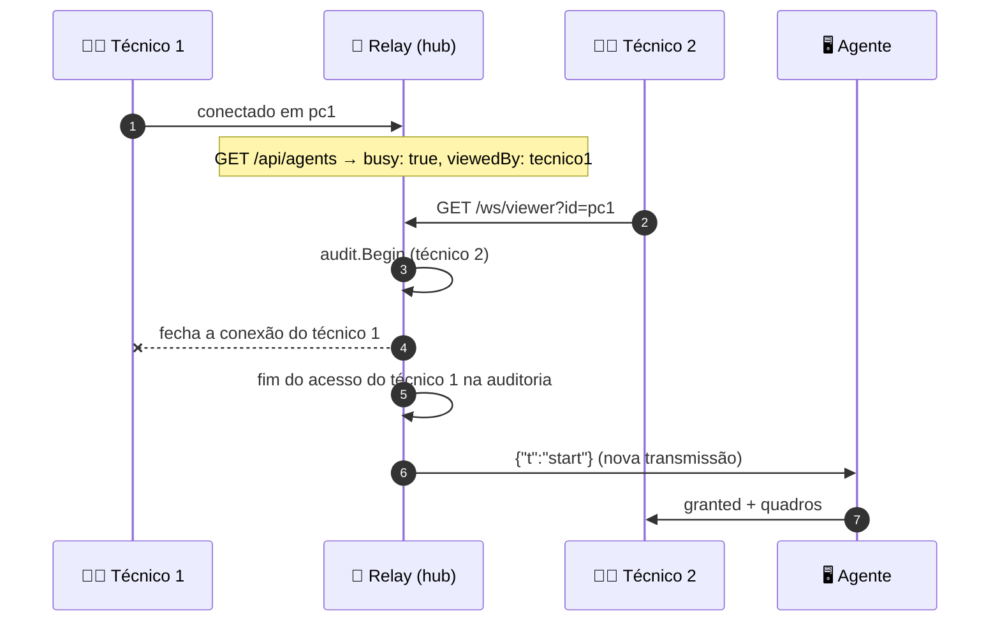

* O `stop` só vale quando quem sai é o **técnico atual**: a saída atrasada do técnico 1 não derruba a sessão do técnico 2 (testado em `internal/relay/hub`).

---

<a id="contas"></a>
## 1️⃣1️⃣ Contas por e-mail

> 🗣️ **Em palavras simples:** quem quer acesso informa o e-mail e recebe um link. Pelo link, escolhe o nome de usuário e a senha. A conta nasce **pendente**, e um administrador precisa aprovar. Esqueceu a senha? Outro link, válido por 1 hora, que troca a senha e derruba todas as sessões abertas. Os links são de uso único, e no banco fica só o resumo (SHA-256) de cada um.

### ✍️ Cadastro e aprovação

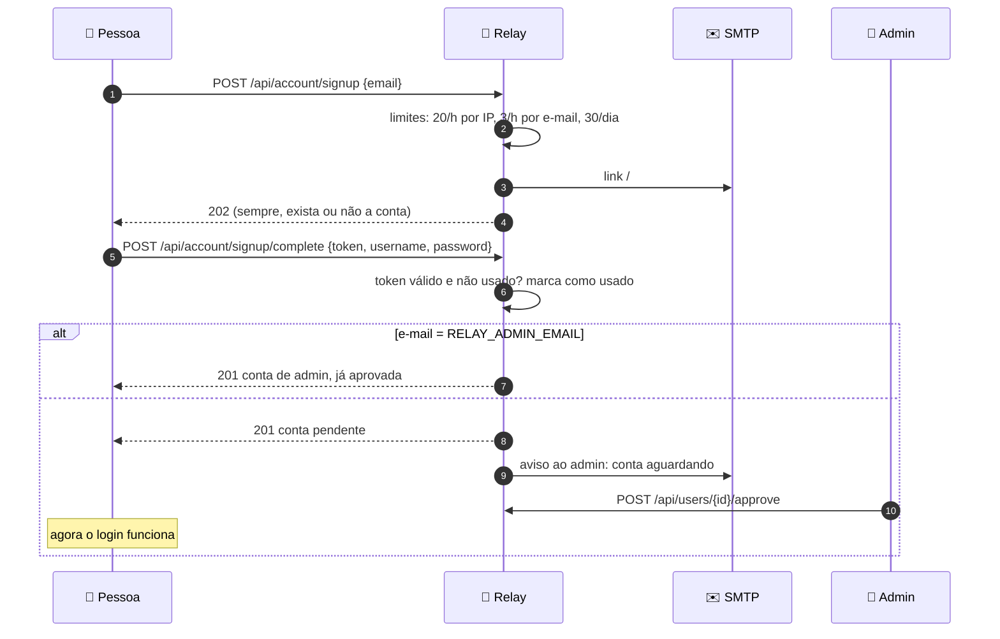

### 🔑 Recuperação de acesso

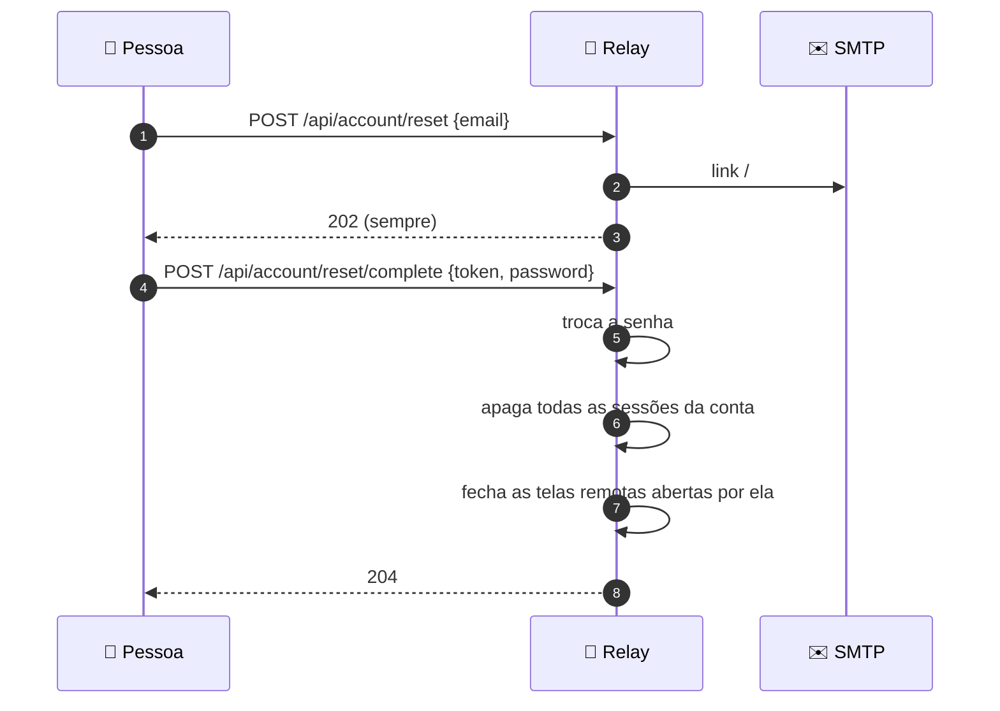

* 🔗 **Vincular e-mail a uma conta antiga:** `POST /api/account/email` (pede a senha) → link `/#/confirmar-email` de 1 h → `POST /api/account/email/complete`. Funciona mesmo se a pessoa abrir o link deslogada.
* 🙈 **202 sempre:** a resposta não revela se o e-mail tem conta.
* 👉 Rotas e códigos de resposta: [ARQUITETURA.md](ARQUITETURA.md#api). Decisão: [ADR 0006](DECISOES.md#adr-0006).

---

<a id="entrega"></a>
## 1️⃣2️⃣ Entregar uma versão nova do agente

> 🗣️ **Em palavras simples:** publicar um agente novo é trocar o arquivo no servidor. O cuidado é garantir que ninguém no caminho (Cloudflare ou o navegador) entregue uma **cópia velha guardada**. Isso já aconteceu: o PC baixava "de novo" e recebia a versão de horas antes.

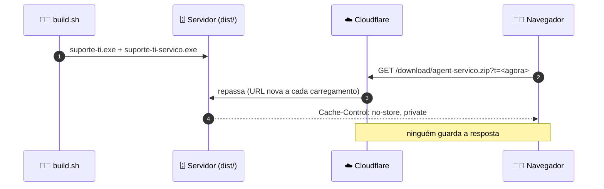

* 🗜️ **Pelo navegador vem um `.zip`:** os botões do console (`/download/*.zip`) e o link de instalação (`/i/<código>`) entregam um `.zip` com o `.exe` e um `LEIA-ME.txt`. Um `.exe` solto é o que os navegadores mais seguram ("não é baixado com frequência") e renomeiam. As rotas `.exe` continuam para `curl`, para a atualização automática e para o comando do PowerShell (`/i/<código>/exe`). Ao rodar o `.exe` extraído, o SmartScreen do Windows ainda pode avisar: o zip não substitui assinatura de código. Código: [`httpapi/zip.go`](../internal/relay/httpapi/zip.go).
* 🏷️ **Cada download é único:** o relay grava o código do técnico no `.exe` ([fluxo 13](#maquinas)), então dois arquivos baixados nunca têm o mesmo hash. Para conferir o que está instalado, veja [WINDOWS.md](WINDOWS.md#conferir-versao).
* 🔐 **Só para quem está logado** (ou com um link de instalação): sem cookie, as rotas de download respondem 401. O `private` impede que um cache compartilhado guarde um arquivo que cadastra máquinas no nome de alguém.

---

<a id="maquinas"></a>
## 1️⃣3️⃣ Máquinas por técnico: `.exe` marcado, cadastro e links

> 🗣️ **Em palavras simples:** cada técnico só vê as máquinas **dele**. Quando ele baixa o agente, o relay grava dentro do `.exe` um código que diz "isto é da Ana". O PC que rodar esse `.exe` troca o código por uma credencial própria e entra na lista da Ana. Ela pode **removê-la**; o admin vê todas. Para o cliente, que não tem conta, a Ana manda um **link de instalação**, que pode ser permanente.

### 🏷️ Do download à máquina na lista

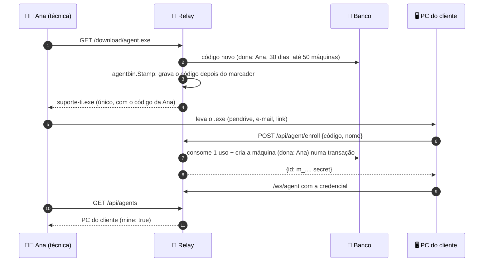

```
suporte-ti.exe (7 MB)
 ... código do agente ...
 ~RemoteIT-enroll-slot-v1~________________________________________   ← build.sh (vazio)
 ~RemoteIT-enroll-slot-v1~kxq4m2...7a___________                      ← depois do download
 ... resto do binário ...
```

* 🔎 O marcador aparece **uma única vez** no binário (o agente nunca usa o marcador sozinho, só o tamanho dele). O relay se recusa a gravar se achar zero ou dois — e o teste de integração confere isso no binário de verdade.
* 🔁 Um `.exe` com **outro código** num PC já cadastrado (outro técnico) cadastra de novo, no nome desse técnico.

### 👀 Quem vê e quem gerencia

| | Vê e conecta | Remove |
|---|:---:|:---:|
| 👤 Dona da máquina (gerou o código) | ✅ | ✅ |
| 👑 Administrador | ✅ (todas) | ✅ |
| 🧑‍💻 Qualquer outro técnico | ❌ (404) | ❌ |
| 🏚️ Máquina **legada** (agente antigo) | só admins | admins |

Não há compartilhamento: cada técnico atende as máquinas dos agentes e links dele. **Remover**
desconecta o agente, revoga a credencial (403 ao reconectar) e tira a máquina das listas.

### 🔗 Link de instalação (cliente sem conta)

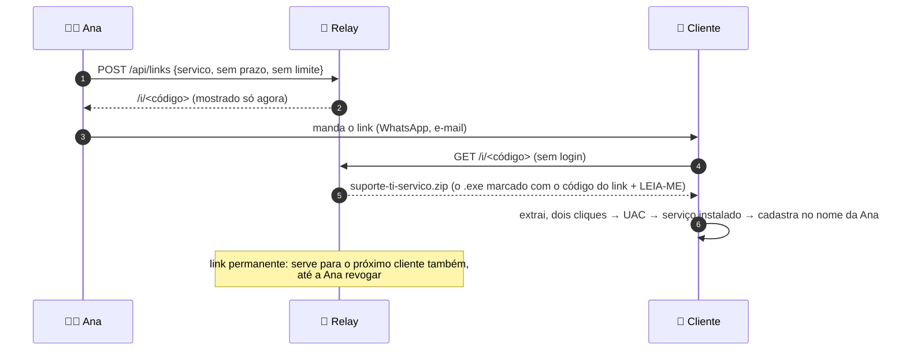

**Sem navegador:** o console mostra também o comando `irm https://…/i/<código>/ps | iex`. Colado no
PowerShell do cliente, ele baixa um script do relay, que baixa o `.exe` do mesmo link, confere o
SHA-256 que o relay calculou, instala (serviço: um UAC; portátil: copia para
`%LOCALAPPDATA%\RemoteIT` e inicia) e mostra o resultado no terminal. Sem aviso de download, sem
`(1)` no nome, sem cache. Código: [`httpapi/installps.go`](../internal/relay/httpapi/installps.go).

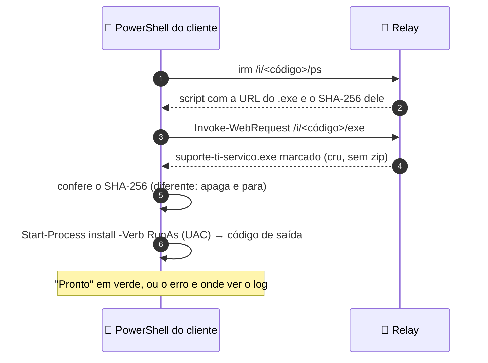

| Regra | Valor |
|---|---|
| Validade | 1 hora a 7 dias, ou **sem prazo** |
| Máquinas por link | 1 a 100, ou **sem limite** |
| Revogar | o dono do link ou um admin; quem ainda não instalou não baixa mais |
| Limite por IP | 200 downloads/dia em `/i/` (o script e o `.exe` contam um cada), 120 cadastros/hora |

---

<a id="atualizacao"></a>
## 1️⃣4️⃣ Atualização automática do agente

> 🗣️ **Em palavras simples:** para publicar uma versão nova, basta trocar os arquivos no servidor. Cada agente pergunta ao relay "qual é a versão?" quando conecta e a cada hora. Se for outra, ele confere que o arquivo foi **assinado pela chave do projeto** (que nunca sai da máquina de build), espera nenhum técnico estar conectado, baixa e se troca sozinho. Ninguém precisa mexer no PC.

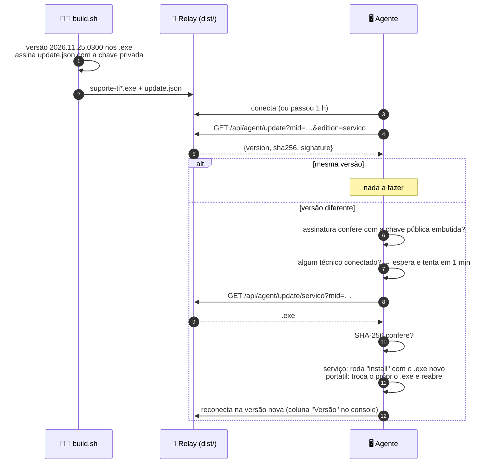

| Detalhe | Valor |
|---|---|
| Quando checa | 30 s depois de iniciar, a cada reconexão e a cada 1 h |
| Com técnico conectado | adia; tenta de novo a cada 1 min |
| Prova de legitimidade | assinatura Ed25519 de edição + versão + SHA-256, e o SHA-256 do `.exe` baixado |
| Rollback | publicar a versão anterior: os agentes seguem "a versão do relay", não "a maior" |
| Agentes antigos | os instalados antes desta versão não têm o atualizador: reinstalar uma vez à mão |

---

<a id="visualizador"></a>
## 1️⃣5️⃣ Visualizador do técnico (Windows)

> 🗣️ **Em palavras simples:** o visualizador fala com o relay exatamente como o console no navegador: mesmo login, mesma lista, mesmo WebSocket de tela. A diferença está nas pontas: ele decodifica e desenha o vídeo pela placa de vídeo do Windows, sem passar pela memória, e pega o teclado inteiro antes do Windows, para Win e Alt+Tab irem para o PC remoto. Se o relay roda no mesmo PC (o relay em casa), ele abre a tela **direto pelo endereço local**, sem a volta pela internet. Guia: [WINDOWS.md](WINDOWS.md#visualizador).

```mermaid
sequenceDiagram
    autonumber
    participant T as 🧑‍💻 Técnico (teclado)
    participant V as 🖥️ remoteit-tecnico.exe
    participant R as 🔀 Relay (público)
    participant L as 🏠 Relay (endereço local)
    participant A as 🖥️ Agente
    V->>R: POST /api/login (token guardado com DPAPI)
    V->>R: GET /api/agents a cada 3 s
    V->>R: GET /api/viewer/route (logado)
    R-->>V: {local: http://localhost:3000, instance: X}
    V->>L: GET /api/relay (sem cookie)
    L-->>V: {instance: X} — é o mesmo relay
    V->>L: GET /ws/viewer?id=m_… (cookie no cabeçalho)
    V->>A: hello {codecs: avc444, av1, h264, jpeg} · cfg {p, vw, vh: área da janela}
    A->>V: rg (onde vale) + quadro AVC444
    V->>V: 2× Media Foundation (DXVA) → texturas NV12 → shader 4:4:4 → só na região → Present
    T->>V: Win+R (hook de teclado: não chega ao Windows local)
    V->>A: kd MetaLeft · kd KeyR · ku… (nomes do protocolo)
    T->>V: Ações ▸ Enviar área de transferência
    V->>A: {"t":"clip","text":"ipconfig /all"}
    A->>A: só com consentimento: põe o texto na área de transferência
```

* 🏠 **Rota local:** com `RELAY_LOCAL_URL` no relay, o visualizador pergunta o endereço local, confere em `/api/relay` (sem mandar a sessão) que do outro lado está **o mesmo processo** e só então abre a tela por ali, com o cookie num cabeçalho. Não chegou ou não é o mesmo: usa o endereço de sempre. A barra mostra **Rota local** ou **internet**. Com o relay num PC de casa atrás de um túnel, isso tira ~90 ms de cada ida e volta ([ADR 0014](DECISOES.md#adr-0014)).
* 🎨 **Desenho na GPU:** o decodificador entrega o NV12 numa textura do mesmo dispositivo Direct3D 11 do desenho; um shader converte (ou recompõe o 4:4:4) e pinta só a região do quadro numa textura que guarda a tela inteira, onde também entram os retalhos sem perda. Uma janela filha recebe o desenho e deixa os cliques passarem para a janela da sessão. Sem Direct3D 11 que leia NV12 em shader (ou com `REMOTEIT_VIEWER_GDI=1`), fica o desenho pela CPU com GDI, com a mesma composição ([`decode.Canvas`](../internal/viewer/decode/canvas.go)).

| Detalhe | Onde |
|---|---|
| API, protocolo e rota local (Go puro, testado no Linux) | [`internal/viewer/client`](../internal/viewer/client) |
| H.264, AVC444 e AV1 pelo Media Foundation, GPU (DXVA) ou CPU; direto na textura (`rd_decode_tex`) ou na memória; JPEG/PNG | [`internal/viewer/decode`](../internal/viewer/decode) |
| Desenho na GPU: composição por região, cor em shader, ajuste à janela | [`internal/viewer/render`](../internal/viewer/render) |
| Janelas, mouse, hook de teclado, teclas mortas | [`internal/viewer/win`](../internal/viewer/win) |
| Tabela de teclas compartilhada com o agente | [`internal/protocol/keys.go`](../internal/protocol/keys.go) |
