# 🧭 Fluxos do RemoteIT

> 🗣️ **Em palavras simples:** este documento conta, passo a passo, o que acontece por baixo de cada coisa que o usuário faz: abrir o agente, o técnico clicar em **Conectar**, um quadro de vídeo atravessar a internet, uma tecla chegar ao Windows, a tela de bloqueio aparecer, alguém criar uma conta. Cada fluxo tem um diagrama e aponta o código que o implementa.

Os diagramas são [Mermaid](https://mermaid.js.org/): o GitHub os desenha sozinho.

| # | Fluxo | Em uma frase |
|---|---|---|
| 1️⃣ | [Agente entra no ar](#agente) | o PC liga para o relay e fica esperando |
| 2️⃣ | [Login do técnico](#login) | usuário e senha viram um cookie de 12 h |
| 3️⃣ | [Sessão remota](#sessao) | do clique em **Conectar** ao primeiro quadro, e o fim |
| 4️⃣ | [Pipeline de vídeo](#video) | da GPU do PC à GPU do técnico |
| 5️⃣ | [Controle de fluxo e bitrate](#fluxo) | por que a imagem não "atrasa" |
| 6️⃣ | [Mouse e teclado](#entrada) | do evento no navegador ao `SendInput` |
| 7️⃣ | [Bloquear a tela e trocar de usuário](#bloqueio) | Win+L remoto e login com outra conta |
| 8️⃣ | [Modo serviço: tela de login e bloqueio](#servico) | o serviço, o worker SYSTEM e os desktops do Windows |
| 9️⃣ | [Instalar, atualizar e remover](#instalar) | o que cada `.exe` faz com dois cliques |
| 🔟 | [Dois técnicos na mesma máquina](#dois-tecnicos) | o segundo assume |
| 1️⃣1️⃣ | [Contas por e-mail](#contas) | cadastro, aprovação, recuperação e vínculo |
| 1️⃣2️⃣ | [Entregar uma versão nova do agente](#entrega) | por que o download nunca vem do cache |

---

## 1️⃣ Agente entra no ar

> 🗣️ **Em palavras simples:** ao abrir, o agente liga para o relay como um navegador abriria um site seguro, se apresenta com a chave secreta embutida no `.exe` e fica com a linha aberta. Se a linha cair, ele liga de novo, esperando cada vez um pouco mais (até 30 s) para não martelar o servidor.

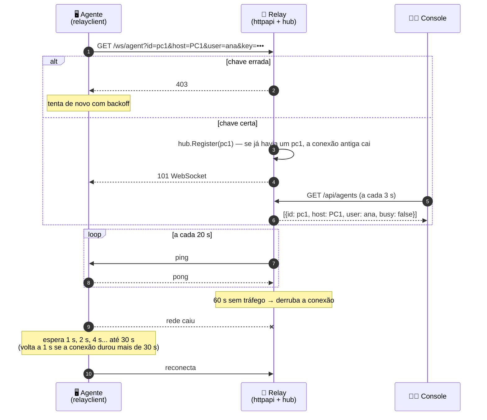

| Detalhe | Valor | Onde |
|---|---|---|
| ID da máquina | hostname em minúsculas | `cmd/agent/main.go` |
| Backoff | 1 s, dobrando até 30 s; volta a 1 s após 30 s conectado | `internal/agent/relayclient` |
| Keepalive | ping a cada 20 s; leitura expira em 60 s | `relayclient`, `httpapi` |
| Mesma ID duas vezes | a conexão nova substitui a antiga | `internal/relay/hub` |

> ⚠️ Por causa da última linha, **duas cópias do agente no mesmo PC se derrubam** em loop ("conectado/desconectado" no log do relay). Por isso o agente portátil sai em silêncio quando já há outra cópia ou o serviço rodando ([fluxo 9](#instalar)).

---

## 2️⃣ Login do técnico

> 🗣️ **Em palavras simples:** a senha nunca é guardada, só um "resumo" dela (bcrypt), que não dá para desfazer. Ao acertar a senha, o relay entrega ao navegador um número aleatório (o token da sessão) num cookie que o JavaScript não consegue ler. No banco fica só o resumo desse número: quem roubar o banco não consegue se passar por ninguém.

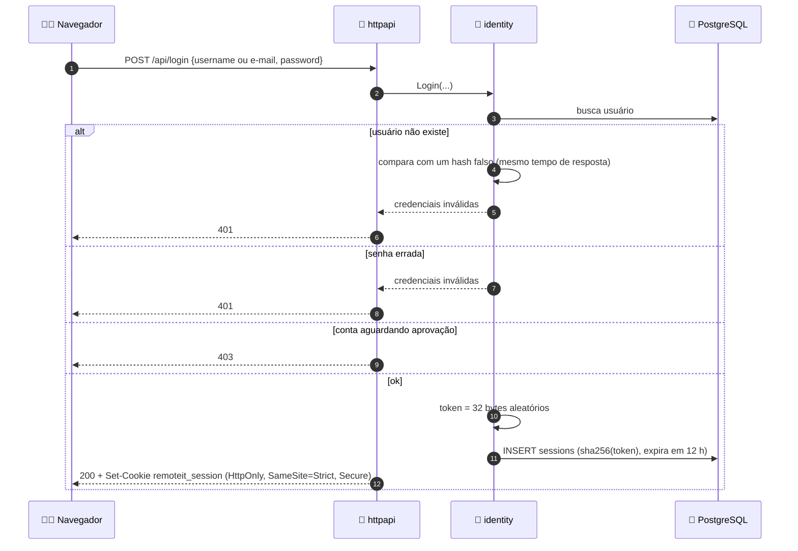

* 🕵️ **Mesmo tempo para "não existe" e "senha errada":** sem isso, medir o tempo da resposta revelaria quais usuários existem.
* 🍪 **`SameSite=Strict` + `Content-Type: application/json` obrigatório:** um site de terceiros não consegue disparar ações com o cookie do técnico (CSRF). Veja [SEGURANCA.md](SEGURANCA.md).

---

## 3️⃣ Sessão remota: do clique ao primeiro quadro

> 🗣️ **Em palavras simples:** quando o técnico clica em **Conectar**, o relay primeiro **anota** o acesso (se não conseguir anotar, não deixa entrar), depois avisa o agente. O agente pergunta ao usuário do PC se ele permite (a não ser no build sem consentimento), e só então começa a mandar a tela e a aceitar mouse e teclado.

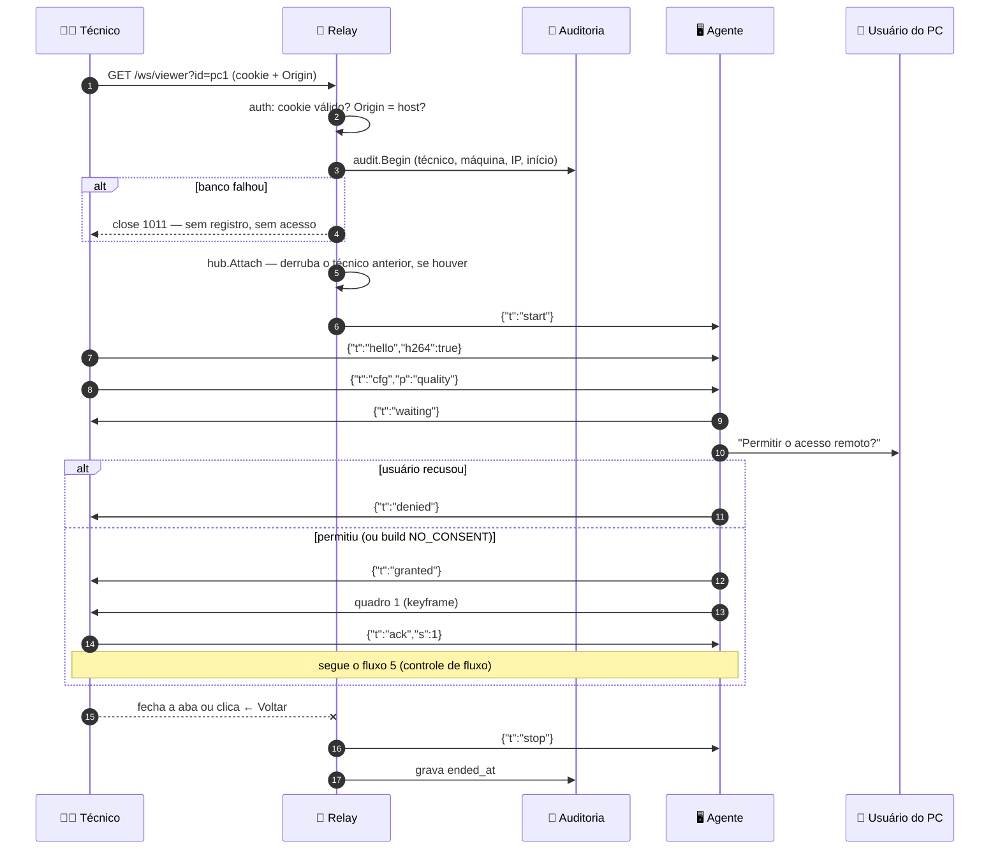

### 🔄 Estados da sessão no agente

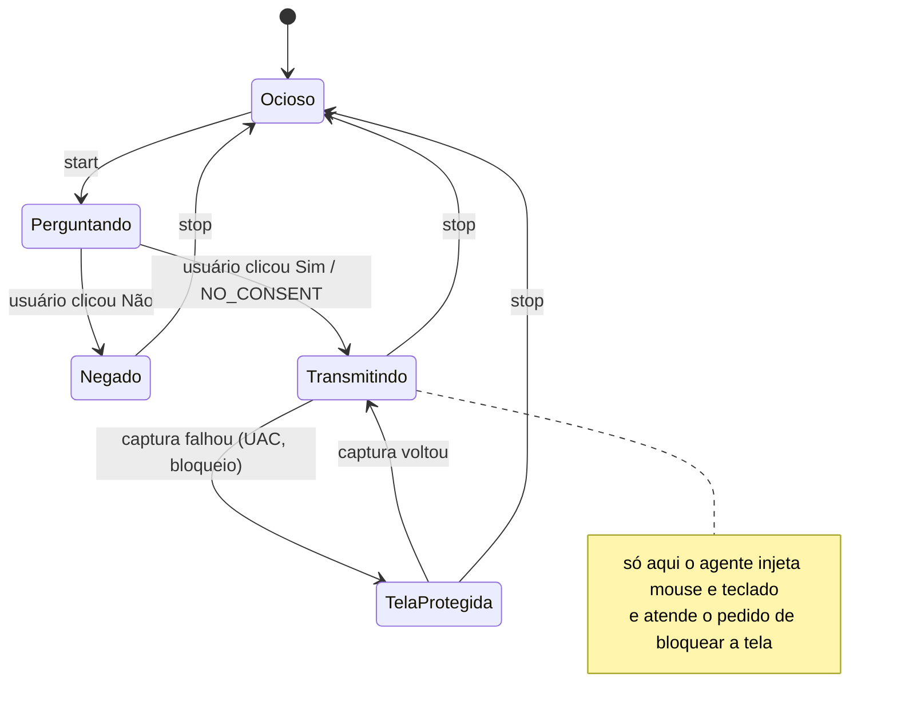

| Mensagem para o técnico | O console mostra |
|---|---|
| `waiting` | "aguardando o usuário permitir" |
| `granted` | a tela remota |
| `denied` | "o usuário recusou" |
| `secure` | "tela protegida por UAC/bloqueio — aguardando" (retoma sozinho) |

* 🔒 **Entrada só depois do consentimento:** o agente descarta mouse, teclado e o pedido de bloqueio enquanto `granted` não for verdadeiro ([`internal/agent/session`](../internal/agent/session)). O teste `TestInputOnlyAfterConsent` prova isso.
* 🎬 **H.264 ou JPEG:** se o navegador não mandar `hello` em 1,5 s, o agente assume JPEG.

---

## 4️⃣ Pipeline de vídeo: da GPU do PC à GPU do técnico

> 🗣️ **Em palavras simples:** a tela é copiada direto da placa de vídeo, reduzida e comprimida ali mesmo em H.264 (o mesmo formato de um vídeo do YouTube), sem passar pelo processador. O navegador do técnico recebe e descomprime também na placa de vídeo dele. Sem placa de vídeo, o plano B é tirar "fotos" JPEG da tela.

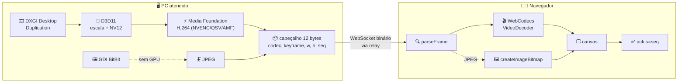

| Etapa | Código | Observação |
|---|---|---|
| Captura + encoder | [`internal/agent/media/h264`](../internal/agent/media/h264) (C em `rcenc.h`) | compilado com Zig; sem Zig, o build sai só com JPEG |
| Fallback | [`media/capture`](../internal/agent/media/capture), [`media/jpeg`](../internal/agent/media/jpeg) | GDI + `image/jpeg`; qualidade 25–85 conforme o bitrate |
| Laço de transmissão | [`media/stream.go`](../internal/agent/media/stream.go) | abre a fonte, mede, envia stats 1x/s |
| Formato do quadro | [`internal/protocol`](../internal/protocol) + [`frontend/src/lib/protocol.ts`](../frontend/src/lib/protocol.ts) | veja [PROTOCOLO.md](PROTOCOLO.md) |
| Decodificação | [`frontend/src/lib/viewer/session.ts`](../frontend/src/lib/viewer/session.ts) | o caminho dos quadros fica fora do Svelte ([ADR 0003](adr/0003-svelte-no-console.md)) |

### 🎚️ Presets de qualidade

| Preset (`cfg.p`) | No console | Largura máx. | FPS | Bitrate |
|---|---|---|:---:|---|
| `turbo` | Ultra-rápido | 1280 px | 60 | 4–10 Mbps |
| `balanced` | Equilibrado | 1920 px | 60 | 8–20 Mbps |
| `quality` (padrão) | Nítido | nativa | 60 | 15–40 Mbps |
| `quality60` | Máximo | nativa | 60 | 25–80 Mbps |

* 🖱️ **Cursor por cima do vídeo:** o agente manda a posição (`cur`) e o formato (`cs`) do cursor separados, e o console desenha o cursor local. Ele se move na hora, mesmo que o quadro ainda esteja a caminho.
* 🔁 **Refino com a tela parada:** quando nada muda, o agente recodifica o último quadro mais duas vezes (`FlagRepeat`) para deixar o texto nítido.

---

## 5️⃣ Controle de fluxo e bitrate

> 🗣️ **Em palavras simples:** se o agente mandasse quadros mais rápido do que a internet aguenta, eles ficariam numa fila, e o técnico veria a tela de segundos atrás. Por isso o navegador **confirma** cada quadro que recebe, e o agente nunca deixa mais de **dois** sem confirmação no caminho. Quando a rede aperta, ele baixa a qualidade; quando folga, sobe de novo, aos poucos.

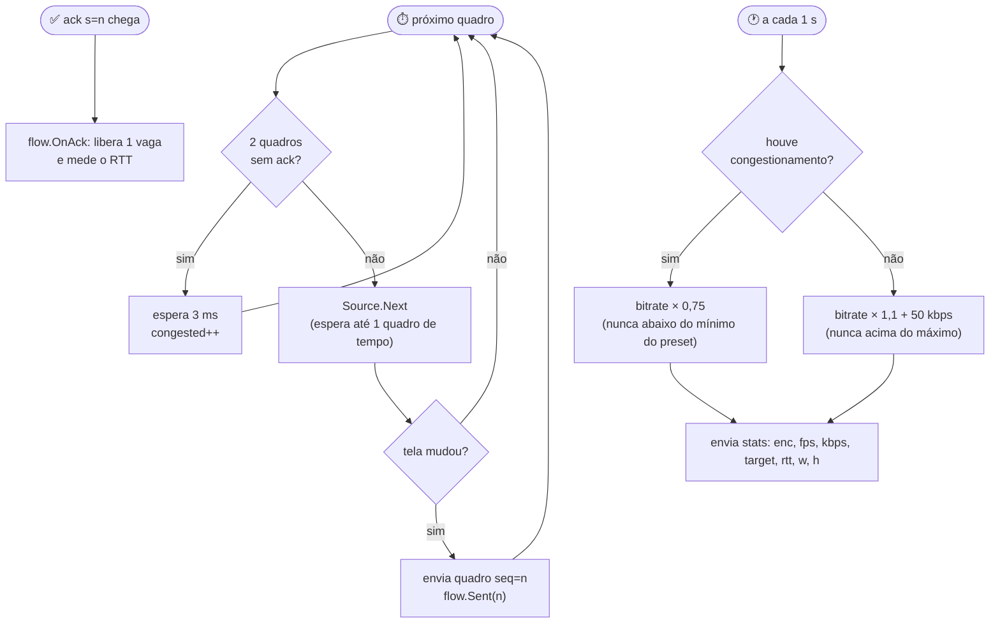

| Regra | Valor | Onde |
|---|---|---|
| Quadros em trânsito | no máximo 2 | [`media/flow.go`](../internal/agent/media/flow.go) |
| Ack perdido | depois de 3 s sem ack, o agente supõe que ele se perdeu e libera a vaga | `flow.go` (teste `TestFlowControlLostAck`) |
| Ack falso ou repetido | ignorado | `TestFlowControlIgnoresBogusAcks` |
| Queda de bitrate | −25% por segundo congestionado | `media.NextBitrate` |
| Subida de bitrate | +10% + 50 kbps por segundo livre | `media.NextBitrate` |
| Keyframe sob pedido | `kf` descarta o que está em trânsito | `Stream.RequestKeyframe` |

---

## 6️⃣ Mouse e teclado

> 🗣️ **Em palavras simples:** o navegador transforma a posição do mouse em "porcentagem da tela" (0 a 1), para funcionar com qualquer resolução. As teclas vão com o nome físico (`KeyA`) e o caractere (`a`, `ç`). No Windows, letras e acentos são digitados como **caractere**, e não como tecla: assim o `ç` sai certo mesmo que o teclado do PC remoto seja americano.

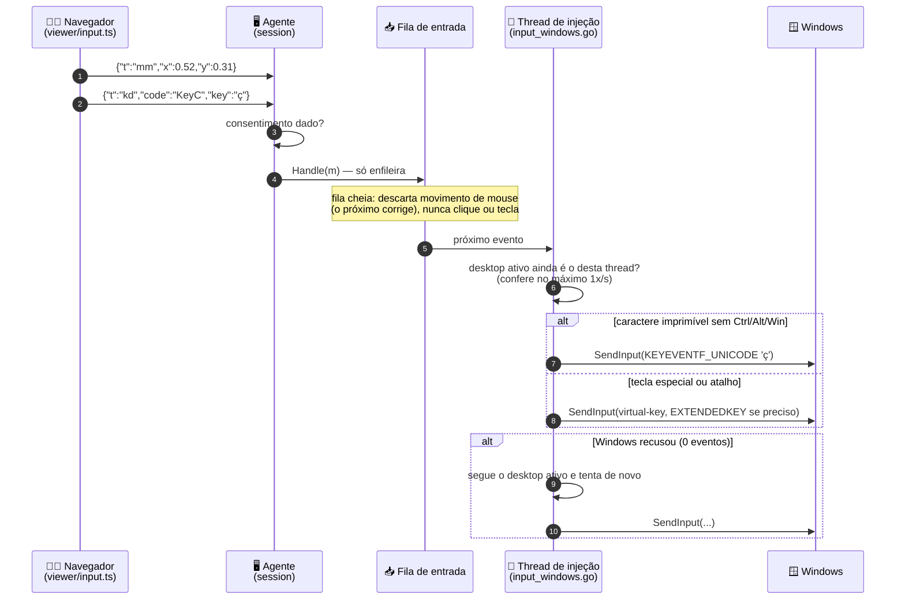

* 🧵 **Por que uma thread só para isso?** No Windows, cada thread está presa a um **desktop** (a área de trabalho normal ou a tela de login), e o `SendInput` só alcança o desktop da thread que o chama. A goroutine que lê a conexão pula de thread em thread, então a injeção roda numa thread fixa que acompanha o desktop ativo ([fluxo 8](#servico)).
* 🧭 **Coordenadas:** `x, y` em [0,1] viram coordenadas absolutas do Windows (0–65535) no monitor principal.
* ⌨️ **Tabela de teclas:** `KeyboardEvent.code` → virtual-key em [`internal/agent/input/keymap.go`](../internal/agent/input/keymap.go) (testada em `keymap_test.go`).
* 🖵 **Tela cheia:** a Keyboard Lock API deixa o navegador capturar Win, Alt+Tab e Esc, que normalmente o sistema do técnico tomaria para si.

---

## 7️⃣ Bloquear a tela e trocar de usuário

> 🗣️ **Em palavras simples:** o Windows **não aceita** Win+L simulado: é uma proteção para um programa não conseguir trancar a sessão de alguém. Então o botão 🔒 do console manda uma mensagem própria, e o agente chama a função oficial do Windows que bloqueia a tela. Para depois logar com outra conta pela tela de bloqueio, o agente precisa estar no **modo serviço**.

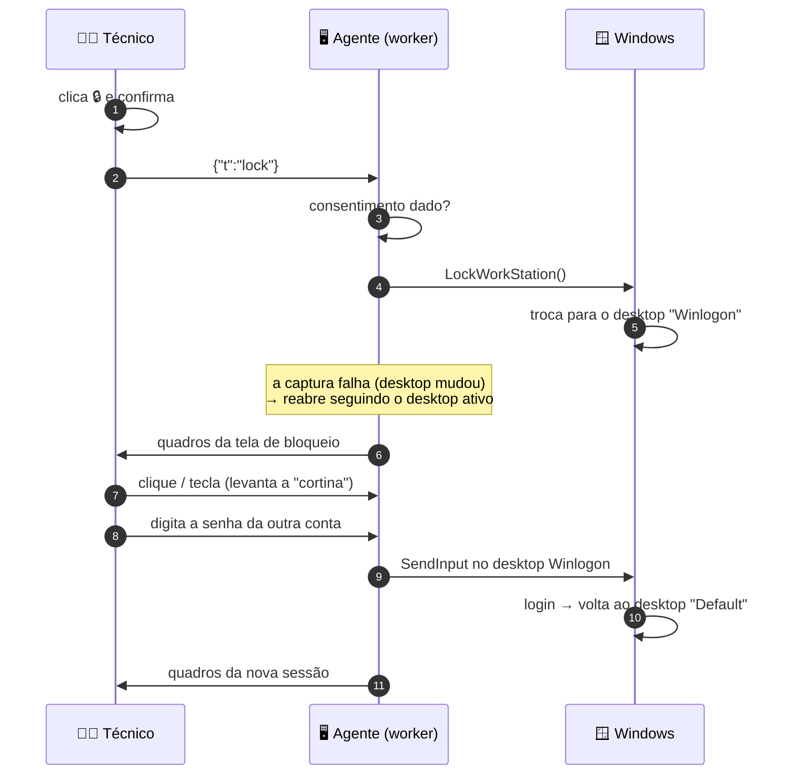

| Agente | 🔒 bloqueia? | Vê a tela de bloqueio? | Digita a senha? |
|---|:---:|:---:|:---:|
| ▶️ Portátil (`suporte-ti.exe`) | ✅ | ❌ "tela protegida" | ❌ |
| 🧩 Serviço (`suporte-ti-servico.exe`) | ✅ | ✅ | ✅ |

> ⚠️ Se o PC exigir **Ctrl+Alt+Del** antes do login (política de grupo), o login remoto para nessa tela: o Windows não deixa nenhum programa simular essa combinação.

---

## 8️⃣ Modo serviço: a tela de login e de bloqueio

> 🗣️ **Em palavras simples:** a tela de login do Windows é especial. Ela roda como o próprio sistema, numa "mesa" separada (o desktop **Winlogon**), e o Windows ignora cliques e teclas que venham de programas comuns. Para alcançá-la, o agente precisa rodar **como o sistema** (SYSTEM) e **mudar de mesa** junto com o Windows.

### 🏢 Quem roda onde

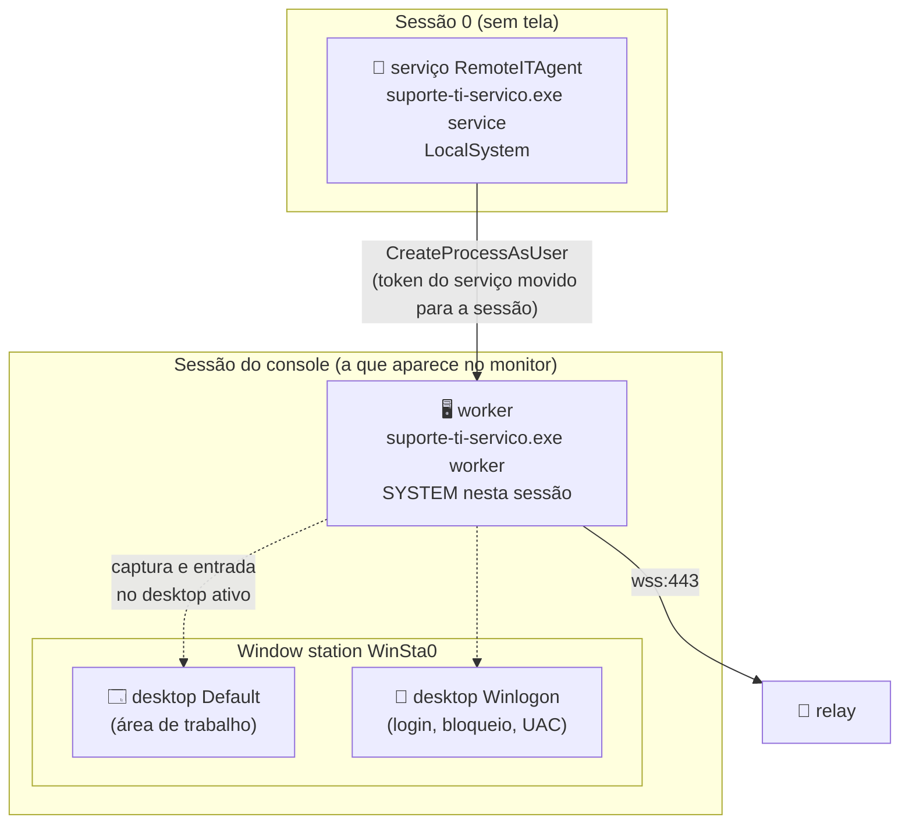

### 🔁 O serviço vigia a sessão

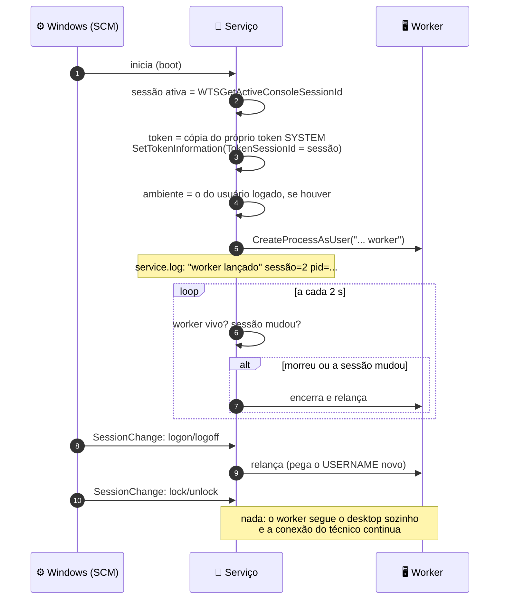

### 🧵 Por que SYSTEM, e por que trocar de thread

| Problema | Sintoma que aparecia | Solução no código |
|---|---|---|
| A captura via o desktop errado | tela congelada ao bloquear | toda (re)abertura da captura chama `desktop.FollowInput` → `OpenInputDesktop` + `SetThreadDesktop` ([`internal/agent/desktop`](../internal/agent/desktop)) |
| **UIPI**: o Windows descarta entrada de um processo de integridade média para a tela de login (SYSTEM) | a tela de bloqueio aparecia, mas cliques e teclas não chegavam | o worker roda com o **token SYSTEM** do serviço, movido para a sessão ([`lifecycle_windows.go`](../internal/agent/lifecycle/lifecycle_windows.go)) |
| `SetThreadDesktop` falha numa thread que já tem janelas, e o Media Foundation cria janelas ocultas | "tela protegida — aguardando" para sempre | a captura roda numa thread do SO **descartável**: se não conseguir mudar de desktop, a thread morre e a captura recomeça numa nova ([`media/stream.go`](../internal/agent/media/stream.go), teste `TestStreamRecoversWhenDesktopCanBeFollowedAgain`) |
| A injeção rodava em qualquer thread | entrada sumia no desktop Winlogon | thread fixa de injeção que segue o desktop ([fluxo 6](#entrada)) |

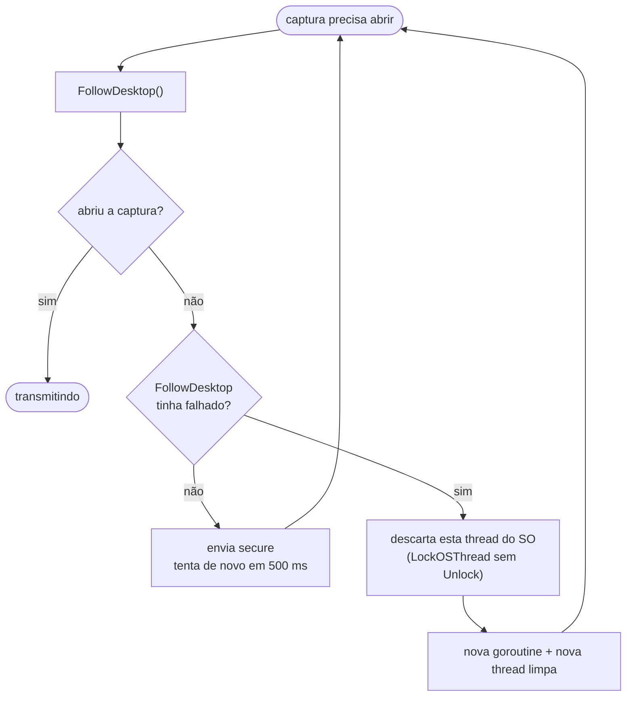

---

## 9️⃣ Instalar, atualizar e remover

> 🗣️ **Em palavras simples:** o `suporte-ti.exe` só roda. O `suporte-ti-servico.exe` instala: pede a permissão de administrador do Windows, se copia para `C:\Program Files\RemoteIT` e cria o serviço. Rodar um `suporte-ti-servico.exe` mais novo em cima **atualiza**. Nada abre janela, e tudo fica anotado em `C:\ProgramData\RemoteIT\service.log`.

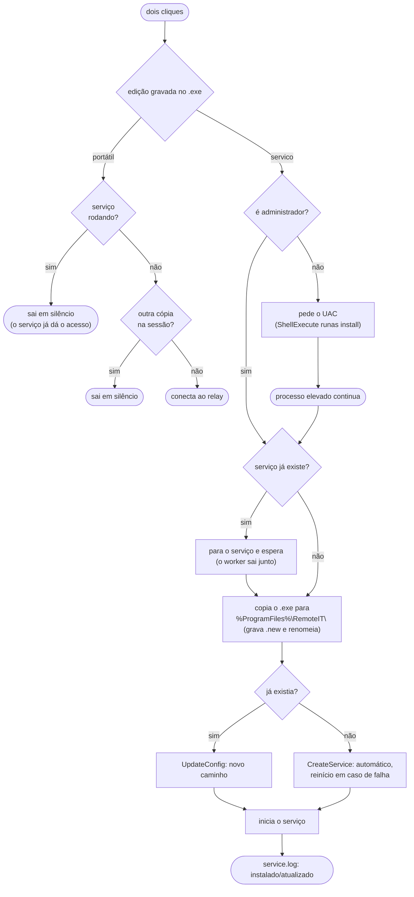

| Comando | O que faz |
|---|---|
| dois cliques em `suporte-ti-servico.exe` | o mesmo que `install` |
| `suporte-ti-servico.exe install` | instala ou atualiza (UAC se preciso) |
| `suporte-ti-servico.exe uninstall` | para, remove o serviço e apaga `%ProgramFiles%\RemoteIT` |
| `suporte-ti.exe` | portátil; `install`/`uninstall` também funcionam nele |

👉 Passo a passo para o usuário, e o que fazer quando algo dá errado: [AGENTE-WINDOWS.md](AGENTE-WINDOWS.md).

---

## 🔟 Dois técnicos na mesma máquina

> 🗣️ **Em palavras simples:** cada máquina atende um técnico por vez. Se um segundo técnico conecta, ele assume; o primeiro é desconectado, e cada acesso fica registrado separadamente.

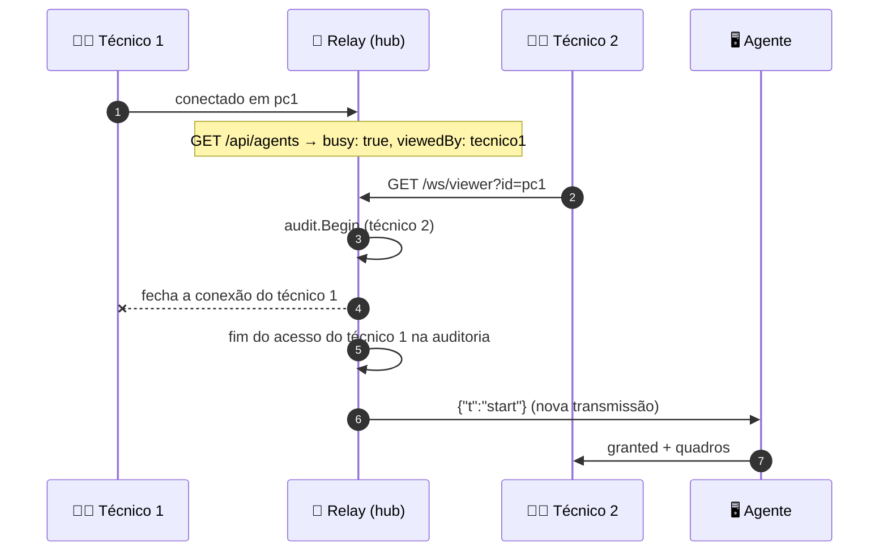

* O `stop` só vale quando quem sai é o **técnico atual**: a saída atrasada do técnico 1 não derruba a sessão do técnico 2 (testado em `internal/relay/hub`).

---

## 1️⃣1️⃣ Contas por e-mail

> 🗣️ **Em palavras simples:** quem quer acesso informa o e-mail e recebe um link. Pelo link, escolhe o nome de usuário e a senha. A conta nasce **pendente**, e um administrador precisa aprovar. Esqueceu a senha? Outro link, válido por 1 hora, que troca a senha e derruba todas as sessões abertas. Os links são de uso único, e no banco fica só o resumo (SHA-256) de cada um.

### ✍️ Cadastro e aprovação

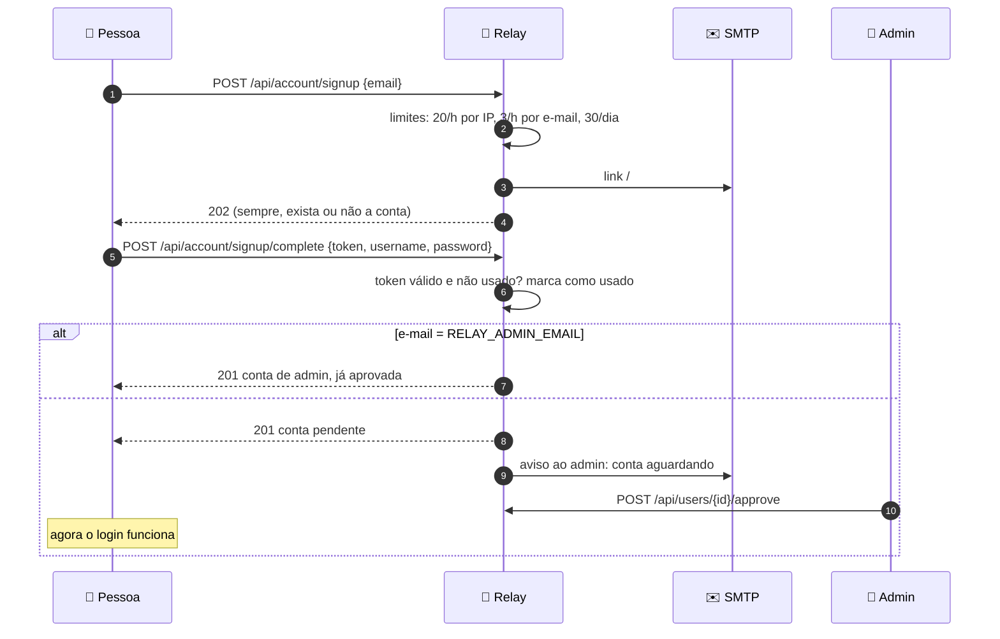

### 🔑 Recuperação de acesso

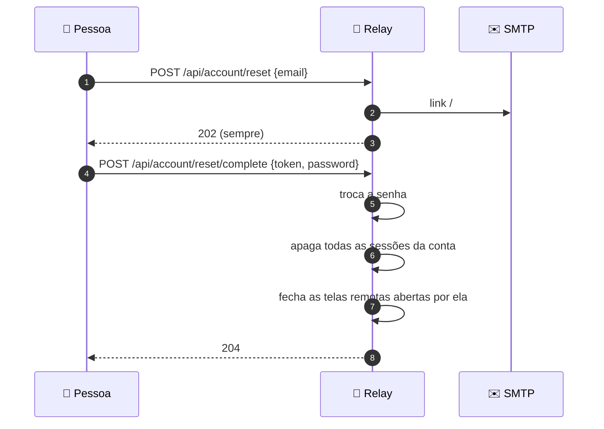

* 🔗 **Vincular e-mail a uma conta antiga:** `POST /api/account/email` (pede a senha) → link `/#/confirmar-email` de 1 h → `POST /api/account/email/complete`. Funciona mesmo se a pessoa abrir o link deslogada.
* 🙈 **202 sempre:** a resposta não revela se o e-mail tem conta.
* 👉 Rotas e códigos de resposta: [API.md](API.md). Decisão: [ADR 0006](adr/0006-contas-por-email.md).

---

## 1️⃣2️⃣ Entregar uma versão nova do agente

> 🗣️ **Em palavras simples:** publicar um agente novo é trocar o arquivo no servidor. O cuidado é garantir que ninguém no caminho (Cloudflare ou o navegador) entregue uma **cópia velha guardada**. Isso já aconteceu: o PC baixava "de novo" e recebia a versão de horas antes.

* 🧾 **Confira o hash** do arquivo baixado (`Get-FileHash`) contra o publicado; os comandos estão em [AGENTE-WINDOWS.md](AGENTE-WINDOWS.md#conferir-versao).
* 🔐 **Só para quem está logado:** sem cookie, as rotas de download respondem 401. O `private` impede que um cache compartilhado guarde um arquivo que tem a chave do agente embutida.
