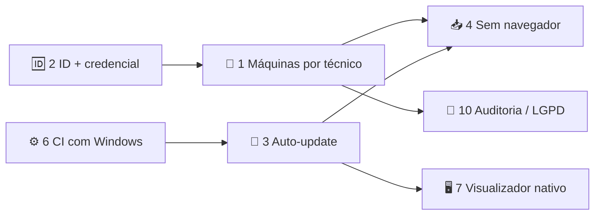
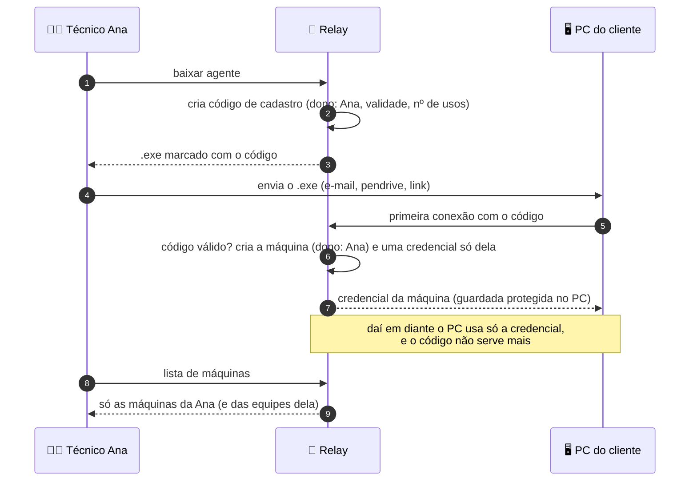
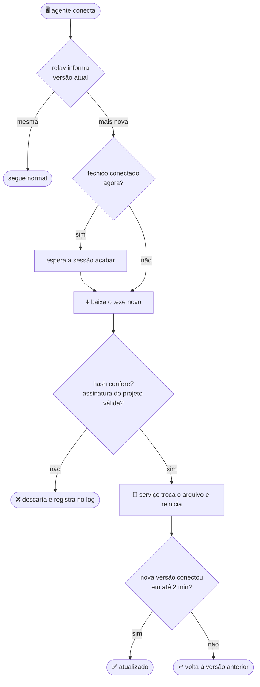

# 🧭 Levantamento de melhorias

> 🗣️ **Em palavras simples:** este é um mapa do que dá para melhorar no RemoteIT, levantado a partir do código como está hoje (24/11/2026). Nada aqui foi implementado ainda. Cada item diz **o problema**, **a proposta**, **o esforço** e **o que depende do quê**, para decidir a ordem com calma.

**Legenda:** 🔴 alto impacto · 🟡 médio · 🟢 baixo — esforço em ⏱️ (dias de trabalho, estimativa grosseira).

---

## 📋 Resumo e ordem sugerida

| # | Melhoria | Impacto | Esforço | Por quê nesta posição |
|---|---|:---:|:---:|---|
| 1 | ✅ [🔐 Cada técnico com as suas máquinas (agente por usuário)](#por-usuario) | 🔴 | feito | fecha a maior falha de segurança e muda o modelo de dados; o resto se apoia nela |
| 2 | ✅ [🆔 ID de máquina único e credencial por máquina](#id-maquina) | 🔴 | feito | parte do item 1; impede uma máquina se passar por outra |
| 3 | ✅ [🔄 Atualização automática do agente](#auto-update) | 🔴 | feito | acaba com "baixe de novo, confira o hash, reinstale" |
| 4 | 🟨 [📥 Instalar sem passar pelo navegador](#sem-navegador) | 🔴 | 4a feito; resto ⏱️ 2–4 | o navegador foi a origem da maior parte dos problemas de instalação |
| 5 | 🟨 [🛡️ Endurecer o login e o console](#login) | 🟡 | limite e CSP feitos; resto ⏱️ 2 | limite de tentativas, 2FA, CSP |
| 6 | [⚙️ CI no GitHub, com Windows](#ci) | 🟡 | ⏱️ 2 | hoje nada do Windows é testado automaticamente |
| 7 | [🖥️ Visualizador nativo para o técnico](#viewer-nativo) | 🟡 | ⏱️ 10+ | o único caminho para cor 4:4:4 e menor latência |
| 8 | [🧰 Funcionalidades de suporte](#funcionalidades) | 🟡 | ⏱️ variável | área de transferência, arquivos, vários monitores, Ctrl+Alt+Del |
| 9 | [📡 Transporte e desempenho](#desempenho) | 🟢 | ⏱️ 5+ | WebTransport/UDP, regiões alteradas |
| 10 | 🟨 [📜 Auditoria, transparência e LGPD](#lgpd) | 🟡 | órfãs feito; resto ⏱️ 2–3 | aviso de "sendo acessado", retenção, gravação opcional |
| 11 | [🏗️ Operação do servidor](#operacao) | 🟢 | ⏱️ 2–4 | versões, métricas, backup automático, relay sem derrubar sessões |
| 12 | [📚 Repositório público](#repositorio) | 🟢 | ⏱️ 0,5 | licença, SECURITY.md, descrição |

> ✅ **Feito em 24/11/2026** ([ADR 0010](adr/0010-maquinas-por-tecnico.md)): itens 1 e 2 (modelo **só o dono**; o compartilhamento foi feito e depois retirado em 25/11), 4a (link de instalação, com opção sem prazo e sem limite desde 25/11), e do item 5 o limite de tentativas no login, a CSP com os cabeçalhos de segurança; do item 10, o encerramento das sessões órfãs.

> 💡 **Também em produção desde 24/11/2026:** refresh de nitidez em PNG com a tela parada, modo 1:1 e bitrate menos nervoso ([ADR 0009](adr/0009-refresh-de-nitidez.md)). Estava pronto e sem commit na pasta e foi junto no mesmo build. Não está repetido abaixo.

**Legenda de situação:** ✅ feito · 🟨 em parte · sem marca = a fazer.

---

## 1️⃣ ✅ 🔐 Cada técnico com as suas máquinas (agente por usuário)

> ✅ **Feito em 24/11/2026** e em produção. Modelo final: **só o dono** (o compartilhamento chegou a ir para produção e foi retirado em 25/11/2026, por não ser usado; sem organizações e equipes). Marcação do `.exe` pela opção A (texto reservado no binário). Detalhes em [ADR 0010](adr/0010-maquinas-por-tecnico.md) e [FLUXOS.md](FLUXOS.md#maquinas). Organizações/equipes e a opção C para o serviço (código digitado) ficaram para depois.

### ❗ O problema hoje

* **Todo técnico logado vê e conecta em todas as máquinas.** `GET /api/agents` devolve a lista inteira, e `/ws/viewer` só confere se a pessoa está logada, sem perguntar se a máquina é dela.
* O `.exe` é **o mesmo para todo mundo**, com a mesma chave embutida. O relay não tem como saber quem distribuiu cada agente.
* Na prática, um técnico da empresa A pode abrir a tela de um PC da empresa B.

### ✅ A proposta

> 🗣️ **Em palavras simples:** quando um técnico baixa o agente, o `.exe` sai **marcado** com um código de cadastro dele. Na primeira vez que roda, o agente troca esse código por uma "chave de casa" só daquela máquina, e a máquina fica **registrada no nome de quem baixou**. Daí em diante, só esse técnico (ou quem ele autorizar, ou um admin) vê e acessa essa máquina.

**Modelo de acesso sugerido:**

| Conceito | Para quê |
|---|---|
| 🏢 **Organização** (cliente/empresa) | separa clientes diferentes; nenhum técnico de uma vê as máquinas de outra |
| 👥 **Equipe** dentro da organização | "suporte N1", "infra": várias pessoas atendendo o mesmo conjunto de máquinas |
| 🖥️ **Máquina** pertence a uma organização (e opcionalmente a uma equipe) | definido pelo código usado no cadastro |
| 🔑 **Permissão** por máquina ou equipe | ver, controlar, bloquear a tela, (futuro) transferir arquivos |
| 👑 **Admin** | vê tudo da organização; o "super admin" do relay vê tudo |

**Onde muda (sem código, só o mapa):**

* 🐘 Banco: tabelas novas `organizations`, `teams`, `team_members`, `machines` (dono, organização, equipe, credencial em hash, revogada em), `enrollment_tokens` (hash, dono, validade, usos restantes).
* 🔀 `hub`: hoje guarda agentes por nome; passa a guardar por **ID de máquina**.
* 🔌 `httpapi`: a lista filtra pelo que o usuário pode ver; `/ws/viewer` recusa (403) quem não tem permissão — e a auditoria registra a tentativa.
* 🎨 Console: tela de máquinas por organização/equipe, renomear máquina, transferir de dono, revogar.

### 🏷️ Como "marcar" o `.exe` por usuário

| Opção | Como funciona | Prós | Contras |
|---|---|---|---|
| **A. Trocar um texto reservado no binário** | o build deixa um espaço fixo (ex.: 64 bytes) com um marcador conhecido, e o relay o preenche no momento do download | simples; o código vai por download sem recompilar; funciona com o `.exe` sem assinatura de hoje | o build precisa reservar o espaço sempre no mesmo formato; o hash do `.exe` passa a ser diferente para cada técnico |
| **B. Código no nome do arquivo** | `suporte-ti_AB12CD.exe` | zero mudança no binário | o navegador renomeia (`(1)`), o usuário renomeia — já vimos isso acontecer |
| **C. Código digitado/colado** | `suporte-ti-servico.exe install --codigo AB12-CD34`, ou o técnico informa o código por telefone | funciona com qualquer `.exe`, inclusive implantação em massa (GPO, Intune) | um passo a mais para o usuário; o portátil "sem janela" não tem onde digitar |

**Recomendação:** **A** como caminho principal e **C** como alternativa para implantação em massa e linha de comando. **B** não é confiável (o nome muda fácil).

### ⚠️ Cuidados

* O código de cadastro **não é segredo eterno**: deve expirar (ex.: 7 dias) e ter número de usos (1 para "este PC", N para "implantar em 50 PCs").
* Agentes já instalados (com a chave antiga) precisam de uma **migração**: aceitar os dois modos por um tempo, e o admin "adota" as máquinas antigas para um dono.
* O agente portátil vira "do técnico que baixou", mesmo rodando num PC de cliente: está certo, é ele quem atende.

---

## 2️⃣ ✅ 🆔 ID de máquina único e credencial por máquina

> ✅ **Feito em 24/11/2026**, exceto o **alerta** de máquina duplicada (a conexão é recusada, mas ninguém é avisado).

### ❗ O problema hoje

* O ID da máquina é **o nome do computador em minúsculas**, e uma conexão nova com o mesmo ID **derruba a antiga**.
* Consequências:
  * 💥 Dois PCs com o mesmo nome (comum: `DESKTOP-ABC123` de imagem clonada, ou "PC-RECEPCAO" em dois clientes) ficam se derrubando.
  * 🎭 **Quem tem um `.exe` pode se passar por outra máquina:** basta se registrar com o mesmo nome, derrubar a verdadeira e esperar o técnico conectar — e digitar uma senha de administrador numa tela falsa.
  * 🔑 A chave é única para todos: vazou de um `.exe`, vale para todos; não dá para revogar uma máquina só.

### ✅ A proposta

| Hoje | Proposto |
|---|---|
| ID = hostname | ✅ ID = identificador aleatório gerado no cadastro (o hostname vira só o **nome de exibição**) |
| chave compartilhada no `.exe` | ✅ **credencial por máquina**, entregue no cadastro e guardada protegida pelo Windows (DPAPI) em `ProgramData` |
| mesma ID derruba a outra | ✅ mesma ID **com outra credencial** é recusada · ⬜ gerar alerta |
| sem revogação | ✅ o console tem **Remover** (revoga): a credencial deixa de valer na hora |

> 🗣️ **Em palavras simples:** cada PC passa a ter um "RG" próprio, impossível de copiar só pelo nome, e uma chave que só ele tem. Se alguém tentar se passar por ele, o relay percebe e recusa.

**Depende de:** item 1 (é o cadastro que entrega a credencial).

---

## 3️⃣ ✅ 🔄 Atualização automática do agente

> ✅ **Feito em 25/11/2026** ([ADR 0011](adr/0011-atualizacao-automatica.md)), com assinatura própria Ed25519, rollback publicando a versão anterior e espera pelo fim do atendimento. Ficaram de fora: canais estável/teste, escolher horário por máquina e a volta automática se a versão nova não conectar.

### ❗ O problema hoje

Em uma única noite de testes, atualizar o agente exigiu: baixar de novo, descobrir que veio do cache, conferir o hash, desinstalar, perceber que o PowerShell não esperou, reinstalar, conferir o caminho do serviço... Isso não escala nem para 5 PCs.

### ✅ A proposta

> 🗣️ **Em palavras simples:** o agente pergunta ao relay "tem versão nova?" e, se tiver, baixa, confere que é legítima e se troca sozinho — sem ninguém mexer no PC.

| Ponto de decisão | Sugestão |
|---|---|
| Quem troca o arquivo | o **serviço** (já tem permissão e já sabe parar/trocar/iniciar — é o `install` de hoje, rodado por ele mesmo) |
| E o portátil? | baixa a versão nova para a pasta dele e se reabre; sem admin, sem serviço |
| Garantia de legitimidade | hash publicado pelo relay **e** uma **assinatura própria do projeto** (chave Ed25519 guardada fora do servidor; a chave pública vai embutida no agente). Protege a atualização mesmo se o relay for invadido |
| Rollback | manter a versão anterior ao lado; se a nova não conectar, voltar |
| Controle | o admin escolhe: automático, só fora do horário, ou manual por máquina; o console mostra a versão de cada máquina |
| Canais | `estável` e `teste` (para validar num PC antes de mandar para todos) |

**Benefício extra:** a coluna **Versão** na lista de máquinas acaba com a pergunta "qual versão está rodando ali?".

---

## 4️⃣ 🟨 📥 Instalar sem passar pelo navegador

> 🟨 **Em parte:** a opção **a** (link de instalação) foi feita em 24/11/2026; desde 25/11 o link também pode ser **sem prazo** e **sem limite de máquinas** (o "link do técnico"). As opções b, c e d continuam abertas.

### ❗ O problema hoje

O navegador foi a origem de quase todos os tropeços:

| Tropeço | Causa |
|---|---|
| "não é baixado com frequência" / "pode ser perigoso" | o navegador segura `.exe` sem reputação |
| baixou e veio a versão velha | cache (já corrigido com `no-store`, mas mostrou a fragilidade) |
| `suporte-ti (1).exe` | o navegador renomeia |
| o técnico precisa estar logado **no PC do cliente** para baixar | o download exige sessão do console |
| conferir hash à mão | não há verificação automática |

### ✅ Alternativas, da mais simples à mais robusta

| Opção | Como o usuário instala | Prós | Contras | Esforço |
|---|---|---|---|:---:|
| ✅ **a. Link de instalação de uso único** | o técnico gera no console um link curto (`lab.../i/AB12CD`, válido por 24 h) e manda ao cliente; abrir o link baixa o `.exe` **já marcado** (item 1) | o cliente **não precisa de conta**; o técnico controla validade e usos | continua passando pelo navegador | ⏱️ 1 |
| **b. Comando de uma linha (PowerShell)** | o técnico copia do console: `irm https://lab.../i/AB12CD \| iex` | sem navegador, sem "Manter", sem `(1)`; o script baixa, confere o hash, instala e mostra o resultado no terminal | **padrão usado por malware**: EDRs bloqueiam; política de execução do PowerShell pode impedir | ⏱️ 1–2 |
| **c. Pacote MSI** | `msiexec /i suporte-ti.msi /qn CODIGO=AB12CD`, ou distribuído por **GPO / Intune / RMM** | o formato que TI corporativa espera; instala em 500 PCs de uma vez; desinstala por "Aplicativos" | build extra (WiX) | ⏱️ 2–3 |
| **d. Instalador "de bolso" (bootstrapper)** | um `.exe` mínimo, que quase nunca muda, baixa sempre a versão atual do agente, confere a assinatura do projeto e a instala | o arquivo distribuído não envelhece | mais um programa para manter | ⏱️ 2–3 |

> 🗣️ **Em palavras simples:** para atendimento pontual, o melhor é o **link de uso único (a)**: o técnico gera, manda por WhatsApp, o cliente abre e pronto. Para empresas com muitos PCs, o **MSI (c)**. O comando de uma linha **(b)** é prático para técnicos, mas parece ataque aos olhos de antivírus corporativos — use com cuidado.

**Recomendação:** **a** já (não depende de nada), **c** quando houver cliente com muitos PCs, **d** junto com o auto-update (item 3).

---

## 5️⃣ 🟨 🛡️ Endurecer o login e o console

> 🟨 **Em parte:** limite de tentativas e CSP/cabeçalhos feitos em 24/11/2026. A CSP ainda aceita `style-src 'unsafe-inline'` (estilos dinâmicos do Svelte).

| Melhoria | Problema que resolve | Esforço |
|---|---|:---:|
| ✅ 🚦 **Limite de tentativas de login** por IP e por usuário | feito: 10 falhas por usuário / 20 por IP em 15 min → 429 | — |
| 🔢 **2FA (TOTP)** obrigatório para admins, opcional para técnicos | uma senha vazada basta para ver qualquer tela | ⏱️ 2 |
| ✅ 🧩 **Content-Security-Policy** e cabeçalhos (`X-Content-Type-Options`, `Referrer-Policy`, `frame-ancestors 'none'`) | feito em todas as respostas | — |
| ⏲️ **Sessão ociosa expira** (ex.: 30 min sem atividade) além das 12 h | console esquecido aberto num PC compartilhado | ⏱️ 0,5 |
| 🔁 **Reautenticar para ações sensíveis** (remover usuário, bloquear tela, revogar máquina) | sessão roubada faz menos estrago | ⏱️ 1 |
| 🔔 **Alerta ao admin** em login de IP novo, muitas falhas, ou máquina "duplicada" (item 2) | hoje nada avisa | ⏱️ 1 |
| 🧱 **Separar o worker SYSTEM** em dois processos: captura/entrada como SYSTEM, rede e protocolo como usuário comum | uma falha no código de rede hoje roda com o privilégio máximo da máquina | ⏱️ 5+ |

---

## 6️⃣ ⚙️ CI no GitHub, com Windows

### ❗ O problema hoje

Os testes rodam só na máquina de desenvolvimento, e tudo o que é Windows (serviço, desktops, `SendInput`, Media Foundation) depende de um checklist manual — e de alguém testar no PC real tarde da noite.

### ✅ A proposta

| Trabalho (GitHub Actions) | Runner | O que garante |
|---|---|---|
| `make check` + unitários | Linux | nada quebra a compilação ou a lógica |
| integração (Postgres por testcontainers) | Linux | relay + agente + banco juntos |
| E2E (Playwright) | Linux | o console funciona ponta a ponta |
| **build do agente com Zig** e **testes no Windows** | **Windows** | o `.exe` compila de verdade; dá para testar `install`/`uninstall`, o serviço subindo, o log sendo criado e até uma captura GDI real |
| publicação de release | Linux/Windows | `.exe` com a assinatura do projeto (item 3), hash publicado, versão marcada |

* 🏷️ **Versões de verdade** (`v0.4.0`) com o número embutido no `.exe` (`-X main.version`), mostrado no console e no log.
* 🧪 Testes de **fuzz** no parser do quadro binário e das mensagens JSON (entrada vinda da rede).
* 🔁 **Build reprodutível** (mesmo código → mesmo hash), para qualquer um conferir que o `.exe` publicado veio deste código.

---

## 7️⃣ 🖥️ Visualizador nativo para o técnico (o "substituto do navegador" do lado do técnico)

### ❗ O problema hoje

O [ADR 0009](adr/0009-refresh-de-nitidez.md) registra o limite: **enquanto a tela mexe**, a cor fica em meia resolução (4:2:0), porque o `VideoDecoder` dos navegadores não decodifica H.264 4:4:4 de forma confiável. O navegador também impõe latência de composição, não captura todas as teclas fora da tela cheia e não acessa a área de transferência livremente.

### ✅ A proposta

Um **aplicativo do técnico** (Windows/macOS/Linux) que fala o mesmo protocolo do console:

| Ganho | Por quê |
|---|---|
| 🎨 **Cor 4:4:4** em movimento | decoder nativo (Media Foundation, VideoToolbox, VA-API) aceita 4:4:4 |
| ⚡ **Menos latência** | decodifica e desenha direto, sem a composição do navegador |
| ⌨️ **Todas as teclas** sem tela cheia | o app captura o teclado como um programa normal |
| 📋 **Área de transferência e arquivos** | o app tem acesso ao sistema do técnico |
| 🖵 **Vários monitores** em janelas separadas | — |

* O **console web continua** como porta de entrada (gestão, auditoria e acesso rápido de qualquer lugar); o app é para quem atende o dia todo.
* Tecnologia possível: Go + uma camada gráfica (ex.: Gio/Fyne/SDL), ou Tauri reaproveitando a interface Svelte com decodificação nativa.
* **Esforço alto** (⏱️ 10+); faz sentido depois dos itens 1–6.

---

## 8️⃣ 🧰 Funcionalidades de suporte

| Funcionalidade | Valor para o suporte | Esforço | Observação |
|---|---|:---:|---|
| 📋 **Área de transferência** (texto) | colar comandos, senhas de Wi-Fi, links | ⏱️ 1–2 | no navegador, só com clique do técnico (API Clipboard) |
| 📁 **Transferir arquivos** | mandar um instalador, pegar um log | ⏱️ 3 | precisa de permissão própria (item 1) e auditoria |
| 🖵 **Vários monitores** | hoje só o principal | ⏱️ 2–3 | escolher monitor na barra |
| ⌨️ **Ctrl+Alt+Del** | logins que exigem SAS | ⏱️ 1 | `SendSAS` funciona só no modo serviço e exige a política "permitir SAS por software" |
| 🔁 **Reiniciar e reconectar** | reiniciar o PC e voltar sozinho (modo serviço já sobe antes do login) | ⏱️ 1 | botão com confirmação, como o 🔒 |
| 💬 **Chat** técnico ↔ usuário | combinar sem telefone | ⏱️ 2 | entra em conflito com "nenhuma janela": seria opcional |
| ℹ️ **Ficha da máquina** | Windows, versão do agente, IP, último acesso, uptime, usuário logado | ⏱️ 1 | ajuda a achar a máquina certa |
| 🔎 **Busca, apelidos e grupos** na lista | a lista vira inviável com dezenas de máquinas | ⏱️ 1 | casa com o item 1 |
| 🔊 Áudio | raro em suporte | ⏱️ 3+ | baixa prioridade |
| ⏰ **Wake-on-LAN** | ligar um PC desligado | ⏱️ 2 | precisa de outro agente ligado na mesma rede |

---

## 9️⃣ 📡 Transporte e desempenho

| Melhoria | Ganho | Esforço |
|---|---|:---:|
| 🧩 **Refresh só das regiões alteradas** (o DXGI informa os retângulos) | refresh de nitidez com uma fração da banda | ⏱️ 3 |
| 🚀 **WebTransport (HTTP/3, UDP 443)** quando a rede permitir, com volta automática ao WebSocket | sem o atraso em cascata de pacote perdido no TCP; a [ADR 0004](adr/0004-websocket-sobre-tcp.md) já previa reavaliar se houver UDP | ⏱️ 5+ |
| 🌎 **Relay mais perto** (vários relays por região) | RTT menor para clientes distantes | ⏱️ 3+ |
| 🔀 **Conexão direta na mesma rede** (técnico e PC na mesma LAN) | latência de LAN, sem dar a volta pelo servidor | ⏱️ 5+ |
| 📊 **Métricas de qualidade por sessão** gravadas (RTT, FPS, banda médios) | descobrir clientes com rede ruim antes da reclamação | ⏱️ 1 |

---

## 🔟 🟨 📜 Auditoria, transparência e LGPD

> 🟨 **Em parte:** o encerramento das sessões órfãs foi feito em 24/11/2026.

> 🗣️ **Em palavras simples:** acesso remoto mexe com dados pessoais (o que está na tela). Quanto mais claro for **quem viu o quê, quando e com qual aviso**, mais fácil é defender o uso diante de um cliente, de um funcionário ou da LGPD.

| Melhoria | Por quê | Esforço |
|---|---|:---:|
| 👁️ **Aviso discreto "sendo acessado"** (ícone na bandeja ou borda colorida na tela) **enquanto houver técnico** | hoje, com `NO_CONSENT`, o usuário pode ser observado sem perceber; um indicador não é uma "caixa para clicar" e não atrapalha | ⏱️ 1–2 |
| 🙋 **Política de consentimento por máquina** (sempre perguntar / só fora do expediente / nunca, para servidores) em vez de por build | um `.exe` só para todos os casos; a escolha fica auditada | ⏱️ 1 |
| 📝 **Auditoria de ações**, não só de sessões: bloqueou a tela, transferiu arquivo, revogou máquina | hoje só início e fim | ⏱️ 1 |
| 🗄️ **Retenção configurável** e exportação (CSV) da auditoria | LGPD pede prazo; clientes pedem relatório | ⏱️ 1 |
| 🎥 **Gravação opcional de sessão** (com aviso) | prova do que foi feito; treinamento | ⏱️ 3+ |
| ✅ 🔚 **Fechar sessões órfãs ao iniciar o relay** | feito: encerradas na partida com o horário do reinício | — |

---

## 1️⃣1️⃣ 🏗️ Operação do servidor

| Melhoria | Por quê | Esforço |
|---|---|:---:|
| 🔁 **Reiniciar o relay sem derrubar sessões** (desligamento gracioso que avisa o técnico, ou dois relays atrás do túnel) | hoje todo deploy do relay exige checar sessões abertas | ⏱️ 2–3 |
| 💾 **Backup automático** do banco (diário, com cópia fora do servidor e teste de restauração) | hoje o backup é manual, no deploy | ⏱️ 1 |
| 📈 **Métricas e alertas** (agentes online, sessões, erros, banco) | saber que caiu antes do cliente | ⏱️ 1–2 |
| 📦 **Registry de imagens** (GHCR) em vez de `docker save \| ssh` | deploy por tag, rollback em um comando | ⏱️ 0,5 |
| 🧾 **Script de deploy** que faz a checagem de sessões, o backup e a verificação externa sozinho | hoje são ~10 passos manuais | ⏱️ 1 |
| 📧 **Domínio próprio no e-mail** (DKIM/DMARC) | remetente `@gmail.com` cai no spam | ⏱️ 0,5 |

---

## 1️⃣2️⃣ 📚 Repositório público

| Item | Por quê |
|---|---|
| 📄 **LICENSE** | sem licença, ninguém pode reutilizar o código, mesmo com o repositório público |
| 🛡️ **SECURITY.md** | diz como reportar uma vulnerabilidade sem abri-la numa issue pública |
| 🏷️ Descrição, tópicos e site no "About" do GitHub | o repositório aparece vazio na busca |
| 🧾 Releases com os `.exe` e os hashes | quem quiser testar não precisa compilar |
| 🧪 Selo do CI no README | mostra que os testes passam (depende do item 6) |

---

## ✅ Próximo passo sugerido

1. ✅ **Feito em 25/11/2026:** as máquinas antigas foram removidas e `RELAY_LEGACY_AGENTS=false` está em produção.
2. ✅ **Feito em 25/11/2026:** atualização automática (item 3).
3. **Visualizador nativo para Windows** (item 7), pedido em 25/11/2026, para usar **junto** com o console no navegador.
4. **CI** (item 6): o usuário vai definir a esteira depois.
