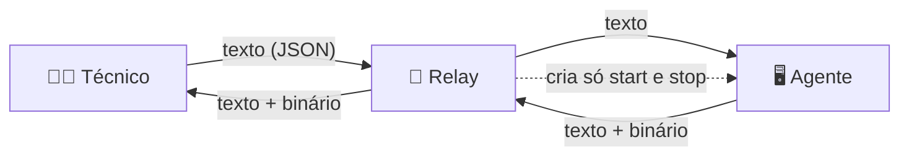
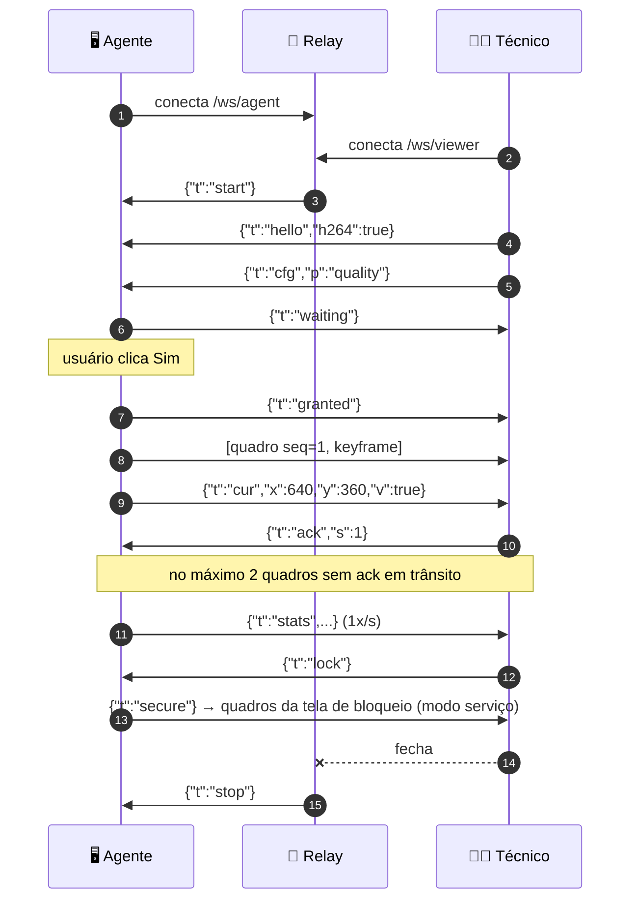

# 📡 Protocolo WebSocket

> 🗣️ **Em palavras simples:** agente e navegador conversam por duas "línguas" na mesma conexão: **texto** (JSON, para comandos como "mexa o mouse" ou "recebi o quadro 12") e **binário** (os quadros de vídeo, com um cabeçalho de 12 bytes na frente). O relay só repassa; ele não abre nem entende o conteúdo.

📌 **Fonte da verdade:** [`internal/protocol`](../internal/protocol) (Go), espelhado em [`frontend/src/lib/protocol.ts`](../frontend/src/lib/protocol.ts). **Os dois mudam juntos.** O teste `TestFrameLayout` fixa o layout binário byte a byte.

---

## 🔌 Conexões

| Quem | URL | Autenticação |
|---|---|---|
| 🖥️ Agente → relay | `wss://relay/ws/agent?mid=&host=&user=` | `Authorization: Bearer <credencial da máquina>` (cadastro em [FLUXOS.md](FLUXOS.md#maquinas)) |
| 🏚️ Agente legado → relay | `wss://relay/ws/agent?id=&host=&user=&key=` | `key` = `RELAY_AGENT_KEY`, só com `RELAY_LEGACY_AGENTS` |
| 🧑‍💻 Técnico → relay | `wss://relay/ws/viewer?id=<agente>` | cookie de sessão + `Origin` igual ao host |



* 🔀 O relay repassa as mensagens **sem inspecioná-las**: texto do técnico vai para o agente; texto e binário do agente vão para o técnico. As únicas mensagens que o relay cria são `start` e `stop`.
* 💓 **Keepalive:** o relay envia ping ao agente a cada 20 s e derruba a conexão após 60 s sem tráfego.

---

## 💬 Mensagens de texto (JSON)

Todas têm o campo `t` com o tipo. Campos com valor zero são omitidos.

### 🧑‍💻 → 🖥️ Técnico para agente

| `t` | Campos | Significado |
|---|---|---|
| `hello` | `h264: bool` | o navegador decodifica H.264 (WebCodecs)? Sem `hello` em 1,5 s, o agente assume JPEG |
| `cfg` | `p: turbo \| balanced \| quality \| quality60` | preset de qualidade ([tabela](FLUXOS.md#video)) |
| `kf` | | pede keyframe (decoder reiniciado); descarta os quadros em trânsito |
| `ack` | `s: uint32` | quadro `s` recebido; libera o controle de fluxo |
| `mm` | `x, y` em [0,1] | mouse move, relativo à tela remota |
| `md` / `mu` | `x, y, b` (0 esq., 1 meio, 2 dir.) | botão pressionado / solto |
| `wh` | `d` (múltiplos de 120) | roda do mouse |
| `kd` / `ku` | `code, key` (do `KeyboardEvent`) | tecla pressionada / solta |
| `clip` | `text` (até 1 MiB) | põe o texto na área de transferência do PC remoto (o técnico cola com Ctrl+V lá). Exige consentimento |
| `lock` | | bloquear a estação (`LockWorkStation`, como Win+L). **Não** conta como entrada, mas também exige consentimento |

> 🔒 `mm`, `md`, `mu`, `wh`, `kd` e `ku` são **entrada** (`Message.IsInput()`): o agente só as aplica depois do consentimento.

### 🔀 → 🖥️ Relay para agente

| `t` | Significado |
|---|---|
| `start` | um técnico entrou: pedir consentimento e transmitir |
| `stop` | o técnico saiu: parar a transmissão |

### 🖥️ → 🧑‍💻 Agente para técnico

| `t` | Campos | Significado |
|---|---|---|
| `waiting` | | caixa de consentimento aberta |
| `granted` | | consentimento dado (ou tela liberada depois de `secure`) |
| `denied` | | o usuário recusou |
| `secure` | | captura bloqueada (UAC, tela de bloqueio sem o modo serviço); retoma sozinho |
| `stats` | `enc, fps, kbps, target, rtt, w, h` | 1x/s: encoder, quadros, banda, alvo de bitrate, RTT em ms, resolução |
| `cs` | `c` | nome CSS do cursor remoto (`default`, `text`, `pointer`...) |
| `cur` | `x, y` (pixels), `v` | posição do cursor, desenhado por cima do vídeo |

---

## 🎞️ Quadros de vídeo (binário, agente → técnico)

```
offset  tamanho  campo
0       1        codec: 1 = H.264 (Annex-B), 2 = JPEG, 3 = PNG (refresh)
1       1        flags: bit 0 = keyframe
2       2        largura   (big-endian)
4       2        altura    (big-endian)
6       4        sequência (big-endian, circular)
10      2        reservado (zero)
12      N        payload
```

```
 0               1               2               3
 0 1 2 3 4 5 6 7 0 1 2 3 4 5 6 7 0 1 2 3 4 5 6 7 0 1 2 3 4 5 6 7
├───────────────┼───────────────┼───────────────────────────────┤
│     codec     │  flags (K=b0) │            largura            │
├───────────────┴───────────────┼───────────────────────────────┤
│            altura             │      sequência (alto)         │
├───────────────────────────────┼───────────────────────────────┤
│       sequência (baixo)       │          reservado            │
├───────────────────────────────┴───────────────────────────────┤
│                 payload (H.264, JPEG ou PNG) ...              │
```

* 🔢 A `sequência` é a mesma que o navegador devolve no `ack`.
* 🔑 Depois de um `kf`, de trocar de preset ou de reabrir a captura, o próximo quadro H.264 é keyframe.
* 🔍 **PNG (codec 3) é o refresh de nitidez:** uma imagem sem perda que o agente manda **uma vez** quando a
  tela fica parada por 300 ms ([ADR 0009](adr/0009-refresh-de-nitidez.md)). Não é vídeo: o navegador
  só a desenha por cima do último quadro se tiver o mesmo tamanho e se nenhum quadro de vídeo chegou
  enquanto ela era decodificada. Também recebe `ack`, como qualquer quadro.

---

## 🔁 Sequência típica



## ✏️ Mudando o protocolo

1. Altere [`internal/protocol/protocol.go`](../internal/protocol/protocol.go) **e** [`frontend/src/lib/protocol.ts`](../frontend/src/lib/protocol.ts).
2. Se for entrada, inclua em `IsInput()` (senão o agente a ignora ou, pior, a aplica antes do consentimento).
3. Atualize esta página e, se mudar o binário, o `TestFrameLayout`.
4. Agentes já distribuídos não conhecem a mensagem nova: o relay continua repassando, e o agente antigo a ignora.
