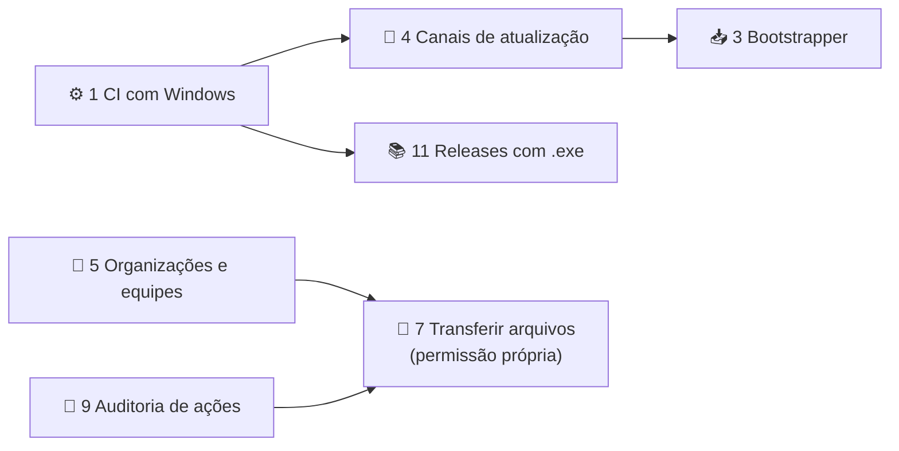
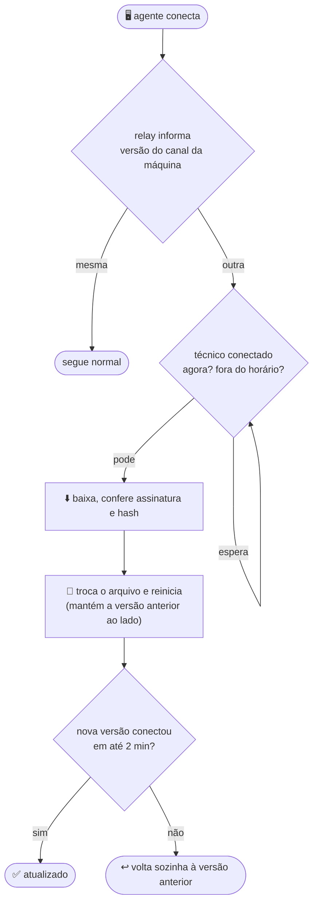

# 🧭 Roadmap: o que já foi feito e o que falta

> 🗣️ **Em palavras simples:** este é o mapa do que dá para melhorar no RemoteIT, levantado a partir do código em 24/11/2026 e atualizado a cada entrega. A primeira parte lista **o que já foi feito** (e onde está explicado). A segunda lista **o que falta**: cada item diz o problema, a proposta, o esforço e o que depende do quê, para decidir a ordem com calma.

**Legenda:** 🔴 alto impacto · 🟡 médio · 🟢 baixo — esforço em ⏱️ (dias de trabalho, estimativa grosseira) · ✅ feito · 🟨 em parte · sem marca = a fazer.

---

## ✅ Já feito

| Quando | O quê | Onde está explicado |
|---|---|---|
| 24/11/2026 | 🔐 **Cada técnico com as suas máquinas**: `.exe` marcado com o código do técnico (opção A: texto reservado no binário), ID aleatório e **credencial por máquina** (DPAPI), **Remover** revoga. Uma ID duplicada é recusada. O portátil vira "do técnico que baixou", mesmo rodando num PC de cliente: está certo, é ele quem atende | [DECISOES 0010](DECISOES.md#adr-0010), [FLUXOS](FLUXOS.md#maquinas) |
| 24/11/2026 | 🔗 **Link de instalação** (`/i/<código>`), o cliente baixa sem conta | [DECISOES 0010](DECISOES.md#adr-0010) |
| 24/11/2026 | 🛡️ Limite de tentativas no login e **CSP** com os cabeçalhos de segurança | [SEGURANCA](SEGURANCA.md) |
| 24/11/2026 | 📜 Sessões órfãs da auditoria encerradas na partida do relay | [SEGURANCA](SEGURANCA.md) |
| 24/11/2026 | 🔍 Refresh de nitidez em PNG com a tela parada, modo 1:1 e bitrate menos nervoso (estava pronto e sem commit na pasta e foi junto no mesmo build) | [DECISOES 0009](DECISOES.md#adr-0009) |
| 25/11/2026 | 🔐 Compartilhamento entre técnicos retirado (modelo **só o dono**); link **sem prazo** e **sem limite** (o "link do técnico") | [DECISOES 0010](DECISOES.md#adr-0010) |
| 25/11/2026 | 🏚️ Fim da migração: máquinas antigas removidas e **agentes legados recusados** (`RELAY_LEGACY_AGENTS=false`) em produção | [DECISOES 0010](DECISOES.md#adr-0010) |
| 25/11/2026 | 🔄 **Atualização automática** do agente e do visualizador, com assinatura própria Ed25519, rollback publicando a versão anterior e espera pelo fim do atendimento; coluna **Versão** no console | [DECISOES 0011](DECISOES.md#adr-0011) |
| 25/11/2026 | 🖥️ **Visualizador nativo para Windows** (Go + Win32, decodificação na GPU, todas as teclas sem tela cheia) e 📋 **área de transferência** (texto, do técnico para o PC) | [DECISOES 0012](DECISOES.md#adr-0012), [WINDOWS](WINDOWS.md#visualizador) |
| 25/11/2026 | 🎞️ **Negociação de codecs**, **cor 4:4:4 com a tela em movimento** no visualizador (AVC444) e **AV1 opcional** | [DECISOES 0013](DECISOES.md#adr-0013) |
| 25/11/2026 | 🚦 Janela do controle de fluxo que cresce com o RTT (de 2 a 8 quadros), para internet lenta não travar o FPS | [DECISOES 0004](DECISOES.md#adr-0004) |
| 25/11/2026 | ⚡ **Instalar sem navegador**: `irm <link>/ps \| iex`, com conferência de SHA-256; downloads do navegador em `.zip` | [WINDOWS](WINDOWS.md#agente), [abaixo](#sem-navegador) |
| 25/11/2026 | 🧾 Script de deploy com checagem de sessões abertas, backup do banco e verificação externa; o relay registra a versão de cada agente que conecta | [DEPLOY](DEPLOY.md) |
| 25/11/2026 (noite) | 🏠 **Qualidade e latência com o relay em casa**, a partir de uma análise com medições: rota local no visualizador (`RELAY_LOCAL_URL`), vídeo do tamanho da janela (redução pela média da área na GPU), **áreas sem perda** por blocos (retalhos PNG + região de cada quadro), fila medida (limite de RTT mín. + 50 ms, bitrate pela fila, pisos baixos), encoder sem keyframe periódico e com buffer de 4 quadros, nada codificado quando só o mouse mexe, desenho na GPU no visualizador (Direct3D 11) e no console (WebGL2, com 4:4:4), telemetria por etapa | [DECISOES 0014](DECISOES.md#adr-0014) |

---

## 📋 O que falta, na ordem sugerida

| # | Melhoria | Impacto | Esforço | Por quê nesta posição |
|---|---|:---:|:---:|---|
| 1 | [⚙️ CI no GitHub, com Windows](#ci) | 🟡 | adiado: o usuário vai definir a esteira | hoje nada do Windows é testado automaticamente |
| 2 | 🟨 [🛡️ Endurecer o login e o console](#login) | 🟡 | ⏱️ 2 | 2FA, sessão ociosa, alertas |
| 3 | 🟨 [📥 Instalar sem passar pelo navegador](#sem-navegador) | 🔴 | MSI e bootstrapper ⏱️ 2–3 | o navegador foi a origem da maior parte dos problemas de instalação |
| 4 | 🟨 [🔄 Atualização: canais e controle](#atualizacao) | 🟡 | ⏱️ 2 | validar num PC antes de mandar para todos; voltar sozinho se a versão nova não conectar |
| 5 | [🏢 Organizações e equipes](#acesso) | 🟡 | ⏱️ 3–5 | várias pessoas atendendo os mesmos clientes |
| 6 | 🟨 [🖥️ Visualizador nativo: o que falta](#viewer-nativo) | 🟡 | vários monitores e arquivos | completar o programa do técnico |
| 7 | 🟨 [🧰 Funcionalidades de suporte](#funcionalidades) | 🟡 | variável | arquivos, vários monitores, Ctrl+Alt+Del, reiniciar e reconectar |
| 8 | 🟨 [📡 Transporte e desempenho](#desempenho) | 🟢 | ⏱️ 5+ | VPS (quando houver), P2P, WebTransport |
| 9 | 🟨 [📜 Auditoria, transparência e LGPD](#lgpd) | 🟡 | ⏱️ 2–3 | aviso de "sendo acessado", retenção, gravação opcional |
| 10 | 🟨 [🏗️ Operação do servidor](#operacao) | 🟢 | ⏱️ 2–4 | métricas, backup automático, relay sem derrubar sessões |
| 11 | [📚 Repositório público](#repositorio) | 🟢 | ⏱️ 0,5 | licença, SECURITY.md, descrição |

---

## 1️⃣ ⚙️ CI no GitHub, com Windows

### ❗ O problema hoje

Os testes rodam só na máquina de desenvolvimento, e tudo o que é Windows (serviço, desktops, `SendInput`, Media Foundation) depende de um checklist manual — e de alguém testar no PC real tarde da noite.

### ✅ A proposta

| Trabalho (GitHub Actions) | Runner | O que garante |
|---|---|---|
| `make check` + unitários | Linux | nada quebra a compilação ou a lógica |
| integração (Postgres por testcontainers) | Linux | relay + agente + banco juntos |
| E2E (Playwright) | Linux | o console funciona ponta a ponta |
| **build do agente com Zig** e **testes no Windows** | **Windows** | o `.exe` compila de verdade; dá para testar `install`/`uninstall`, o serviço subindo, o log sendo criado e até uma captura GDI real |
| publicação de release | Linux/Windows | `.exe` com a assinatura do projeto, hash publicado, versão marcada |

* 🏷️ **Versões de verdade** (`v0.4.0`). 🟨 Hoje a versão é a data do build (`AAAA.MM.DD.hhmm`), embutida no `.exe` (`-X main.version`) e mostrada no console e no log; falta o número semântico e a release.
* 🧪 Testes de **fuzz** no parser do quadro binário e das mensagens JSON (entrada vinda da rede).
* 🔁 **Build reprodutível** (mesmo código → mesmo hash), para qualquer um conferir que o `.exe` publicado veio deste código.

---

## 2️⃣ 🟨 🛡️ Endurecer o login e o console

> 🟨 **Em parte:** limite de tentativas e CSP/cabeçalhos feitos em 24/11/2026. A CSP ainda aceita `style-src 'unsafe-inline'` (estilos dinâmicos do Svelte).

| Melhoria | Problema que resolve | Esforço |
|---|---|:---:|
| ✅ 🚦 **Limite de tentativas de login** por IP e por usuário | feito: 10 falhas por usuário / 20 por IP em 15 min → 429 | — |
| 🔢 **2FA (TOTP)** obrigatório para admins, opcional para técnicos | uma senha vazada basta para ver qualquer tela | ⏱️ 2 |
| ✅ 🧩 **Content-Security-Policy** e cabeçalhos (`X-Content-Type-Options`, `Referrer-Policy`, `frame-ancestors 'none'`) | feito em todas as respostas | — |
| ⏲️ **Sessão ociosa expira** (ex.: 30 min sem atividade) além das 12 h | console esquecido aberto num PC compartilhado | ⏱️ 0,5 |
| 🔁 **Reautenticar para ações sensíveis** (remover usuário, bloquear tela, revogar máquina) | sessão roubada faz menos estrago | ⏱️ 1 |
| 🔔 **Alerta ao admin** em login de IP novo, muitas falhas, ou máquina "duplicada" | hoje nada avisa: a máquina duplicada é recusada, mas ninguém é avisado | ⏱️ 1 |
| 🧱 **Separar o worker SYSTEM** em dois processos: captura/entrada como SYSTEM, rede e protocolo como usuário comum | uma falha no código de rede hoje roda com o privilégio máximo da máquina | ⏱️ 5+ |

---

## 3️⃣ 🟨 📥 Instalar sem passar pelo navegador

> 🟨 **Em parte:** a opção **a** (link de instalação) foi feita em 24/11/2026; desde 25/11 o link também pode ser **sem prazo** e **sem limite de máquinas** (o "link do técnico"). A opção **b** (comando de uma linha no PowerShell, `irm <link>/ps | iex`) foi feita em 25/11/2026, com conferência de SHA-256. Os downloads do navegador vêm em `.zip`. As opções c e d continuam abertas.

### ❗ O problema

O navegador foi a origem de quase todos os tropeços:

| Tropeço | Causa |
|---|---|
| "não é baixado com frequência" / "pode ser perigoso" | o navegador segura `.exe` sem reputação (o `.zip` ajuda, mas não resolve) |
| baixou e veio a versão velha | cache (já corrigido com `no-store`, mas mostrou a fragilidade) |
| `suporte-ti (1).exe` | o navegador renomeia |
| o técnico precisa estar logado **no PC do cliente** para baixar | resolvido pelo link de instalação |
| conferir hash à mão | resolvido pelo comando do PowerShell, que confere sozinho |

### ✅ Alternativas, da mais simples à mais robusta

| Opção | Como o usuário instala | Prós | Contras | Esforço |
|---|---|---|---|:---:|
| ✅ **a. Link de instalação** | o técnico gera no console um link curto (`.../i/AB12CD`) e manda ao cliente; abrir o link baixa o agente **já marcado** | o cliente **não precisa de conta**; o técnico controla validade e usos | continua passando pelo navegador | feito |
| ✅ **b. Comando de uma linha (PowerShell)** | o técnico copia do console: `irm https://.../i/AB12CD/ps \| iex` | sem navegador, sem "Manter", sem `(1)`; o script baixa, confere o hash, instala e mostra o resultado no terminal | **padrão usado por malware**: EDRs bloqueiam; política de execução do PowerShell pode impedir | feito |
| **c. Pacote MSI** | `msiexec /i suporte-ti.msi /qn CODIGO=AB12CD`, ou distribuído por **GPO / Intune / RMM** | o formato que TI corporativa espera; instala em 500 PCs de uma vez; desinstala por "Aplicativos" | build extra (WiX) | ⏱️ 2–3 |
| **d. Instalador "de bolso" (bootstrapper)** | um `.exe` mínimo, que quase nunca muda, baixa sempre a versão atual do agente, confere a assinatura do projeto e a instala | o arquivo distribuído não envelhece | mais um programa para manter | ⏱️ 2–3 |

> 🗣️ **Em palavras simples:** para atendimento pontual, o **link (a)** resolve: o técnico gera, manda por WhatsApp, o cliente abre e pronto. O comando de uma linha **(b)** é prático, mas parece ataque aos olhos de antivírus corporativos. Para empresas com muitos PCs, falta o **MSI (c)**, que também é onde entraria o código digitado na linha de comando (a opção C de [DECISOES 0010](DECISOES.md#adr-0010)).

**Recomendação:** **c** quando houver cliente com muitos PCs; **d** junto com os canais de atualização ([item 4](#atualizacao)).

---

## 4️⃣ 🟨 🔄 Atualização: canais e controle

> 🟨 **Em parte:** a atualização automática está feita ([DECISOES 0011](DECISOES.md#adr-0011)). Ficaram de fora os pontos abaixo, que estavam na proposta original.

| Falta | Por quê | Esforço |
|---|---|:---:|
| ↩️ **Volta automática** se a versão nova não conectar em até 2 min (mantendo a anterior ao lado) | hoje uma versão que nem conecta não consegue buscar a anterior; por isso é preciso testar numa máquina antes de publicar | ⏱️ 1 |
| 🧪 **Canais** `estável` e `teste` | validar num PC antes de mandar para todos | ⏱️ 1 |
| ⏰ **Controle pelo admin**: automático, só fora do horário, ou manual por máquina | um cliente pode não querer trocas no meio do expediente | ⏱️ 1 |
| 🔑 **Troca da chave de atualização** por uma nova, assinada pela antiga | hoje perder ou vazar a chave obriga a reinstalar à mão ([SEGURANCA](SEGURANCA.md#riscos)) | ⏱️ 1 |

---

## 5️⃣ 🏢 Organizações e equipes

> Fora do modelo atual por decisão ([DECISOES 0010](DECISOES.md#adr-0010): **só o dono**). Faz sentido quando várias pessoas atenderem os mesmos clientes. O compartilhamento entre técnicos chegou a existir e foi retirado em 25/11/2026, por não ser usado.

| Conceito | Para quê |
|---|---|
| 🏢 **Organização** (cliente/empresa) | separa clientes diferentes; nenhum técnico de uma vê as máquinas de outra |
| 👥 **Equipe** dentro da organização | "suporte N1", "infra": várias pessoas atendendo o mesmo conjunto de máquinas |
| 🖥️ **Máquina** pertence a uma organização (e opcionalmente a uma equipe) | definido pelo código usado no cadastro |
| 🔑 **Permissão** por máquina ou equipe | ver, controlar, bloquear a tela, (futuro) transferir arquivos |
| 👑 **Admin** | vê tudo da organização; o "super admin" do relay vê tudo |

**Onde mudaria (só o mapa):**

* 🐘 Banco: tabelas novas `organizations`, `teams`, `team_members`; `machines` e `enrollment_codes` ganham organização e equipe.
* 🔌 `httpapi`: a lista e `/ws/viewer` filtram pelo que o usuário pode ver (hoje: dono ou admin); a auditoria registra a tentativa recusada.
* 🎨 Console: máquinas por organização/equipe, renomear máquina, transferir de dono.

---

## 6️⃣ 🟨 🖥️ Visualizador nativo: o que falta

> ✅ **Feito em 25/11/2026** ([DECISOES 0012](DECISOES.md#adr-0012), [0013](DECISOES.md#adr-0013), [guia](WINDOWS.md#visualizador)): Go + Win32, decodificação pelo Media Foundation (GPU quando possível), **cor 4:4:4 em movimento** (AVC444), AV1, todas as teclas sem tela cheia, área de transferência para o PC remoto, telemetria, diagnóstico de vídeo e atualização automática. Usado **junto** com o console, que continua como porta de entrada (gestão, auditoria e acesso rápido de qualquer lugar); o visualizador é para quem atende o dia todo.

| Ganho | Situação |
|---|---|
| 🎨 **Cor 4:4:4** em movimento | ✅ com AVC444: dois fluxos H.264 4:2:0 recompostos no visualizador. (Correção: a ideia original, "o decoder nativo aceita 4:4:4", não valia para o H.264 do Windows, que vai só até o perfil High 4:2:0; veja [DECISOES 0013](DECISOES.md#adr-0013)) |
| ⚡ **Menos latência** | ✅ decodifica e desenha direto, sem a composição do navegador |
| ⌨️ **Todas as teclas** sem tela cheia | ✅ hook de teclado |
| 📋 **Área de transferência** | ✅ texto, do técnico para o PC; falta o sentido inverso |
| 📁 **Arquivos** | a fazer ([item 7](#funcionalidades)) |
| 🖵 **Vários monitores** em janelas separadas | a fazer |
| 🎨 **Desenho na GPU** | ✅ Direct3D 11: o quadro não passa pela memória (antes: ~5 ms por quadro em 1080p e ~18 ms em 4K só de conversão de cor na CPU) |
| 🍎 **macOS e Linux** | a fazer; o `internal/viewer/client` e o `ui` já são Go puro, falta a janela e o decodificador de cada sistema |

---

## 7️⃣ 🟨 🧰 Funcionalidades de suporte

> 🟨 **Em parte:** a área de transferência (texto, do técnico para o PC) foi feita em 25/11/2026 com o visualizador nativo. O resto da tabela continua a fazer.

| Funcionalidade | Valor para o suporte | Esforço | Observação |
|---|---|:---:|---|
| ✅ 📋 **Área de transferência** (texto) | colar comandos, senhas de Wi-Fi, links | feito (25/11) | do técnico para o PC remoto, pelo visualizador nativo (mensagem `clip`, só com consentimento); falta o sentido inverso e o botão no console web |
| 📁 **Transferir arquivos** | mandar um instalador, pegar um log | ⏱️ 3 | precisa de permissão própria e auditoria |
| 🖵 **Vários monitores** | hoje só o principal | ⏱️ 2–3 | escolher monitor na barra |
| ⌨️ **Ctrl+Alt+Del** | logins que exigem SAS | ⏱️ 1 | `SendSAS` funciona só no modo serviço e exige a política "permitir SAS por software" |
| 🔁 **Reiniciar e reconectar** | reiniciar o PC e voltar sozinho (modo serviço já sobe antes do login) | ⏱️ 1 | botão com confirmação, como o 🔒 |
| 💬 **Chat** técnico ↔ usuário | combinar sem telefone | ⏱️ 2 | entra em conflito com "nenhuma janela": seria opcional |
| ℹ️ **Ficha da máquina** | Windows, versão do agente, IP, último acesso, uptime, usuário logado | ⏱️ 1 | ajuda a achar a máquina certa |
| 🔎 **Apelidos e grupos** na lista | a lista vira inviável com dezenas de máquinas | ⏱️ 1 | a busca já existe no visualizador; casa com o [item 5](#acesso) |
| 🔊 Áudio | raro em suporte | ⏱️ 3+ | baixa prioridade |
| ⏰ **Wake-on-LAN** | ligar um PC desligado | ⏱️ 2 | precisa de outro agente ligado na mesma rede |

---

## 8️⃣ 🟨 📡 Transporte e desempenho

> 🟨 **Em parte** ([DECISOES 0014](DECISOES.md#adr-0014)). Medido em 25/11/2026 com o relay numa internet doméstica atrás do Cloudflare Tunnel: o técnico no próprio PC do relay mandava o vídeo dar a volta pela internet (85–100 ms contra 4–6 ms pelo endereço local). A **rota local** corta isso no visualizador (e o console aberto por `http://localhost:3000`); a **fila medida** e o fim do keyframe periódico tiraram o atraso que o próprio vídeo causava. Para técnicos fora de casa, o que resta é o caminho até o relay.

| Melhoria | Ganho | Esforço |
|---|---|:---:|
| ✅ 🏠 **Rota local** para o técnico no PC (ou na rede) do relay | ~90 ms a menos por ida e volta; o vídeo deixa de usar o upload de casa. Pronta, mas **desligada em produção**: o usuário quer todo acesso pelo domínio | feito |
| ✅ 🧩 **Refresh só das regiões alteradas** (o DXGI informa os retângulos) | texto exato nas partes paradas, com uma fração da banda; o vídeo só pinta o que mudou | feito |
| 🌎 **Relay mais perto** (uma VPS em São Paulo, onde o túnel já chega) | ~40–60 ms para **qualquer** técnico, não só o de casa | ⏱️ 1 + mensalidade (sem VPS por enquanto) |
| 🔀 **Conexão direta (P2P, WebRTC)** quando a rede permitir UDP | latência de LAN, sem dar a volta pelo servidor; não serve na rede da empresa atendida (só TCP 443/8080) | ⏱️ 5+ |
| 🚀 **WebTransport (HTTP/3, UDP 443)** quando a rede permitir, com volta automática ao WebSocket | sem o atraso em cascata de pacote perdido no TCP; [DECISOES 0004](DECISOES.md#adr-0004) já previa reavaliar se houver UDP | ⏱️ 5+ |
| 🟨 📊 **Métricas de qualidade por sessão** | ✅ a telemetria mostra fila, codificação, decodificação e rota; falta **gravar** os médios por sessão para achar clientes com rede ruim | ⏱️ 1 |

---

## 9️⃣ 🟨 📜 Auditoria, transparência e LGPD

> 🟨 **Em parte:** o encerramento das sessões órfãs foi feito em 24/11/2026.

> 🗣️ **Em palavras simples:** acesso remoto mexe com dados pessoais (o que está na tela). Quanto mais claro for **quem viu o quê, quando e com qual aviso**, mais fácil é defender o uso diante de um cliente, de um funcionário ou da LGPD.

| Melhoria | Por quê | Esforço |
|---|---|:---:|
| 👁️ **Aviso discreto "sendo acessado"** (ícone na bandeja ou borda colorida na tela) **enquanto houver técnico** | hoje, com `NO_CONSENT`, o usuário pode ser observado sem perceber; um indicador não é uma "caixa para clicar" e não atrapalha | ⏱️ 1–2 |
| 🙋 **Política de consentimento por máquina** (sempre perguntar / só fora do expediente / nunca, para servidores) em vez de por build | um `.exe` só para todos os casos; a escolha fica auditada | ⏱️ 1 |
| 📝 **Auditoria de ações**, não só de sessões: bloqueou a tela, transferiu arquivo, revogou máquina | hoje só início e fim | ⏱️ 1 |
| 🗄️ **Retenção configurável** e exportação (CSV) da auditoria | LGPD pede prazo; clientes pedem relatório | ⏱️ 1 |
| 🎥 **Gravação opcional de sessão** (com aviso) | prova do que foi feito; treinamento | ⏱️ 3+ |
| ✅ 🔚 **Fechar sessões órfãs ao iniciar o relay** | feito: encerradas na partida com o horário do reinício | — |

---

## 🔟 🟨 🏗️ Operação do servidor

| Melhoria | Por quê | Esforço |
|---|---|:---:|
| 🔁 **Reiniciar o relay sem derrubar sessões** (desligamento gracioso que avisa o técnico, ou dois relays atrás do túnel) | hoje todo deploy do relay exige checar sessões abertas | ⏱️ 2–3 |
| 💾 **Backup automático** do banco (diário, com cópia fora do servidor e teste de restauração) | hoje o backup é feito pelo script, no deploy | ⏱️ 1 |
| 📈 **Métricas e alertas** (agentes online, sessões, erros, banco) | saber que caiu antes do cliente | ⏱️ 1–2 |
| 📦 **Registry de imagens** (GHCR) em vez de `docker save \| ssh` | deploy por tag, rollback em um comando | ⏱️ 0,5 |
| 🟨 🧾 **Script de deploy** que faz a checagem de sessões, o backup e a verificação externa sozinho | em uso desde 25/11/2026, fora do repositório; falta versioná-lo (sem os dados do servidor) | ⏱️ 0,5 |
| 📧 **Domínio próprio no e-mail** (DKIM/DMARC) | remetente `@gmail.com` cai no spam | ⏱️ 0,5 |

---

## 1️⃣1️⃣ 📚 Repositório público

| Item | Por quê |
|---|---|
| 📄 **LICENSE** | sem licença, ninguém pode reutilizar o código, mesmo com o repositório público |
| 🛡️ **SECURITY.md** | diz como reportar uma vulnerabilidade sem abri-la numa issue pública |
| 🏷️ Descrição, tópicos e site no "About" do GitHub | o repositório aparece vazio na busca |
| 🧾 Releases com os `.exe` e os hashes | quem quiser testar não precisa compilar |
| 🧪 Selo do CI no README | mostra que os testes passam (depende do [item 1](#ci)) |

---

## 🖼️ Qualidade de imagem: o que mudou de fato

> 🗣️ **Em palavras simples:** com a tela **parada**, a imagem ficou perfeita; com a tela **mexendo**, a cor ficou completa no visualizador do técnico, e no navegador continua como antes. O 4:4:4 foi medido (PSNR); o resto é avaliado pelo que a mudança faz.

| Mudança | Efeito |
|---|---|
| Refresh de nitidez em PNG ([DECISOES 0009](DECISOES.md#adr-0009)) | **grande** com a tela parada: 300 ms depois, a imagem é idêntica à do PC (texto e cores); desde a [0014](DECISOES.md#adr-0014), por partes e em qualquer preset |
| Modo Tamanho real (1:1) | **visível** em monitores com escala 125–150%: sem o borrado do redimensionamento |
| Bitrate menos nervoso | **pequeno**: menos quedas de qualidade em soluços de rede |
| Visualizador nativo | o ganho é em teclado e decodificação na GPU; a imagem melhora com o 4:4:4 (linha abaixo) |
| Cor 4:4:4 (AVC444, [DECISOES 0013](DECISOES.md#adr-0013)) | **grande** com texto colorido e a tela em movimento: numa captura de editor de código + planilha, o 4:2:0 fica preso em ~31 dB em qualquer bitrate, e o 4:4:4 chega a 39 dB com os mesmos bytes. Só no visualizador nativo, na resolução nativa e com encoder de GPU |
| AV1 opcional | **na banda**, não na imagem: só em PCs com encoder AV1 de GPU, e no técnico com decodificação AV1 na GPU |
| Janela que cresce com o RTT | **no FPS**, não na imagem: numa internet lenta, deixa de travar em ~14 fps |
| Áreas sem perda por blocos ([DECISOES 0014](DECISOES.md#adr-0014)) | **grande** no uso real: as partes paradas ficam exatas mesmo com outra parte mexendo (antes, um cursor de texto piscando fazia a tela inteira alternar entre nítida e borrada) |
| Vídeo do tamanho da janela | **visível** quando a tela remota é maior que a janela: redução com filtro próprio para texto no agente, em vez do bilinear do navegador; e menos banda |
| Sem keyframe periódico | **no ritmo**: some o soluço (e a "respiração" da imagem) de 1 em 1 s |
| 4:4:4 no console | **grande** com texto colorido em movimento, no navegador, se o PC do técnico dá conta de decodificar em software |
| Espaço de cor explícito (BT.709) | **pequeno**: evita vermelhos e verdes levemente trocados se o encoder não gravar os metadados |
| Máquinas por técnico, links, atualização | nenhum (segurança e operação) |

**Ainda não resolvido:** no **navegador** sem WebGL2, ou num PC que não dá conta de decodificar as duas visões em software, a cor em movimento continua em meia resolução (4:2:0); as partes paradas ficam exatas de qualquer jeito.

---

## ✅ Próximo passo sugerido

1. **Confirmar num PC Windows real** o que só roda lá ([checklist](../CONTRIBUTING.md#testes)): o desenho do visualizador em Direct3D 11, a redução e a leitura sem perda no agente com GPU, a rota local e o 4:4:4 no Chrome; e, das entregas anteriores, o AVC444, o AV1 e o `irm | iex` com UAC no PowerShell 5.1.
2. **CI** ([item 1](#ci)): o usuário vai definir a esteira depois.
3. **Volta automática da atualização** ([item 4](#atualizacao)): o maior risco que sobrou na operação.
