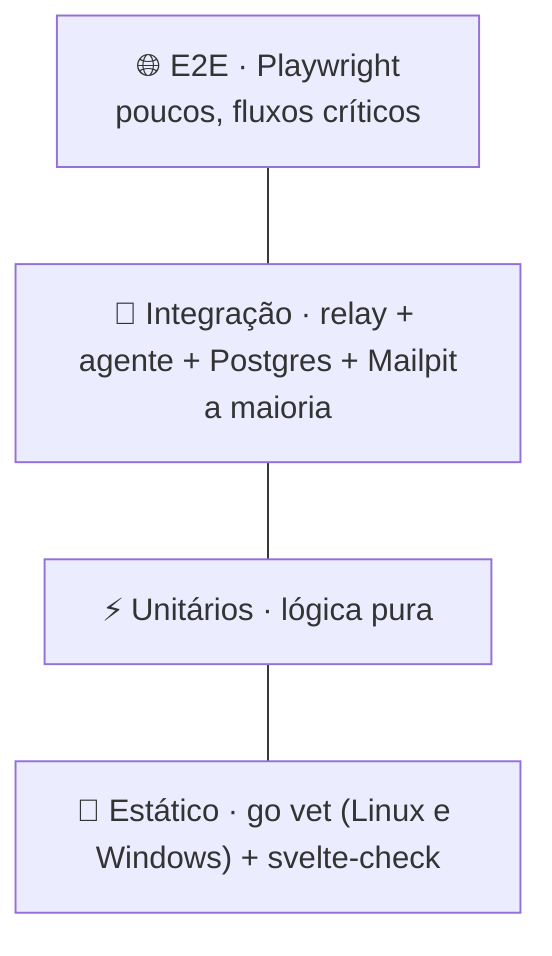

# 🧪 Testes

> 🗣️ **Em palavras simples:** a maior parte dos testes liga as peças **de verdade**: um banco PostgreSQL real, o relay real, o agente real e um navegador real. Assim, o que passa no teste é o que acontece em produção. Só o que depende do Windows (capturar a tela, digitar no PC) fica num checklist manual.



Formato "troféu": poucos unitários, a maioria em integração, E2E nos fluxos críticos. Sempre que
possível as dependências são reais (banco, relay, WebSocket, agente). Motivo: [ADR 0005](adr/0005-testes-com-dependencias-reais.md).

| Camada | Comando | Onde | Precisa |
| --- | --- | --- | --- |
| ⚡ Unitário | `make test` | `*_test.go` ao lado do código | Go |
| 🐘 Integração | `make test-integration` | `test/integration/` (tag `integration`) | Docker |
| 🌐 E2E | `make test-e2e` | `frontend/e2e/` + `compose.e2e.yaml` | Docker |
| 🔎 Estático | `make check` | `go vet` (Linux e Windows) + `svelte-check` | Go, Node |

## ⚡ Unitários: lógica pura

| Pacote | O que fixa |
| --- | --- |
| `protocol` | Cabeçalho binário: codificar e decodificar de volta e o layout byte a byte; payload AVC444 (layout e truncado); `Accepts` lê o hello novo e o antigo e fecha com JPEG |
| `avc444` | ida e volta das duas visões sem compressão erra no máximo 2 níveis; só a principal perde cor; branco fica sem cor |
| `relay/hub` | Substituição de conexão, técnico novo assume, `stop` só do técnico atual, repasse, derrubar máquina removida |
| `protocol` (atualização) | assinatura recusada com outra chave, outro `.exe`, outra versão, outra edição ou sem chave |
| `relay/agentbin` | Gravar o código no espaço reservado do `.exe`; recusar binário sem espaço, com dois espaços ou código inválido |
| `agent/machine` | Cadastra uma vez e reusa a credencial; `.exe` de outro técnico recadastra; código recusado cai na credencial antiga ou no legado; 401 apaga a credencial, 403 não |
| `relay/identity` | Validação de nome, senha e papel; não remover a si mesmo |
| `relay/httpapi` | Limite por IP e agrupamento de IPv6; limite de login conta só falhas, por IP e por usuário |
| `relay/mail` | Validação da configuração SMTP |
| `protocol` (teclas) | toda tecla que o agente injeta volta ao mesmo nome no visualizador (`KeyToVK` ↔ `CodeForVK`) |
| `viewer/decode` | JPEG e PNG viram BGRA com as cores certas; **a recomposição 4:4:4 em C (`yuv.h`) bate byte a byte com a referência em Go**; o AVC444 guarda a última visão de cada fluxo e usa só a principal enquanto a auxiliar não chega |
| `viewer/ui` | lista do visualizador (online primeiro, busca por nome/dono/usuário, dono só para admin), contagem, segmentos e cores da telemetria, motivo do 4:4:4 inativo, erros de login legíveis (DNS, certificado, sem resposta, senha) e o diagnóstico |
| `viewer/client` | ordem dos codecs do hello (4:4:4 só com H.264); o hello mantém o campo `h264` para agentes antigos |
| `agent/media/gpu` | AV1: o cabeçalho de sequência entra depois do delimitador temporal e nunca em dobro; extração do `av1C`; OBUs com extensão e tamanho longo |
| `agent/media` | Bitrate adaptativo; controle de fluxo (limite em trânsito, quadro lento, ACK perdido, ACK falso; **a janela cresce com o RTT** e ainda para quando um quadro fica velho demais); **a captura troca de thread quando o desktop não pode ser seguido e volta a transmitir** (`TestStreamRecoversWhenDesktopCanBeFollowedAgain`); **negociação de codecs**: segue a ordem do técnico, pula o 4:4:4 com resolução reduzida, cai para o próximo quando um encoder não abre ou quebra no meio, e troca com um hello novo (`codec_test.go`) |
| `agent/input` | Tabela `KeyboardEvent.code` → virtual-key |

## 🐘 Integração: as partes juntas, de verdade

`TestMain` sobe um **PostgreSQL 19** com testcontainers (ou usa `TEST_DATABASE_URL`). Cada teste
cria um relay completo com `httptest` sobre o banco limpo (`newEnv`).

| Arquivo | Cenários |
| --- | --- |
| `relay_test.go` | login/logout, login sem JSON → 415, chave do agente, agente entra e sai da lista, ponte agente ↔ técnico com quadro de 300 KB idêntico, segundo técnico assume, agente sai → técnico cai, sem login → 401, outra origem → 403 (CSWSH), offline → 404, gestão de usuários e papéis, sessão de usuário removido invalida, auditoria com início e fim, **sem auditoria → acesso recusado**, **download nunca vem de cache** e troca o arquivo sem reiniciar (`TestAgentDownloadIsNeverCached`), **as duas edições saem cada uma pela sua rota** (`TestBothAgentEditionsDownload`) |
| `accounts_test.go` | com Mailpit real: cadastro e aprovação, primeiro admin por e-mail, campos injetados, link vencido, reusado e concorrente, recuperação derruba sessão e tela, vínculo de e-mail, limites, migração de banco existente |
| `agent_test.go` | agente real transmite JPEG válido 640x360 e envia stats, consentimento negado → nenhum quadro, **sem ACK no máximo 2 quadros** (sem RTT medido a janela não cresce) e retomada após ACK, **input só depois do consentimento**, **bloquear a tela só depois do consentimento** (`TestLockOnlyAfterConsent`) |
| `machines_test.go` | **o binário real do agente, baixado pelo técnico, se cadastra sozinho e só aparece para a dona e os admins**, e reusa a identidade ao rodar de novo (`TestDownloadedAgentBelongsToItsTechnician`); credencial errada → 401, legado não usa ID `m_`, remover derruba e dá 403; link de instalação público com limite de máquinas, revogação e a versão sem prazo e sem limite; limite de login; cabeçalhos de segurança; acessos órfãos encerrados na partida |
| `viewer_test.go` | o **cliente do visualizador nativo** contra relay e agente reais: login, sessão guardada, lista, o hello com 4:4:4, AV1 e H.264 cai em JPEG num agente sem eles, mais de 2 quadros (os acks voltam), mouse, teclado e área de transferência chegando ao agente, técnico sem acesso, logout |
| `update_test.go` | com a ferramenta de assinatura real: o agente recebe exatamente o `.exe` publicado; mesma versão não faz nada; técnico conectado adia; legado não atualiza; `.exe` trocado, manifesto reescrito ou chave de outro projeto são recusados; a versão aparece no console |
| `storage_test.go` | migrations idempotentes, auditoria sobrevive à remoção do usuário, sessão vencida rejeitada, admin inicial só com banco vazio |

Fakes usados: `recordingInjector` (no lugar do SendInput) e funções de consentimento. Todo o resto
é código de produção.

Dica: uma leitura com timeout corrompe a conexão do gorilla/websocket. Para "esperar e ver se nada
chega", use uma goroutine leitora com canal (veja `TestFlowControlWithoutAcks`).

## 🌐 E2E: navegador real

`make test-e2e` sobe `compose.yaml` + `compose.e2e.yaml` com o projeto `remoteit-e2e` (relay em
`localhost:18080`, banco descartável, agente Linux com hostname `e2e-pc`), roda o Playwright 1.65 em
container e derruba tudo com `down -v`.

| Teste | Prova |
| --- | --- |
| senha errada | mensagem de erro, não entra |
| admin vê a tela remota | quadros atravessam agente → relay → navegador (pixels não pretos no canvas) |
| criar e recuperar conta | link do Mailpit, aprovação, login por e-mail, senha antiga deixa de valer |
| associar e-mail | conta antiga confirma o link mesmo tendo saído |
| técnico isolado | admin cadastra um técnico; o técnico **não vê** a máquina do admin nem tem botão de compartilhar; o acesso do admin aparece na auditoria encerrado |
| link de instalação | gerar pela tela um link **sem prazo e sem limite**; ele abre sem login; um link inventado dá 404; o **comando do PowerShell** aparece e o script `/ps` responde (404 para link inventado) |

Falhou? O Playwright grava trace em `frontend/test-results/`; abra com `npx playwright show-trace`.

## 🪟 Fora do CI: checklist manual por release (Windows real)

Os testes rodam no Linux, então nada abaixo é exercitado automaticamente: `SendInput`, DXGI, Media Foundation, serviço do Windows e desktops. O que compila no Windows é garantido por `GOOS=windows go vet` e `go build`; o comportamento, só por esta lista.

Para a janela do visualizador há um teste de fumaça no Wine (container com Xvfb e `xdotool`: login, lista, sessão e vídeo). Ele não cobre o Media Foundation, o hook de teclado nem o DPAPI.

**Shaders do 4:4:4 no Wine:** `TestAVC444ShadersMatchReference` (em `internal/agent/media/gpu`, só Windows) compila o HLSL de `rcenc.h` e compara as duas visões com `avc444.Pack`. Roda no Windows e no Wine:

```bash
CGO_ENABLED=1 GOOS=windows CC="zig cc -target x86_64-windows-gnu" CGO_CFLAGS="-O2 -Wno-missing-braces" \
  go test -c -o gpu.test.exe ./internal/agent/media/gpu/
docker run --rm -v "$PWD":/w remoteit-wine bash -c \
  'Xvfb :9 & export DISPLAY=:9 WINEDEBUG=-all; sleep 2; wine /w/gpu.test.exe -test.v'
```

Ele cobre a matemática dos shaders, não o desenho direto nos planos NV12 nem os encoders (só com GPU de verdade).

**▶️ Portátil (`suporte-ti.exe`)**

- [ ] `build.sh` com Zig: a barra mostra `H.264 GPU` (ou `AV1 GPU` num PC com encoder AV1 e um navegador que decodifica AV1 na GPU)
- [ ] `agent.log` sem "codec indisponível" para H.264 numa máquina com placa de vídeo; se houver para AVC444/AV1, anote a GPU e o erro
- [ ] Dois cliques, usuário sem admin: a máquina aparece no console, sem nenhuma janela
- [ ] Dois cliques de novo, com ele aberto: nada acontece (não derruba a sessão)
- [ ] Caixa de consentimento aparece (build sem `NO_CONSENT`) e "Não" bloqueia
- [ ] Mouse, teclado com acentos (ç, ã) e Ctrl+Shift+Esc
- [ ] UAC mostra "tela protegida" e retoma
- [ ] Monitor com escala de 125%+: o clique cai no lugar certo

**🖥️ Visualizador do técnico (`remoteit-tecnico.exe`)**

- [ ] Login, e a sessão continua ao fechar e abrir o programa (DPAPI); senha errada mostra "Usuário ou senha inválidos."
- [ ] Lista com ponto de estado e versão; **Buscar** filtra; Enter conecta; rodapé mostra "H.264 sim · 4:4:4 sim" (e AV1 se a extensão estiver instalada)
- [ ] Barra de telemetria com FPS e RTT coloridos; **Ajuda ▸ Diagnóstico de vídeo** mostra codec e encoder do PC remoto
- [ ] Título mostra "decodificação na GPU" numa máquina com placa de vídeo
- [ ] Win, Win+R, Alt+Tab e Ctrl+Esc chegam ao PC remoto com a janela em primeiro plano; com **Teclado** desligado, ficam no PC local
- [ ] Teclas mortas: ´ + a vira "á" no PC remoto (teclado ABNT2)
- [ ] Ctrl+Alt+F entra e sai da tela cheia; Tamanho real fica 1:1
- [ ] Enviar área de transferência + Ctrl+V cola o texto no PC remoto
- [ ] Atualização automática: publicar uma versão nova troca o visualizador sem sessão aberta
- [ ] **4:4:4:** preset Nítido, título com "H.264 4:4:4 GPU"; texto vermelho/azul pequeno (planilha, editor de código) nítido **enquanto rola**; desligar **Cor 4:4:4** volta a "H.264 GPU" sem reconectar
- [ ] **4:4:4 com preset reduzido** (Equilibrado): cai para H.264 comum sozinho; voltar a Nítido religa o 4:4:4
- [ ] **AV1** (só com PC remoto RTX 40+/Arc/RX 7000+ e a Extensão de Vídeo AV1 aqui): título "AV1 GPU", imagem normal; sem a extensão, nunca pede AV1

**🧩 Serviço (`suporte-ti-servico.exe`)**

- [ ] Dois cliques → UAC → serviço instalado; `PathName` aponta para `C:\Program Files\RemoteIT`
- [ ] Dois processos `SISTEMA`: serviço na sessão 0 e worker na sessão do console
- [ ] `service.log` e `agent.log` criados em `C:\ProgramData\RemoteIT`
- [ ] 🔒 bloqueia a tela, a tela de bloqueio aparece, o clique mostra a caixa de senha e o login funciona
- [ ] Logar com **outra conta** do Windows pela tela de bloqueio
- [ ] Reiniciar o PC: acesso na tela de login, antes de qualquer usuário entrar
- [ ] Dois cliques num `suporte-ti-servico.exe` mais novo: atualiza (hash do Program Files muda)
- [ ] Com o serviço instalado, dois cliques no portátil: nada acontece
- [ ] `uninstall`: serviço e pasta do Program Files somem
