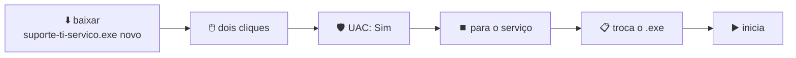

# 🪟 No Windows: o agente e o visualizador do técnico

> 🗣️ **Em palavras simples:** dois programas rodam no Windows. O **agente** vai no PC atendido (o do cliente) e o **visualizador** vai no PC do técnico. Esta página diz como instalar, usar, atualizar e remover cada um, e o que fazer quando algo dá errado.

| Programa | Quem usa | Seção |
|---|---|---|
| `suporte-ti.exe` / `suporte-ti-servico.exe` | o PC atendido | [🖥️ Agente](#agente) |
| `remoteit-tecnico.exe` | o técnico | [🖥️ Visualizador do técnico](#visualizador) |

---

<a id="agente"></a>
## 🖥️ Agente no Windows: instalar, atualizar, remover e resolver problemas

> 🗣️ **Em palavras simples:** existem dois `.exe` para baixar no console. O **portátil** só roda: dois cliques e o técnico já vê a tela. O **de serviço** instala o agente no Windows para ele subir sozinho com o PC e funcionar também na tela de login e de bloqueio. Nenhum dos dois mostra caixa de mensagem.

---

### 📦 Qual baixar?

| | ▶️ Executar agente | 🧩 Instalar como serviço |
|---|---|---|
| Arquivo | `suporte-ti.exe` | `suporte-ti-servico.exe` |
| Dois cliques | conecta ao relay na hora | instala ou atualiza o serviço |
| Pede administrador? | ❌ nunca | ✅ uma vez (UAC do Windows) |
| Funciona antes do login? | ❌ | ✅ |
| Tela de bloqueio, login, UAC | ❌ mostra "tela protegida" | ✅ vê e controla |
| Sobrevive a reiniciar o PC? | ❌ precisa abrir de novo | ✅ sobe com o Windows |
| Onde fica | onde você salvou (ex.: Downloads) | `C:\Program Files\RemoteIT\suporte-ti.exe` |
| Ideal para | atendimento pontual, usuário sem admin | PCs da empresa, servidores, acesso sem ninguém na frente |

> 💡 É **o mesmo programa**: o build grava a edição dentro do `.exe` (`-X main.edition=servico`). Renomear o arquivo não muda o comportamento.

---

### ▶️ Usar o portátil

1. No console, clique em **Executar agente (.zip)** e salve. O download vem em `.zip` (com o `.exe` e um `LEIA-ME.txt`), que o navegador segura bem menos que um `.exe` solto; se ainda assim segurar, clique em **Manter**.
2. Extraia o `.zip` (botão direito → *Extrair tudo*).
3. Dê **dois cliques** no `suporte-ti.exe`. Se aparecer o SmartScreen ("O Windows protegeu o computador"): *Mais informações* → *Executar assim mesmo*.
4. Em alguns segundos a máquina aparece em **Máquinas online** no console.

✨ **O que aconteceu:** o agente abriu uma conexão de saída na 443 para o relay e ficou esperando um técnico. Ele roda com o usuário atual, sem instalar nada. Para encerrar, saia da sessão do Windows ou finalize `suporte-ti.exe` no Gerenciador de Tarefas.

> ⚠️ Se o **serviço estiver instalado**, o portátil sai em silêncio: o serviço já dá o acesso, e duas cópias com o mesmo nome de máquina ficariam se derrubando no relay.

---

### 🧩 Instalar o serviço

1. No console, clique em **Instalar como serviço (.zip)** e salve (clique em **Manter** se o navegador segurar).
2. Extraia o `.zip` e dê **dois cliques** no `suporte-ti-servico.exe`.
3. O Windows pergunta *"Deseja permitir que este aplicativo faça alterações?"* → **Sim**.
4. Pronto. A máquina aparece no console e continua lá depois de reiniciar o PC.

✨ **O que aconteceu:**

```
suporte-ti-servico.exe (Downloads)
 ├── 📋 copiou-se para  C:\Program Files\RemoteIT\suporte-ti.exe
 ├── 🧩 criou o serviço RemoteITAgent  (automático; reinicia sozinho em caso de falha)
 └── ▶️ iniciou o serviço → que lança o worker na sua sessão, como SYSTEM
```

O arquivo em Downloads pode ser apagado: o serviço usa a cópia do Program Files.

#### ⚡ Sem navegador, com um comando

O técnico gera um **link de instalação** no console e copia o comando que aparece embaixo dele. No PC
do cliente, abra o **PowerShell** (não precisa ser como administrador) e cole:

```powershell
irm https://suporte.exemplo.com/i/<código>/ps | iex
```

O comando baixa o agente do próprio link, confere o **SHA-256** que o relay calculou, pede o UAC uma
vez e mostra **"Pronto"** em verde (ou o erro e onde ver o log). Num link **Executar**, o agente vai
para `%LOCALAPPDATA%\RemoteIT` e roda sem instalar nada. Não há aviso de download do navegador nem
arquivo em Downloads. Alguns antivírus corporativos bloqueiam comandos `irm … | iex`; aí use o link
no navegador.

#### 💻 Pelo terminal (PowerShell como Administrador)

```powershell
Start-Process "$env:USERPROFILE\Downloads\suporte-ti-servico.exe" -ArgumentList install -Wait
```

> 💡 **Por que `Start-Process -Wait`?** O agente é um programa "de janela" (sem console próprio), e o PowerShell não espera esse tipo de programa terminar. Sem o `-Wait`, a próxima linha roda antes de a instalação acabar.

---

### 🔄 Atualizar

> ✅ **Desde a versão com atualização automática ([ADR 0011](DECISOES.md#adr-0011)), não precisa fazer nada:** o agente se troca sozinho em até 1 hora depois de uma versão nova ser publicada, sempre fora de um atendimento. A coluna **Versão** do console mostra quem já atualizou. O passo a passo abaixo vale para a primeira instalação de quem ainda tem uma versão anterior a essa.


**É igual a instalar:** baixe o `suporte-ti-servico.exe` novo e dê dois cliques. Ele para o serviço, troca o arquivo no Program Files e inicia de novo. Durante esses segundos, o técnico conectado cai e reconecta.



---

### 🗑️ Remover

PowerShell como Administrador:

```powershell
Start-Process "C:\Program Files\RemoteIT\suporte-ti.exe" -ArgumentList uninstall -Wait
```

Isso para o serviço, remove o serviço e apaga `C:\Program Files\RemoteIT`. Os logs em `C:\ProgramData\RemoteIT` ficam.

**Remoção manual** (se o arquivo não existir mais ou algo der errado):

```powershell
sc.exe stop RemoteITAgent
Start-Sleep 3
sc.exe delete RemoteITAgent
Get-Process suporte-ti* -ErrorAction SilentlyContinue | Stop-Process -Force
Remove-Item "C:\Program Files\RemoteIT" -Recurse -Force -ErrorAction SilentlyContinue
```

---

<a id="conferir-versao"></a>
### 🔎 Conferir o que está instalado

```powershell
Get-Service RemoteITAgent                                                   # está rodando?
(Get-CimInstance Win32_Service -Filter "Name='RemoteITAgent'").PathName     # de qual arquivo?
Get-Process suporte-ti -IncludeUserName | Format-Table Id,SessionId,UserName -AutoSize
Test-Path C:\ProgramData\RemoteIT\machine.json                               # já se cadastrou?
```

| O que olhar | Certo |
|---|---|
| `PathName` | `"C:\Program Files\RemoteIT\suporte-ti.exe" service` |
| Processos | dois, os dois `AUTORIDADE NT\SISTEMA`: o serviço na sessão **0** e o worker na sua sessão (1, 2...) |
| `machine.json` | `True`: a máquina já trocou o código do `.exe` pela credencial dela |

> 💡 **Hash não serve mais para conferir a versão:** cada download sai com o código do técnico gravado, então dois `.exe` baixados nunca têm o mesmo hash. A versão certa é a que você acabou de baixar pelo console ou pelo link.

> ⚠️ Se o worker aparecer com o **seu usuário** (ex.: `PC\ana`) em vez de SISTEMA, é uma versão antiga do agente: ela não consegue digitar na tela de bloqueio. Atualize.

---

### 🪪 Identidade da máquina

| Arquivo | Quem usa | Protegido por |
|---|---|---|
| `C:\ProgramData\RemoteIT\machine.json` | serviço (worker SYSTEM) | DPAPI da máquina: copiar para outro PC não funciona |
| `%LOCALAPPDATA%\RemoteIT\machine.json` | portátil (seu usuário) | DPAPI do usuário |

* Na primeira execução, o agente troca o **código gravado no `.exe`** pela credencial e grava este arquivo. Daí em diante, usa só a credencial.
* Para instalar em vários PCs, gere um **link de instalação** com várias máquinas (até 100) e use o mesmo `.exe` baixado dele em todos. O portátil também aceita o código à mão (`-code <código>` ou `REMOTEIT_CODE`), útil em testes; o serviço usa sempre o código gravado no `.exe`. Implantação por MSI/GPO ainda não existe (veja [ROADMAP.md](ROADMAP.md#sem-navegador)).
* Apagar o `machine.json` faz a máquina se cadastrar de novo (se o código ainda valer) e aparecer como **outra** máquina no console.

### 📜 Logs

| Arquivo | Quem escreve | O que tem |
|---|---|---|
| `C:\ProgramData\RemoteIT\service.log` | serviço e instalador | instalou, atualizou, removeu, lançou o worker (sessão, pid) ou **por que não conseguiu** |
| `C:\ProgramData\RemoteIT\agent.log` | worker | conectou ao relay, abriu a captura (qual encoder e codec), "codec indisponível, tentando o próximo" (com o motivo: sem encoder de GPU, d3dcompiler ausente, segunda sessão de NVENC recusada…), não conseguiu seguir o desktop |

```powershell
type C:\ProgramData\RemoteIT\service.log -Encoding UTF8
type C:\ProgramData\RemoteIT\agent.log -Tail 40 -Encoding UTF8
```

> 💡 Sem `-Encoding UTF8`, o PowerShell 5 mostra `serviço` no lugar de `serviço`: o arquivo está certo, só a leitura que não. Cada arquivo recomeça quando passa de 2 MB. O agente portátil não grava log.

Exemplo de um serviço saudável:

```
time=... level=INFO msg="serviço iniciado"
time=... level=INFO msg="worker lançado" sessão=2 pid=2760
time=... level=INFO msg="agente iniciado" modo=1 relay=wss://lab.d4ffy.com
time=... level=INFO msg="conectado ao relay" id=pc1
```

---

### 🩺 Resolver problemas

| Sintoma | Causa provável | O que fazer |
|---|---|---|
| A máquina não aparece no console | o agente não rodou, ou o firewall bloqueia a 443 | `Get-Process suporte-ti`; abra o site do console no próprio PC para testar a 443 |
| Fica "conectado/desconectado" alternando | **duas cópias** do agente com o mesmo nome (ex.: serviço + portátil antigo) | `Get-Process suporte-ti -IncludeUserName`; finalize a cópia que não é SISTEMA |
| "tela protegida por UAC/bloqueio — aguardando" | agente **portátil** na tela de bloqueio/UAC, ou versão antiga do serviço | use o serviço atualizado; veja o `agent.log` |
| Vejo a tela de bloqueio mas não consigo digitar | worker antigo rodando com o usuário, não como SYSTEM | atualize o serviço e confira os processos |
| A máquina não aparece na **minha** lista | o `.exe` foi baixado por outro técnico (a máquina é dele), ou é um agente antigo | baixe o agente (ou gere um link) com a sua conta e reinstale; agentes antigos são recusados pelo relay |
| Aparece "sem versão" no console | agente instalado antes da atualização automática | reinstale uma vez com um `.exe` baixado agora; depois ele se atualiza sozinho |
| A máquina sumiu e não volta | alguém a **removeu** no console: a credencial foi revogada | instale um agente baixado de novo (ele se cadastra como máquina nova) |
| "conectado/desconectado" depois de clonar o PC | a imagem clonada levou o `machine.json` junto | apague `machine.json` no clone e reinicie o serviço: ele se cadastra de novo (se o código do `.exe` ainda valer) |
| O navegador salvou `suporte-ti (1).zip` (ou `.exe`) | já havia um arquivo com o mesmo nome | tudo bem: o nome não importa, a edição está dentro do `.exe` |
| `install` "não fez nada" | o UAC foi negado, ou o PowerShell não esperou | rode com `Start-Process ... -Wait` e leia o `service.log` |
| O PC exige Ctrl+Alt+Del antes do login | política de grupo (*Logon interativo: não exigir Ctrl+Alt+Del* desativada) | o Windows não deixa simular essa combinação; desative a política ou faça o login local |
| Antivírus apagou o arquivo | `.exe` sem assinatura com comportamento de acesso remoto | veja abaixo |

---

<a id="antivirus"></a>
### 🧾 Distribuição e antivírus (IMPORTANTE)

Um `.exe` que captura a tela e injeta mouse e teclado se comporta como um malware de acesso remoto. Sem assinatura digital, o Windows reage assim:

| Proteção | O que faz | Dá para passar? |
|---|---|---|
| 🛡️ **SmartScreen** (padrão) | tela azul "O Windows protegeu o computador" | ✅ *Mais informações → Executar assim mesmo* |
| 🔒 **Smart App Control** (Windows 11 recente) | bloqueia **sem** opção de executar; decide pela reputação do hash exato | ❌ |
| 🦠 **Defender / EDR corporativo** | pode remover o arquivo como ameaça | só com exclusão pelo time de segurança |

**A única solução para "o usuário só executa" é assinar o executável:**

1. Comprar um certificado de *code signing* de uma CA (DigiCert, Sectigo etc.). Exige CNPJ; custa ~US$ 200–400/ano. O **EV** zera SmartScreen e Smart App Control quase na hora; o **OV** só depois de ganhar reputação.
2. Assinar no Windows:
   ```powershell
   signtool sign /fd SHA256 /tr http://timestamp.digicert.com /td SHA256 suporte-ti.exe
   signtool sign /fd SHA256 /tr http://timestamp.digicert.com /td SHA256 suporte-ti-servico.exe
   ```
3. Publicar os `.exe` assinados no `dist/` do servidor.

> ⚠️ Mesmo assinado, um EDR corporativo (CrowdStrike, SentinelOne etc.) pode bloquear por comportamento, como faz com ferramentas pagas. A liberação depende de o time de segurança incluir o certificado ou o hash na allowlist.

---

### 🔬 Como funciona por dentro

* 🧭 O passo a passo com diagramas (serviço, worker SYSTEM, desktops `Default` e `Winlogon`, UIPI, thread descartável da captura): **[FLUXOS.md — Modo serviço](FLUXOS.md#servico)** e **[Instalar, atualizar e remover](FLUXOS.md#instalar)**.
* 📁 Código: [`internal/agent/lifecycle`](../internal/agent/lifecycle) (serviço, instalação, logs), [`internal/agent/desktop`](../internal/agent/desktop) (seguir o desktop ativo), [`internal/agent/lock`](../internal/agent/lock) (bloquear a tela).

| Flag / variável | Descrição |
|---|---|
| `-relay` / `REMOTEIT_RELAY` | URL do relay (o build embute um padrão) |
| `-code` / `REMOTEIT_CODE` | código de cadastro (o download do console já grava um no `.exe`) |
| `-key` / `REMOTEIT_KEY` | chave compartilhada do modo legado (o build embute um padrão) |
| `-noconsent` | não pede consentimento (o build com `NO_CONSENT=1` já embute) |
| `install` / `uninstall` | instala/atualiza ou remove o serviço (pede o UAC) |
| `service` / `worker` | uso interno do Windows e do serviço; não rode à mão |

---

<a id="visualizador"></a>
## 🖥️ Visualizador do técnico (Windows)

> 🗣️ **Em palavras simples:** é um programa para o **técnico** (não para o cliente) abrir as máquinas sem passar pelo navegador. A imagem é decodificada direto pela placa de vídeo, chega com a **cor completa** (texto colorido nítido mesmo com a tela mexendo) e **todas as teclas** (Win, Alt+Tab, Ctrl+Esc) vão para o PC remoto sem precisar de tela cheia. O console no navegador continua existindo: use os dois.

| | 🌐 Console no navegador | 🖥️ Visualizador do técnico |
|---|---|---|
| Onde | qualquer computador, qualquer sistema | Windows |
| Instalar | nada | um `.exe` (baixado em `.zip`), sem admin |
| Decodificação e desenho | `VideoDecoder` do navegador; WebGL2 | Media Foundation na GPU (DXVA) e Direct3D 11, sem passar pela memória |
| Cor com a tela em movimento | **4:4:4** se o navegador tem WebGL2 e o PC dá conta de decodificar em software; senão 4:2:0 | **4:4:4** (completa) |
| Partes paradas da tela | sem perda (retalhos PNG) | sem perda (retalhos PNG) |
| AV1 (menos banda) | se o navegador decodifica AV1 na GPU | se o Windows tem a *Extensão de Vídeo AV1* |
| Win, Alt+Tab, Ctrl+Esc | só em tela cheia | sempre, com a janela em primeiro plano |
| Área de transferência → PC remoto | — | **Ações ▸ Enviar área de transferência** |
| Gestão (usuários, auditoria, links, remover máquina) | ✅ | ❌ (use o console) |
| Atualização | sempre a versão do site | automática, assinada ([ADR 0011](DECISOES.md#adr-0011)) |

---

### ⬇️ Instalar

1. No console, em **Máquinas**, clique em **Visualizador do técnico (.zip)**.
2. Extraia o `remoteit-tecnico.exe` do `.zip` onde quiser (ex.: Área de Trabalho) e dê dois cliques. Se o SmartScreen aparecer: *Mais informações* → *Executar assim mesmo*.
3. Entre com o mesmo usuário e senha do console. O endereço do relay já vem preenchido.

Fechar o visualizador é sair: as telas remotas abertas fecham, a sessão termina no relay e da próxima vez ele pede a senha de novo. Enquanto ele está aberto, o login fica guardado (protegido pelo Windows, só para o seu usuário) em `%LOCALAPPDATA%\RemoteIT\viewer.token`, para a atualização automática reabrir já logado; **Sair** e fechar a janela apagam.

O visual é o do console web (cores, JetBrains Mono, rótulos em maiúsculas, bordas retas) e acompanha a escala do Windows (100%, 125%, 150%…), inclusive ao arrastar a janela para outro monitor.

### 🧭 Usar

* **Lista:** as suas máquinas (admins veem todas), atualizada a cada 3 s, online primeiro. Cada linha tem um LED de estado (ciano online, âmbar em uso por outro técnico, rosa offline), o nome e, embaixo, o usuário logado no PC, o dono (para admins) e a versão do agente. **Buscar** filtra por nome, dono ou usuário. Dois cliques, **Enter** ou **Conectar** abrem uma janela por máquina.
* **Rodapé:** a versão do visualizador e o que **este PC** decodifica (H.264, 4:4:4, AV1).
* **Barra de telemetria** (embaixo da sessão): codec em uso (em ciano quando é **4:4:4**), decodificação na GPU ou CPU, resolução, **FPS desenhados aqui**, banda, RTT (verde até 60 ms, âmbar até 150 ms, rosa acima), **Fila** (quanto os quadros esperam em algum buffer do caminho; verde até 30 ms), **Codif.** (captura + codificação no PC remoto), **Decod.** (decodificação + desenho aqui). Os campos são sempre os mesmos, em posições fixas ("—" sem dado); numa janela estreita, os últimos ficam de fora. A rota (local ou internet) aparece no Diagnóstico. À direita, em âmbar, o motivo quando a **Cor 4:4:4** está ligada mas não está em uso. Some em tela cheia; liga e desliga em **Exibir ▸ Barra de telemetria**.
* **Tamanho do vídeo:** a sessão abre maximizada, como uma aba do navegador; o agente manda a tela do tamanho da janela (reduzida com um filtro próprio para texto). Ao redimensionar, o visualizador espera a janela parar e pede o tamanho novo. Em **Tamanho real (1:1)**, vem a resolução nativa.

| Menu | O que faz |
|---|---|
| **Qualidade** | Ultra-rápido, Equilibrado, Nítido (padrão), Máximo — troca sem reconectar |
| **Qualidade ▸ Cor 4:4:4** | ligada (padrão): pede a cor completa. Vale nos presets Nítido e Máximo e quando o PC remoto tem encoder H.264 na placa de vídeo; senão o agente manda o vídeo comum sozinho. Desligue para economizar banda numa conexão fraca |
| **Exibir ▸ Tamanho real (1:1)** | um pixel remoto por pixel do seu monitor (sem borrar) |
| **Exibir ▸ Tela cheia** | também por **Ctrl+Alt+F** (esse atalho não vai para o PC remoto) |
| **Ações ▸ Enviar Ctrl+Shift+Esc** | abre o Gerenciador de Tarefas remoto |
| **Ações ▸ Enviar área de transferência** | põe o texto copiado aqui na área de transferência do PC remoto; cole lá com **Ctrl+V** |
| **Ações ▸ Bloquear a tela remota** | como Win+L |
| **Teclado ▸ Enviar Win, Alt+Tab…** | ligado: todas as teclas vão para o PC remoto; desligado: Win e Alt+Tab ficam no seu Windows |
| **Ajuda ▸ Diagnóstico de vídeo** | versão, o que este PC decodifica, desenho (GPU ou GDI), codecs pedidos ao agente, codec e encoder em uso no PC remoto, FPS desenhados e enviados, banda e alvo, rota, RTT sem fila e fila, tempo de codificação lá e de decodificação aqui. Copie isso ao relatar um problema de imagem |

> ⚠️ Com o **Teclado** ligado e a janela da sessão em primeiro plano, Alt+Tab **não** troca de janela no seu computador. Clique em outra janela, use a barra de tarefas ou desligue a opção.

### 🩺 Problemas

| Sintoma | O que fazer |
|---|---|
| Barra mostra "Decodifica CPU" | o Windows não ofereceu DXVA para esta placa: decodifica na CPU (funciona, gasta mais) |
| FPS baixo e RTT alto (âmbar ou rosa) | olhe a **Fila**: alta, é a banda que não dá conta (o agente já baixa o bitrate sozinho); baixa, é a distância até o relay. Se o relay roda neste PC, confira se a **Rota** está **local** (`RELAY_LOCAL_URL`, veja [DEPLOY](DEPLOY.md#relay-em-casa)). O agente já deixa mais quadros a caminho quando o RTT sobe (até 8) ([FLUXOS](FLUXOS.md#fluxo)) |
| **Codif.** alto (perto de 16 ms a 60 fps) | a placa do PC remoto está no limite: o agente passa sozinho a priorizar velocidade; um preset menor também ajuda |
| Sem **Rota local** com o relay neste PC | o relay está sem `RELAY_LOCAL_URL` (em produção é assim: tudo pelo domínio), ou o endereço local não responde daqui (veja [DEPLOY](DEPLOY.md#relay-em-casa)) |
| Diagnóstico diz **Desenho: CPU (GDI)** | a placa ou o driver não lê NV12 em shader (Direct3D 11): o visualizador desenha pela CPU, como as versões antigas. `REMOTEIT_VIEWER_GDI=1` força esse modo, para comparar |
| Imagem em JPEG (título mostra "JPEG") | o decodificador H.264 do Windows não abriu (ex.: Windows N sem o *Media Feature Pack*) |
| Barra mostra "H.264", não "H.264 4:4:4" (o motivo aparece à direita) | preset com resolução reduzida, **Cor 4:4:4** desligada, ou o PC remoto não tem encoder de GPU (ou não abriu o segundo): o motivo fica no `agent.log` do PC remoto |
| Nunca usa AV1 | normal na maioria dos PCs: precisa de encoder AV1 na placa do PC remoto **e** da *Extensão de Vídeo AV1* (Microsoft Store) neste Windows |
| "Sua sessão expirou" | entre de novo; a sessão do relay dura 12 h |
| Tecla presa no PC remoto | troque de janela e volte: o visualizador solta todas as teclas ao perder o foco |
| Log | `%LOCALAPPDATA%\RemoteIT\viewer.log` (recomeça a cada abertura) |

### 🔬 Por dentro

* Código: [`cmd/viewer`](../cmd/viewer), [`internal/viewer/client`](../internal/viewer/client) (API, protocolo e lista de codecs, testado no Linux), [`internal/viewer/ui`](../internal/viewer/ui) (o que as janelas mostram: linhas da lista, barra de telemetria, aviso do 4:4:4, mensagens de erro e diagnóstico; testado no Linux), [`internal/viewer/decode`](../internal/viewer/decode) (H.264, AVC444 e AV1 via Media Foundation, `rcdec.h`; recomposição 4:4:4 em `yuv.h`), [`internal/viewer/win`](../internal/viewer/win) (Win32).
* **Como chega o 4:4:4:** o agente manda duas imagens H.264 comuns por quadro (a principal e a auxiliar, que leva a cor que a principal descarta). O visualizador decodifica as duas com o Media Foundation direto em texturas da placa de vídeo e um shader junta a cor pixel a pixel. Se o decodificador falhar três vezes seguidas, o visualizador desiste do codec e o agente troca para o próximo da lista.
* **Desenho:** [`internal/viewer/render`](../internal/viewer/render) (Direct3D 11): a tela composta fica na GPU; o vídeo só pinta as regiões que mudaram, e os retalhos sem perda entram por cima.
* Decisões: [ADR 0012](DECISOES.md#adr-0012) (o visualizador) e [ADR 0013](DECISOES.md#adr-0013) (codecs e 4:4:4).
